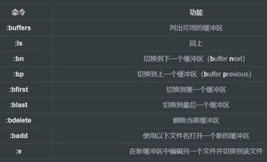

无论是在debian还是ubuntu下都经常使用到神奇的vim编辑器，所以写了这篇文章做个记录。

### 初始化配置

如果你刚下载好虚拟机，你的vim应该是一个大白板，甚至连行号都没有，所以我们进行初始化的配置。

//进入vim设置的编辑器  
`vim ~/.vimrc`

按下i进入编辑界面，选择需要的功能进行设置，如果你需要复制但是鼠标右键无效，你可以多按几次esc返回到默认操作，然后输入`:set mouse=r`，就可以快乐地右键复制咯。

```
"打开语法高亮
syntax on

"使用配色方案
colorscheme desert

"打开文件类型检测功能
filetype on

"不同文件类型采用不同缩进
filetype indent on

"允许使用插件
 
filetype plugin on
filetype plugin indent on

"关闭vi模式
set nocp

"与windows共享剪贴板
set clipboard+=unnamed

"取消VI兼容，VI键盘模式不易用
set nocompatible

"显示行号, 或set number
set nu

"历史命令保存行数
set history=100

"当文件被外部改变时自动读取
set autoread

"取消自动备份及产生swp文件
set nobackup
set nowb
set noswapfile

"允许使用鼠标点击定位
set mouse=a

"允许区域选择
set selection=exclusive
set selectmode=mouse,key

"高亮光标所在行
set cursorline

"取消光标闪烁
set novisualbell

"总是显示状态行
set laststatus=2

"状态栏显示当前执行的命令
set showcmd

"标尺功能，显示当前光标所在行列号
set ruler

"设置命令行高度为3
set cmdheight=3

"粘贴时保持格式
set paste

"高亮显示匹配的括号
set showmatch

"在搜索的时候忽略大小写
set ignorecase

"高亮被搜索的句子
set hlsearch

"在搜索时，输入的词句的逐字符高亮（类似firefox的搜索）
set incsearch

"继承前一行的缩进方式，特别适用于多行注释
set autoindent

"为C程序提供自动缩进
set smartindent

"使用C样式的缩进
set cindent

"制表符为4
set tabstop=4

"统一缩进为4
set softtabstop=4
set shiftwidth=4

"允许使用退格键，或set backspace=2
set backspace=eol,start,indent
set whichwrap+=<,>,h,l

"取消换行
set nowrap

"启动的时候不显示那个援助索马里儿童的提示
set shortmess=atI

"在被分割的窗口间显示空白，便于阅读
set fillchars=vert:\ ,stl:\ ,stlnc:\

"光标移动到buffer的顶部和底部时保持3行距离, 或set so=3
set scrolloff=3

"设定默认解码
set fenc=utf-8
set fencs=utf-8,usc-bom,euc-jp,gb18030,gbk,gb2312,cp936

"设定字体
set guifont=Courier_New:h11:cANSI
set guifontwide=新宋体:h11:cGB2312

"设定编码
set enc=utf-8
set fileencodings=ucs-bom,utf-8,chinese
set langmenu=zh_CN.UTF-8
language message zh_CN.UTF-8
source $VIMRUNTIME/delmenu.vim
source $VIMRUNTIME/menu.vim

"自动补全
filetype plugin indent on
set completeopt=longest,menu

"自动补全命令时候使用菜单式匹配列表
set wildmenu
autocmd FileType ruby,eruby set omnifunc=rubycomplete#Complete
autocmd FileType python set omnifunc=pythoncomplete#Complete
autocmd FileType javascript set omnifunc=javascriptcomplete#CompleteJS
autocmd FileType html set omnifunc=htmlcomplete#CompleteTags
autocmd FileType css set omnifunc=csscomplete#CompleteCSS
autocmd FileType xml set omnifunc=xmlcomplete#CompleteTags
autocmd FileType java set omnifunc=javacomplete#Complet
```

此时你已经配置好了vim，接下我将介绍vim的一些高级使用技巧

### vim高级使用技巧

vim存在默认模式与插入模式，在默认模式下。按下a或者i可以切换到插入模式，在插入模式下，可以通过esc返回到默认模式。

默认模式可以用类似于快捷键的操作，插入模式可以进行文本的编写。

**光标移动**

虽然vim推荐使用hjkl进行光标的移动，但是我还是更加习惯于上下左右按键

**基本动作**

*   h:左
*   l:右
*   j:下
*   k:上

**其他移动**

*   **gg**:文档顶部
*   **G**:文件底部或行号（如果在G前面放置数字）
*   **w**:下一个单词（**w**ord）
*   **e**:单词尾（**e**nd）
*   **0**:行首（第0个字符）
*   **$**:行尾（类似正则表达式语法）

前述已经有许多移动命令，一般的初学者都已经知道了。但是，我们也可以通过其他方式引导**移动**。

我们可以使用以下命令将光标移动到页面当前可见部分的不同区域:

*   **H**:将光标移动到当前可见页面的顶部（**H**igh）
*   **M**:将光标移到当前可见页面的中间（**M**iddle）
*   **L**:将光标移动到当前可见页面的底部（**L**ow）

如果要移动页面而不是光标（**注意是页面动，光标不随页面动**），则可以使用以下命令:

*   **CTRL-D**:向下翻页（**D**own）
*   **CTRL-U**:向上翻页（**U**p）
*   **CTRL-E**:向下滚动一行
*   **CTRL-Y**:向上滚动一行

我们还可以按句子、段落进行导航。如果您键入常规文本而不是代码，这将很有用。这些类似于单词和行导航命令。

*   **)**:移至下一个句子的开头
*   **(**:移至上一句的开头
*   **}**:移至下一个段落的开头（以空白行分隔）
*   **{**:移至下一段的开头（以空白行分隔）

### vim复制、粘贴、剪切

#### 选择文本

*   v+光标移动 （按字符选择）高亮选中所要的文本，然后进行各种操作（比如，d表示删除）。
*   V （按行选择）
*   v+选中的内容+c 更改选中的文字

#### 复制：y(ank)

*   y 用v命令选中文本后，用y进行复制
*   yy 复制当前行，然后用p进行粘贴
*   5yy 复制从当前行开始的5行
*   y\_ 等同于yy
*   Y 等同于yy
*   yw 复制当前单词
*   y$ 从当前位置复制到行尾
*   y0 从当前位置复制到行首
*   y^ 从当前位置复制到第一个非空白字符
*   yG 从当前行复制到文件结束
*   y20G 从当前行复制到第20行
*   y?bar 复制至上一个出现bar的位置

#### 粘贴：p(aste)

*   p(小写) 在光标位置之后粘贴
*   P(大写) 在光标位置之前粘贴

#### 剪切

*   v + 方向键(hjkl)选中内容 + d 剪切 + p粘贴

### 剪贴板

#### 默认剪贴板

vim提供12个剪贴板，它们的名字分别为vim有11个粘贴板，分别是`0`、`1`、`2`、`...`、`9`、`a`、`“`。如果开启了系统剪贴板，则会另外多出两个：`+`和`*`。使用`:reg`命令，可以查看各个粘贴板里的内容。

```
:reg 
```

在vim中简单用y只是复制到`“`（双引号)粘贴板里，同样用p粘贴的也是这个粘贴板里的内容。

#### 复制和粘贴到指定剪贴板

要将vim的内容复制到某个粘贴板，需要退出编辑模式，进入正常模式后，选择要复制的内容，然后按"Ny完成复制，其中N为粘贴板号（注意是按一下双引号然后按粘贴板号最后按y），例如要把内容复制到粘贴板a，选中内容后按"ay就可以了。

要将vim某个粘贴板里的内容粘贴进来，需要退出编辑模式，在正常模式按"Np，其中N为粘贴板号。比如，可以按"5p将5号粘贴板里的内容粘贴进来，也可以按"+p将系统全局粘贴板里的内容粘贴进来。

### （划重点）

如果在虚拟机中使用vim最好的使用外部粘贴板的方式就是输入`:set mouse=r`，就可以快乐地右键复制粘贴咯。

#### 同时打开多个窗口

```
 vim file1 file2 file3
```

每个文件都在自己的缓冲区中打开。目前，我们只能看到第一个文件。

通过输入，我们可以看到可用的缓冲区`:buffers`。

```
:buffers
:buffers
  1 %a  "file1"             line 1
  2     "file2"             line 0
  3     "file3"             line 0
Press ENTER or type command to continue
```

如果我们希望进入下一个缓冲区，可以键入`:bn`。这将更改为下一个缓冲区。

类似地，我们可以通过键入`b`数字或名称（在上面的第一列）或名称来切换到缓冲区。即使文件名不完整，也可以使用。

以下是一些管理缓冲区的命令:



### 如何管理窗口

vim分别管理多个文件的控制机制是基于`windows`或`views`的概念。这使您可以将当前编辑区域划分为不同的窗口，以便可以同时查看多个缓冲区。

要将当前工作空间拆分为单独的窗口，可以键入`:split`或`:sp`。这将在当前窗口上方打开一个新窗口，并将光标更改到该窗口。您可以使用上面显示的buffer命令更改至新窗口中显示的缓冲区。

以下是一些我们可以用来创建和管理窗口的命令:

*   **:sp**:将当前窗口水平一分为二。最初，每个窗口将显示相同的缓冲区。（**sp**lit）
*   在“ sp”之前加上数字以设置新窗口的高度。
*   **:vs**:垂直拆分当前窗口。最初，每个窗口将显示相同的缓冲区。（**v**ertical **s**plit）
*   在“ vs”之前加上数字以设置新的窗口宽度。
*   **CTRL-ww**:将光标切换到下一个窗口（**w**indow）
*   **CTRL-w（移动）**:将焦点沿指示的方向（h，j，k，l）更改到指定窗口
*   **CTRL-wc**:关闭当前窗口（**c**lose）
*   **CTRL-w+**:增加当前窗口的大小
*   **CTRL-w-**:减小当前窗口的大小
*   **CTRL-w=**:将所有窗口设置为相等大小
*   **＃CTRL-w\_**:将高度设置为前面的“＃”指示的大小
*   **:only**:关闭当前窗口以外的所有窗口
*   **CTRL-wn**:使用新缓冲区打开新窗口（**n**ew）

### 如何管理标签

在vim中管理多个文档的第三个概念是`tabs`。与许多程序不同，在vim中，选项卡可以包含窗口，而不能相反。选项卡可以包含窗口，这些窗口充当缓冲区的视口。

我们可以分别管理每个选项卡的窗口布局。要创建标签，我们可以使用`:tabnew`命令打开一个新标签。

一些简单的选项卡管理方法是:

*   **:tabnew**:打开新标签
*   **:tabclose**:关闭当前标签页
*   **:tabn**:切换到下一个标签（**n**ext）
*   **gt**:切换到下一个标签
*   **:tabp**:切换到上一个标签
*   **gT**:切换到上一个标签
*   **:tab ball**:在单个选项卡中打开所有缓冲区
*   **:tabs**:列出所有可用的标签

随着缓冲区，窗口和选项卡的混排，有时会混淆您当前正在查看的文件。查找当前正在查看的文件名的快速方法是键入:

*   **CTRL-g**:显示当前文件名

### 针对不同文档的小技巧

### 纯文本

如果要编辑纯文本文档，vim可以通过多种方式为您提供帮助。此功能必不可少的功能之一是拼写检查。

要在vim中打开拼写检查，可以输入:

```
:set spell
```

要设置使用的语言，您可以输入:

```
:set spelllang=[language abbreviation]
```

现在，针对英文文本文档，将检查您的文档的拼写。波浪线将出现在拼写错误的单词下方。这就是您的使用方式。

要在拼写错误的单词之间来回跳转，请输入:

```
]s    # Jump to next mistake
[s    # Jump to previous mistake
```

将光标移到拼写错误的单词上方后，您可以通过输入以下内容查看拼写建议:

```
z=
```

这将为您提供可能的匹配项列表。您可以通过选择关联的数字来选择所需的选项，或者可以按Enter键以保持单词原样不变。

如果您想将单词标记为非拼写错误，可以将其添加到拼写列表之一。Vim维护两个拼写列表，一个常规列表；另一个是临时列表，将仅用于当前会话。

要将单词添加到“好”单词列表中，请使用以下命令之一:

```
zg    # Adds word to regular dictionary
zG    # Adds word to the current session dictionary
```

如果您不小心添加了一个单词，则可以通过转到该单词并键入以下内容来将其删除:

```
zug   # Remove word from regular dictionary
zuG   # Remove word from the current session dictionary
```

如果您发现自己不得不经常输入长词组的短语，则可以添加缩写。

如果我们键入`:ab`后跟一个缩写词和一个全名，则每当我们键入一个缩写词和一个空格后，vim都会输入全名。

例如，如果我们遵循Richard Stallman的示例使用“ GNU/Linux”替换“ Linux”的这个词，那么我们可以创建一个自动执行的缩写:

```
:ab Linux GNU/Linux
```

现在，当我们键入“ Linux”时，vim将自动替换为“ GNU / Linux”。

```
Linux is an operating system.
```

更改为:

```
GNU/Linux is an operating system.
```

但是，如果发现全文专门谈论内核，那么只有Linux这个词是合适的，我们可以在键入空格之前通过键入`CTRL-V`来取消扩展。

```
GNU/Linux is an operating system with Linux(CTRL-V) as a kernel.
```

如果我们不再希望使用此缩写，则可以使用以下命令将其删除:

```
:una Linux
```

现在我们的“ Linux”将仍然是“ Linux”。

* * *

您可能需要不时做的另一件事是插入传统qwerty键盘上没有的字符。我们称这些为“特殊字符”。您可以通过输入以下内容来查看vim的特殊字符集:

```
:digraphs
NU ^@  10    SH ^A   1    SX ^B   2    EX ^C   3    ET ^D   4    EQ ^E   5
AK ^F   6    BL ^G   7    BS ^H   8    HT ^I   9    LF ^@  10    VT ^K  11
FF ^L  12    CR ^M  13    SO ^N  14    SI ^O  15    DL ^P  16    D1 ^Q  17
D2 ^R  18    D3 ^S  19    D4 ^T  20    NK ^U  21    SY ^V  22    EB ^W  23
CN ^X  24    EM ^Y  25    SB ^Z  26    EC ^[  27    FS ^\  28    GS ^]  29
RS ^^  30    US ^_  31    SP     32    Nb #   35    DO $   36    At @   64
```

现在，您可以通过在左列中键入`CTRL-k`两个字母，然后在右列中插入任何字符。

例如，在我的计算机上，要输入英镑符号，可以在**插入模式**下输入以下字符:

```
CTRL-k Pd
```

### 编写源代码

如果您正在编码，那么vim有很多不同的东西可以帮助您对代码进行操作。

最基本的是语法高亮显示。您可以通过键入以下内容来启用语法高亮:

```
:syntax on
```

这应该根据检测到的文件扩展名为文件设置语法高亮。如果要更改高亮的语言类型，可以通过以下方式设置语言:

```
:set filetype=[language]
```

如果您想使用系统命令来修改文件中的某些行，则可以`!`在正常模式下通过使用命令来调用它。

该命令接受动作，然后将其发送给随后的命令。

```
![motion] filter
```

例如，要对从当前位置到文件末尾的行进行排序，可以键入:

```
!G sort
```

排序是一种Linux命令，默认情况下按字母顺序对输入进行排序。

如果我们要将命令的输出插入文件中，请导航至需要输出的空白行。类型:

```
!!command
```

这会将指定命令的输出内容放入文档中。

如果我们想查看命令的结果，但又不想将其插入文档中，则也可以使用命令模式（:)版本，该版本为:

```
:!command
```

这将显示命令的结果，但完成后将使您返回到未更改的文档。

### 减少重复操作（宏的使用）

通常在编辑或创建任何类型的文件时，您会发现自己重复了许多相同或相似的操作。幸运的是，vim提供了一些将命令组保存到**宏**中的方法。

要开始录制宏，您可以键入`q`后跟字母以命名该宏。

```
qa    # will save macro "a"
```

现在，您键入的任何命令现在都将记录为宏的一部分。要结束宏，可以再次键入`q`。

因此，如果我们键入:

```
qa0c3wDELETED<esc>q
```

这将开始一个宏（保存为“ a”），转到该行的开头，然后用单词“ DELETED”替换接下来的三个单词。然后退出插入模式并结束宏。

要从当前光标位置开始播放此宏，请使用`@`字符，后跟宏引用:

```
@a
```

这将从当前位置开始重播宏命令。

如果我们希望创建一个以插入模式结束的宏，则必须以另一种方式结束该宏（键入“ q”将仅插入字母q）。我们可以在插入模式下执行普通模式命令`CTRL-O`，然后键入“q”来结束宏的录制。

因此，如果我们要更改此行上第一个括号的内容，则可以有一个宏，内容为:

```
qi0f(lct)<CTRL-O>q
```

这将创建一个宏 “i”。宏移动到当前行的开头。然后找到左括号并向右移动一个字符（在括号内移动）。然后，它将更改所有内容，直到右括号为止。在vim处于插入模式下等待替换文本时，我们按键，`CTRL-O`然后`q`结束宏，从而使我们处于插入模式下准备替换文本。

### 结束

以上就是vim常用的一些技巧参考，部分源自知乎，仅供自己参考。
