在手搓了RTT之后，我打算用之前学习到的内容，搓一个开源数字存储示波器。

###### 数字存储示波器

数字存储示波器的软件流程是这样子的：

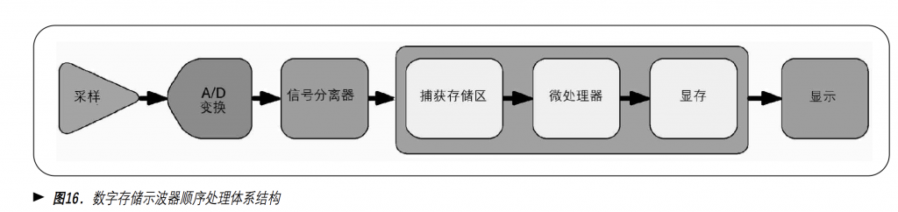

DSO的软件流程是串行的。所以它是存在死区时间的，当捕获存储区（FIFO）满的时候会将数据传给微处理器处理并显示，但是就是在处理和显示的时间段里DSO无法进行采样，这就导致了死区时间，在死区时间中出现的波形无法被采集，直到重新开始ADC采样和存储。

而数字荧光示波器使用的是并行处理的体系结构，显示直接交予数字荧光处理器，而微处理器处理波形的运算、测量以及控制：

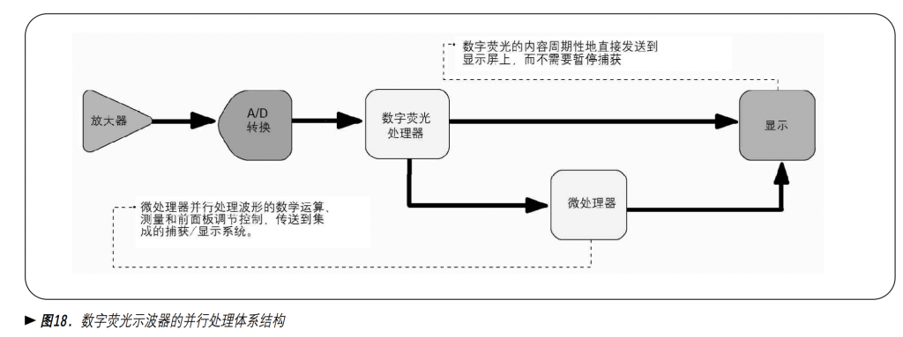

这样并行的思想在我们制作数字存储示波器的后期也可以加以结合，使用cpld协处理器或者dsp、fpga等并行计算技术对示波器的实时显示进行优化。

但是对于产品研发而言，我们首先需要做的就是把产品的功能实现，其次才是效率优化。

###### 耦合

耦合指的是两个电信号连接的方式，DC耦合会显示所有输入信号（震荡的信号+直接电流偏置（固定值）），而AC耦合会去除信号中的直流成分，因为直流一般是偏置，也就是会把信号“抬高”。

当整个信号大于伏格设置时，可以使用AC耦合让波形始终以零电压为中心。

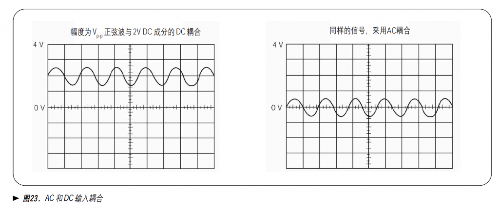

###### 带宽限制

根据大佬傅里叶提出的傅里叶变换思想，任何一个信号都可以被分解成无数个正弦波的叠加。

那么限制带宽，即保留信号的主要成分，忽略一些不重要的高频信号成分，则可以减少显示波形中出现的噪声，使波形更加清晰。

###### 显示模式

1、交替模式：通道1的数据全部刷新结束后刷新通道2的数据。  
2、轮显模式：类似于RTOS中的线程切换模式，各自画一点然后切换。

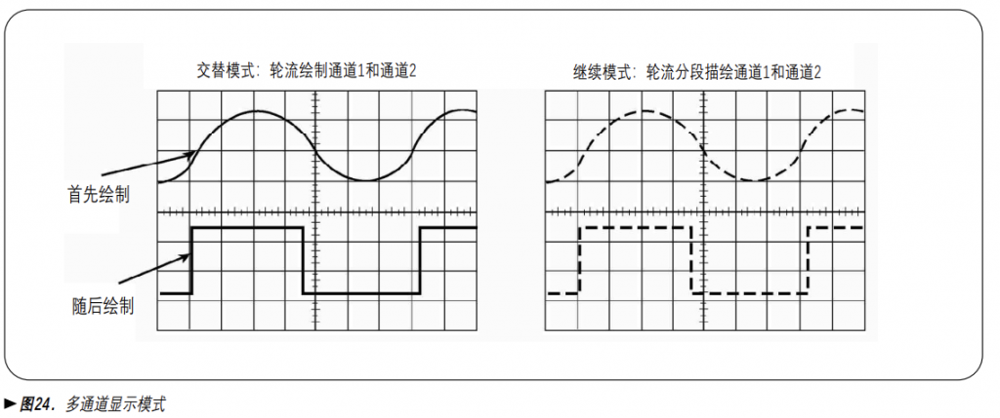

###### 采样

采样分为实时采样与等效时间采样。

实时采样顾名思义，类似于通信协议中的CLK，每隔固定的时间采样一次：

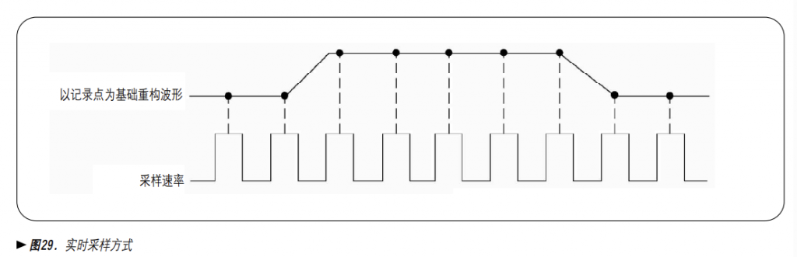

但是对于高频率的信号，示波器的采样率需要满足高采样率才能得到精确的数据图像，如下图中如果对一个10ns的脉冲信号采样，其频率为100Mhz，那么采样率就必须大于200Mhz，才能保证能够采集到这个跳变的脉冲：

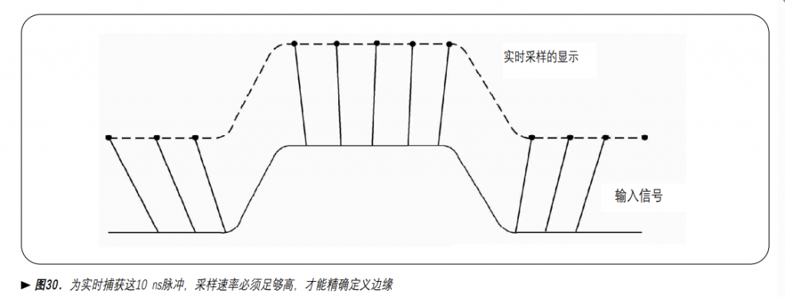

如果采样率不够快，高频成分可能会混叠为低频信号。

而在对于特定信号的实时采样过程中 ，点与点之间不一定是以线性插值法来连接，比如下图中的正弦信号可以使用非线性插值法连接。

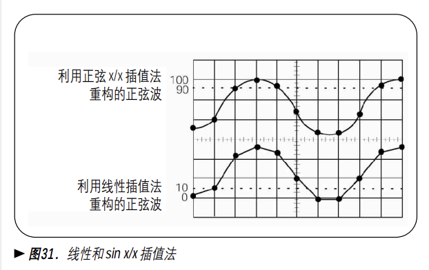

对于高频的周期性的信号，使用等效时间采样构建重复信号的图像，即使信号的频率成分远远高于示波器的采样速率，也能精确地采样：

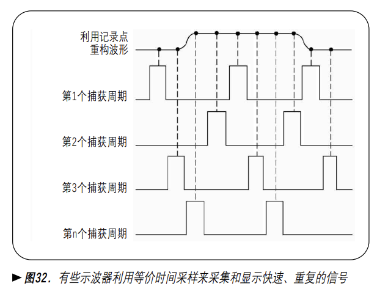

- 随机等效时间采样：允许输入信号的显示先于触发点，不需要使用延时线。

- 连续等效时间采样：更大的时间分辨率和精度。

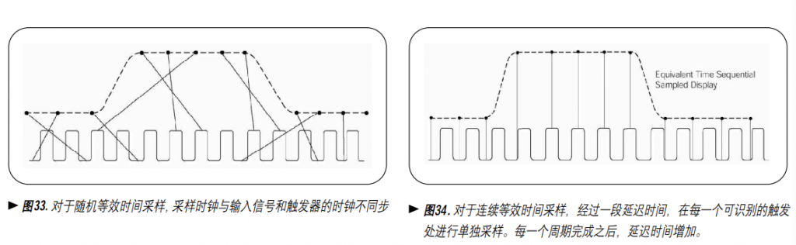

左图随即等效时间采样待讨论。

采样速率取决于波形以及使用的插值方法：

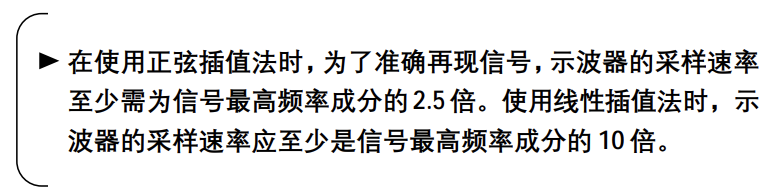

###### 触发

触发方式：

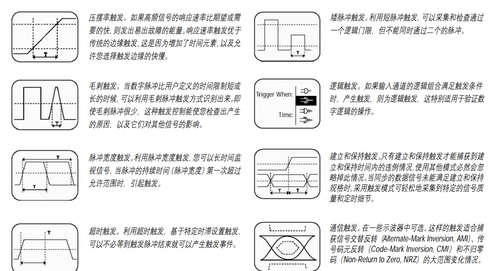

通过各种触发方式可以让波形在视觉上停止或者捕获某种特定的波形（单次触发或循环触发）。

###### 带宽

示波器的带宽指的是正弦输入信号衰减到-3dB点时的频率的值：

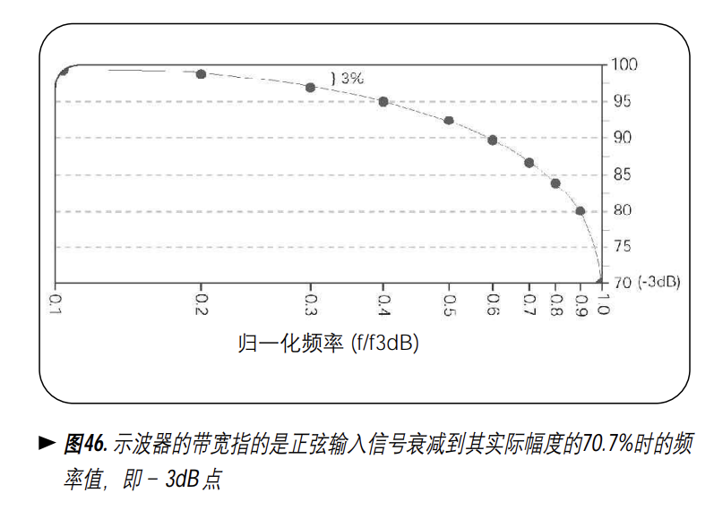

上面说到任何一个信号都是由各种频率的正弦波叠加而成的，在频谱上，可以很清晰地看出，一个方波信号：

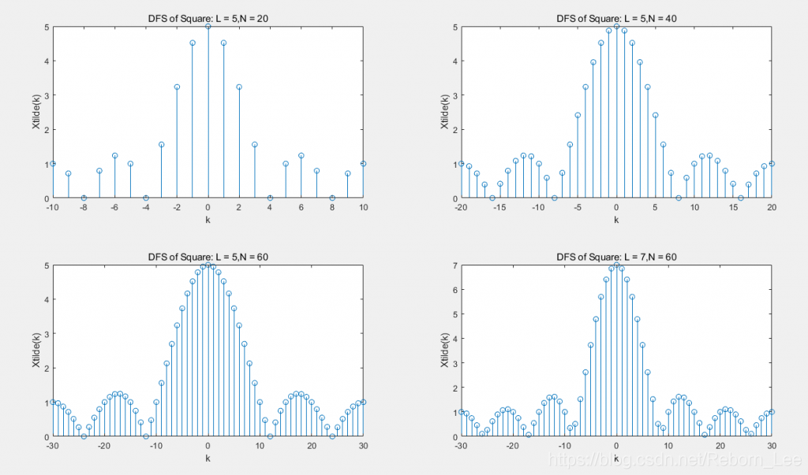

带宽可以理解为上图中的横向窗口大小，上面的图像中任何一幅都可以向左向右延续，但是由于横向窗口是有限的，所以也就截取了这么一部分，而被忽略掉的就是高频的信号。

而被忽略掉的高频信号往往是处于边缘位置，最终导致信号的失真。

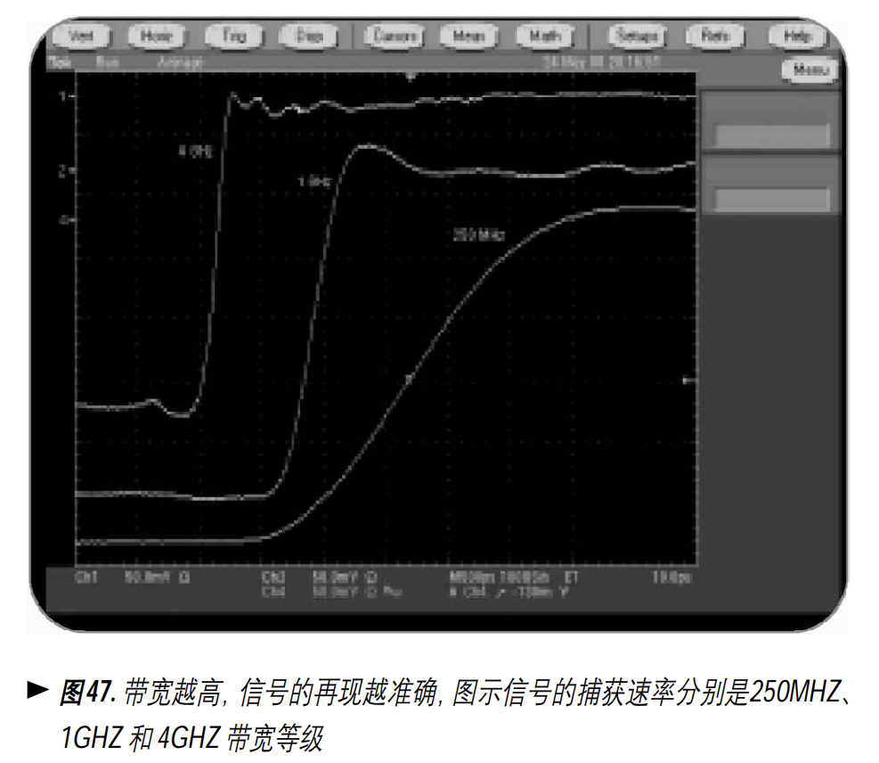

所以，我认为带宽指的是在频域上的显示宽度。

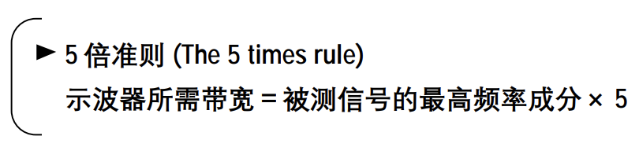

无论如何，带宽越高，信号在频域上保留的就越多，信号的真实度就越高。

###### 开源示波器系统流程图

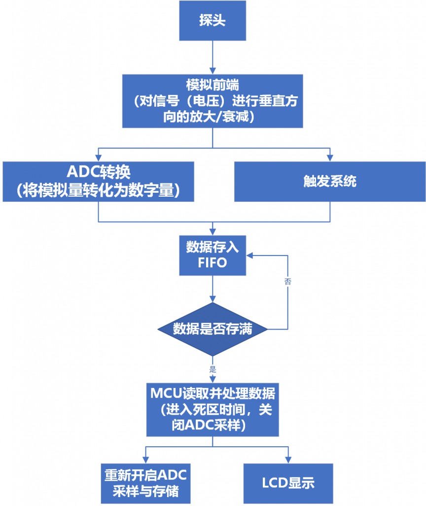
