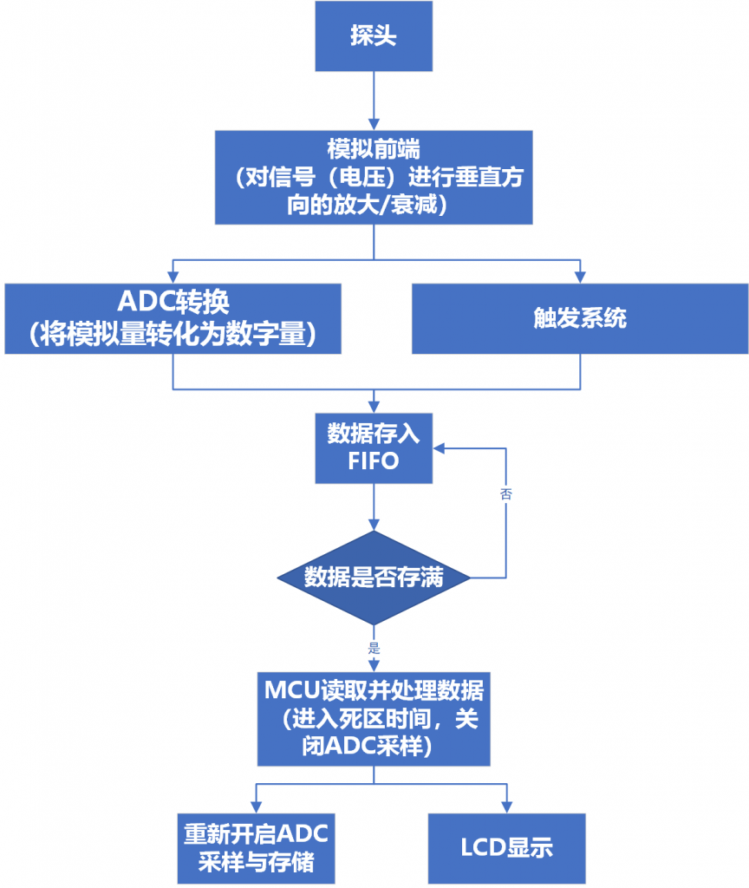
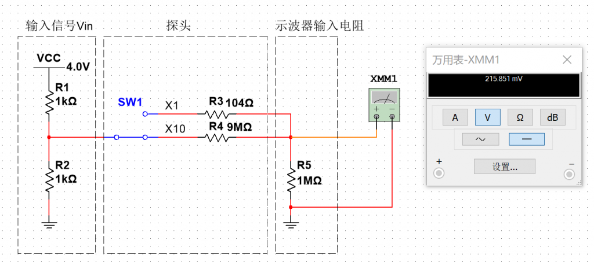
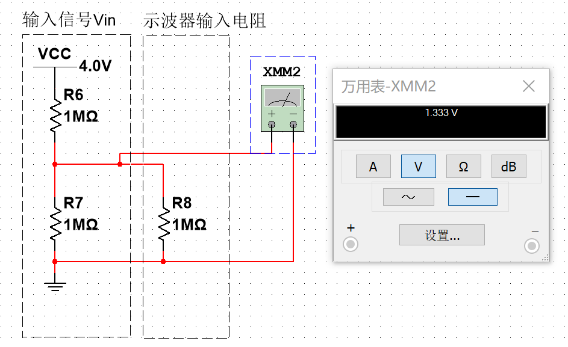
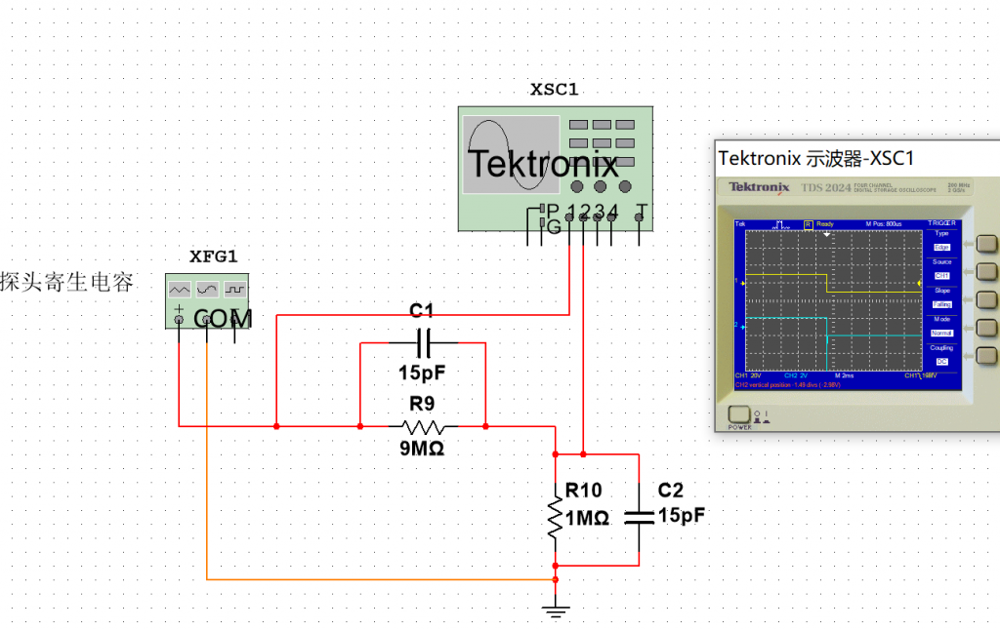
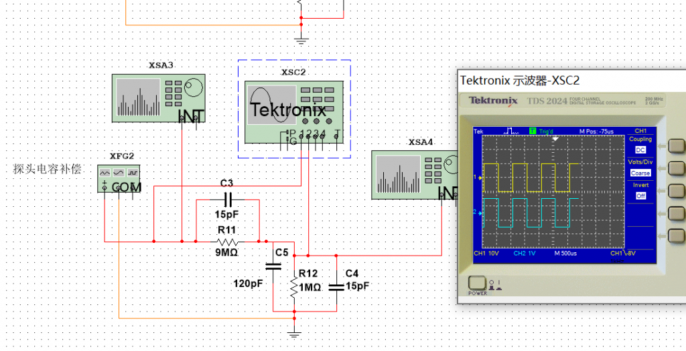
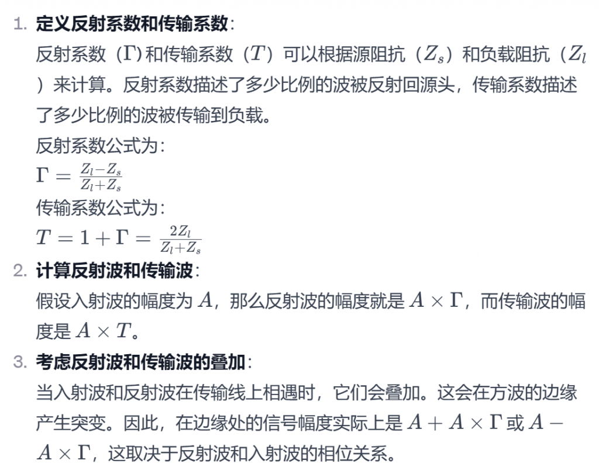
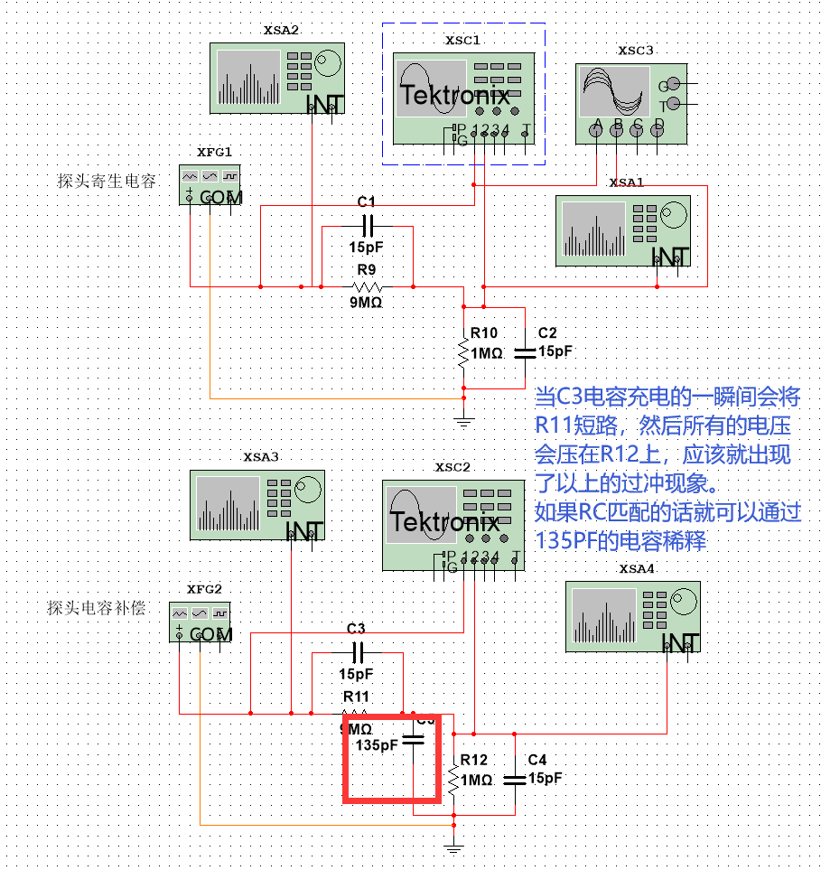
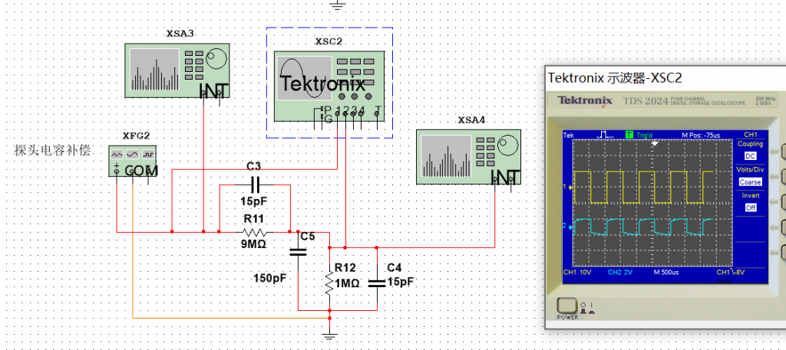
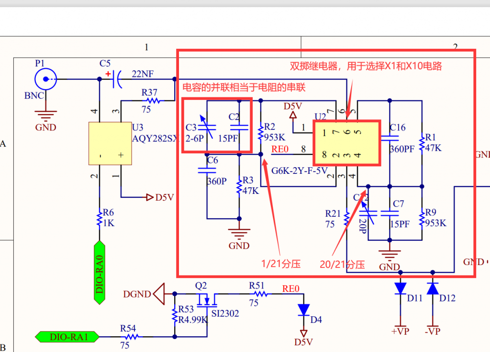

###### 前情提要

###### 无源探头

对于我们常用的示波器而言，无源探头是必不可少了，如果最开始采集进来的数据就不精确，那么就更不用提后面的转换和处理等操作了。

###### 挡位

我们使用的探头上一般有两个挡位：X1和X10，简单来说就是对输入信号的处理，如果是X1挡位的话就是把原来的信号/1，如果是X10挡位的话就是把原来的信号/10。

我们使用multisim进行仿真，

探头X10档

由于探头X10能够将输入电压缩小十倍，所以可以测量大电压。  
当然我们需要在示波器上也选择X10档，在数据处理和显示的时候便会将数据乘10，这样就能保证电路不会被大电压损坏。

###### 被测电路

在上面的仿真中，被测电路是一个使用两个1k电阻构成的分压电路，对于阻值为1M的示波器输入电阻而言几乎为0，但是如果被测电路中是两个1M电阻，使用X1档，则会出现错误的结果：

那么电路在化简之后的仿真效果：

修改被测电路

由于R7不能被忽略，所以R8两端的电压就是R8和R7并联后在总电路中的分压,，而R7和R8在电路中可以等效为0.5M的电阻，所以：  
Vout = 4V * 0.5M / （0.5M + 1M）=4 / 3 约等于 1.333V

所以说，我们如果在测量过程中发现电压值错误，就需要去考虑是否是上述情况。

###### 寄生电容

由于我们使用的探头也是信号线，它使用GND层包起来的，所以就会形成一个寄生电容，那么由于这个电容的存在就与探头的电阻形成了一个低通滤波器。

高频信号需要阻抗匹配的原因可以从信号传输的效率和信号完整性两个方面来理解。

###### 信号传输效率

1. **最大功率传输**：阻抗匹配的一个核心原则是确保在源和负载之间传递最大功率。当源（如信号发生器）和负载（如示波器或接收设备）的阻抗相匹配时，可以实现最大的功率传递。这在高频信号传输中尤为重要，因为高频信号更容易受到传输路径上损耗的影响。

1. **减少反射**：在高频信号的传输中，如果遇到阻抗不连续（如阻抗不匹配），信号会产生反射。这些反射信号可以干扰原始信号，导致信号失真和传输效率下降。

###### 信号完整性

1. **保持信号形状**：阻抗匹配有助于保持信号波形的完整性。在不匹配的情况下，信号的某些频率成分可能会被强化或削弱，导致信号失真。

1. **频率响应**：特别是在高频范围内，电子设备的阻抗特性会随频率变化。如果不进行适当的阻抗匹配，设备可能无法正确响应不同频率的信号，导致性能下降。

###### 为什么边缘发生了突变？

阻抗不匹配导致方波的边缘出现突变，主要是由于反射和传输线效应所致。在电子信号传输中，当信号沿着传输线（如同轴电缆或电路板上的走线）传播时，如果遇到阻抗不匹配的地方（例如，传输线的阻抗与负载阻抗不同），就会发生反射。

以下是阻抗不匹配导致方波边缘突变的几个关键因素：

1. **反射波的形成**：当方波信号从一个阻抗到另一个不同阻抗的介质传播时，部分信号会在界面处被反射回来。这种反射会干扰原始信号，导致信号失真。

1. **信号叠加**：反射波和入射波在传输线上相遇并叠加。这种叠加可能是构造性的（使信号振幅增加）或是破坏性的（使信号振幅减小），从而在方波的边缘产生突变。

1. **驻波形成**：在严重的阻抗不匹配情况下，反射波和入射波可能形成驻波，这会在特定位置产生振幅的极大值或极小值。

1. **信号的波形失真**：由于阻抗不匹配引起的反射，原本应该是尖锐和清晰的方波边缘可能变得模糊不清，出现过冲或振铃现象。

为了减少这种影响，通常需要确保信号的传输线和连接的设备（如接收器、传感器）具有匹配的阻抗。在高速电子设计中，阻抗匹配是非常重要的，可以通过使用适当的终端电阻来实现。

RC不匹配的波形（边缘发生突变）

在探头内部增加电容进行补偿，满足C3/(C5 + C2)  =  R12 / R11，也就是  
R11*C3  =  R12*(C5 + C2)

RC匹配时地波形

既然之前提到了方波是由无数个正弦信号所组成的，而高频分量决定了方波的边缘（猜测），所以我们观察频谱，看能否发现一些端倪：

###### 推导过程

作为软件工程师，我细想继续深扒下去对于我和硬件工程师的battle并无异议，所以就此打住，等之后上班了请硬件佬吃个饭细🔒。

###### 居工的猜想

跟rm的居工聊了下，可能的一个解释，我觉得符合常理。

类似地，我们继续调大电容，会发现反向过冲现象，证明了我们的猜测是对的：

###### 电阻分压网络电容匹配

下图电阻串联实现了1/16分压，并且通过可调C14和C16电容（不一定是360pF）实现了电容匹配。

因为R9和R16串联937.5K，R17和R20串联62.5K，比例大致为15：1。

两个挡位
