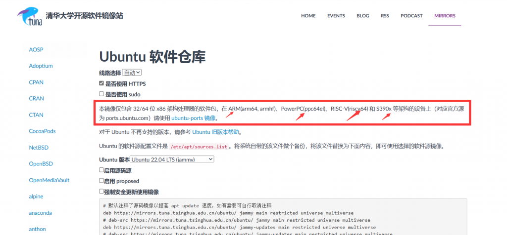
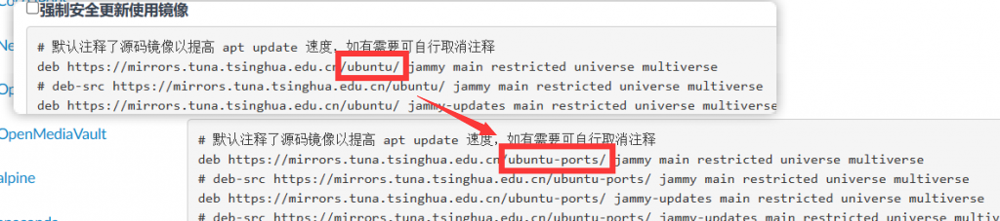

无脑换源带来的后果就是忽略了小字：

网上提供的大部分方法基本都是对于x86虚拟机换源，很少有人会去刻意提到这一点。

在以下网址复制，或者在原先的源url链接中将ubuntu修改为ubuntu-ports：

清华源ubuntu-ports网址：[ubuntu-ports | 镜像站使用帮助 | 清华大学开源软件镜像站 | Tsinghua Open Source Mirror](https://mirrors4.tuna.tsinghua.edu.cn/help/ubuntu-ports/)

修改举例：

