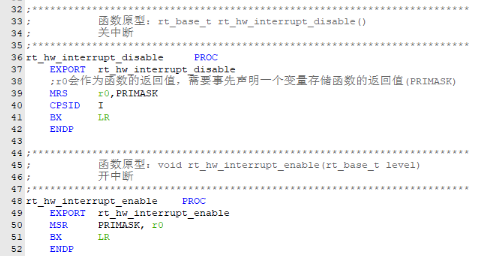
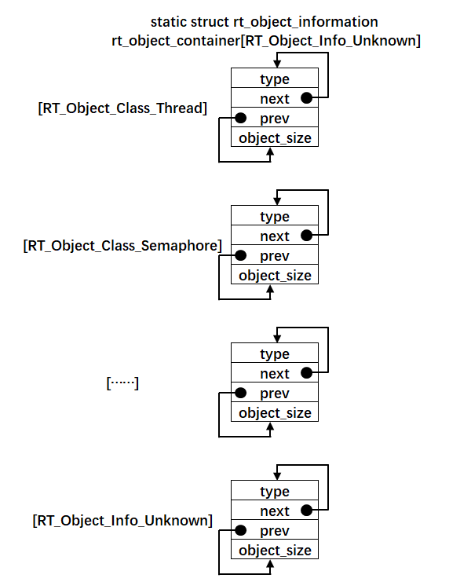
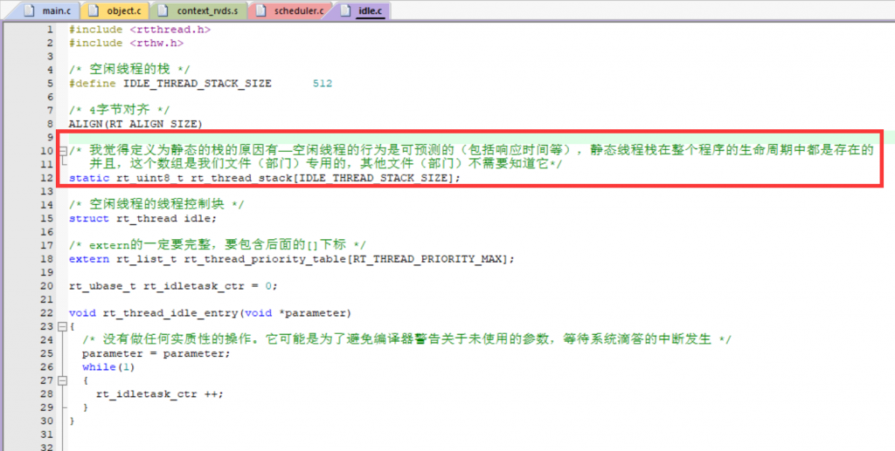
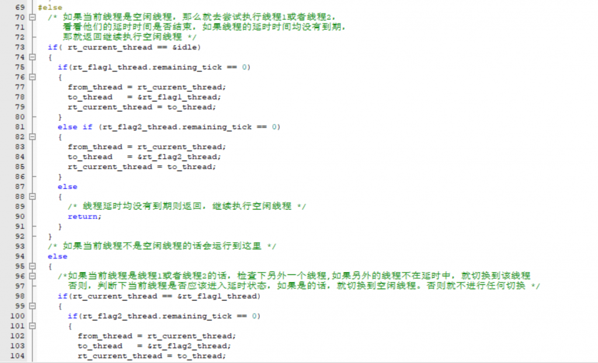

Github链接：[HawkJ02/RT-Thread\_Handmade: 手搓Rt-Thread (github.com)](https://github.com/HawkJ02/RT-Thread_Handmade)

#### 临界段

当我们进入某些重要的程序段（比如初始化、处理数据等）的时候，就处于一种临界的状态，不能被中断所打扰，那么就需要进入临界段，关闭中断。

当然，disable的时候会储存PRIMASK的值到变量，然后在下一次恢复的时候将这个值重新加载。

因为如果在递归调用的情况下，咱如果说在循环外关中断，然后在循环内关中断接着开中断，那么第一次在循环外关中断不是都无效了嘛，就像是中括号{ }，得是对应的。

#### 对象容器

对象容器就是创建了很多个链表，简单来说就是**归类**。

比如我们创建的信号量、消息队列这些链表，在初始化的时候都挂到了这一类的链表上面，就像超市的货架一样。

#### IDLE空闲线程

空闲线程是通过调度实现的，空闲线程的优先级是32，最低优先级：

如果当前线程是空闲线程，那么就去尝试执行线程1或者线程2，看看他们的延时时间是否结束，如果线程的延时时间均没有到期，那就返回继续执行空闲线程。

当然这是本章的方法，接下来会使用到定时器和时间片。

