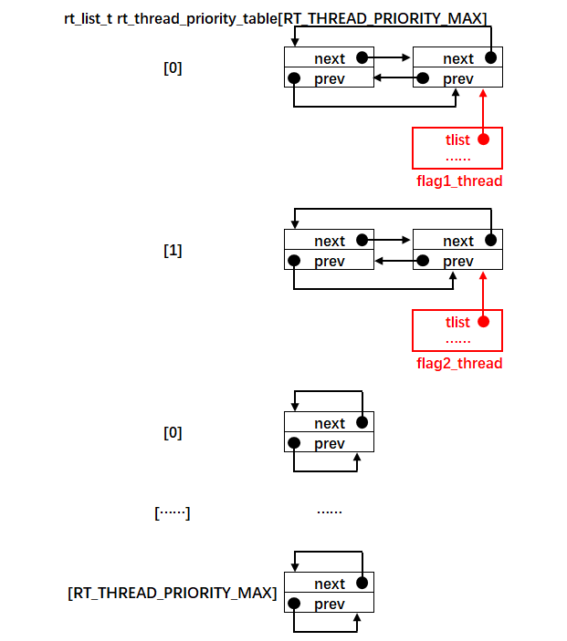
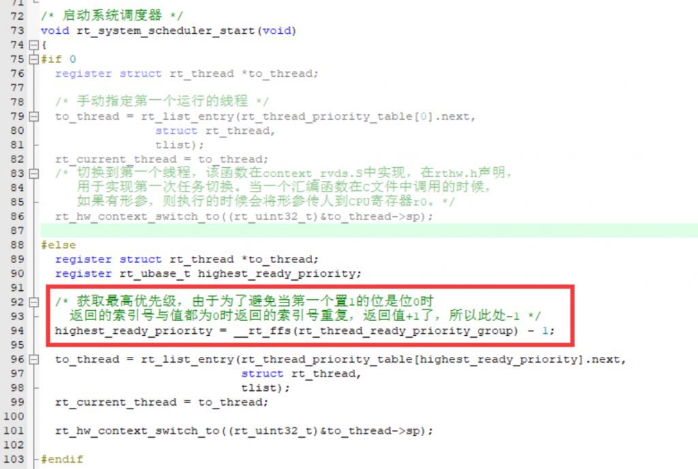
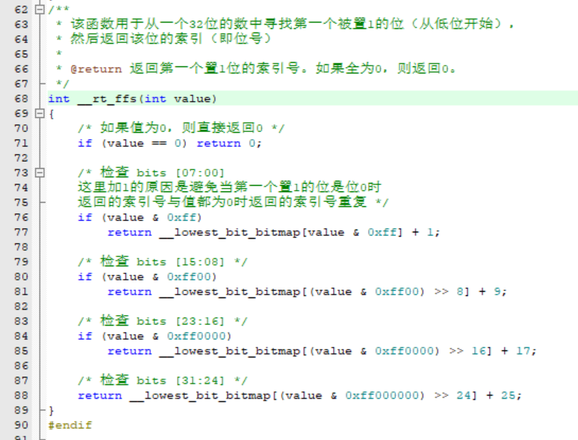
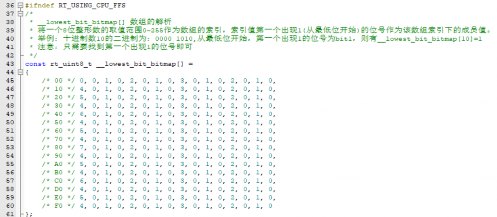
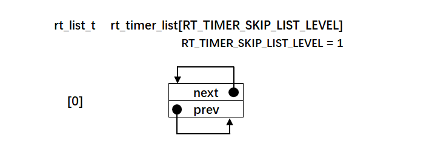
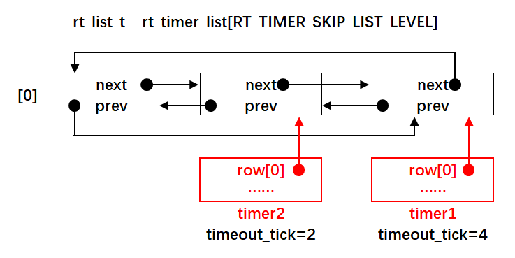
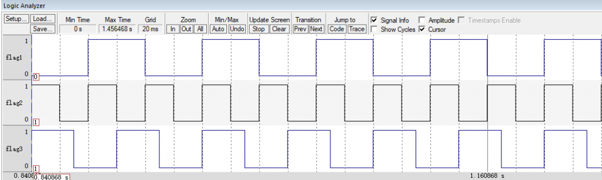

Github链接：[HawkJ02/RT-Thread\_Handmade: 手搓Rt-Thread (github.com)](https://github.com/HawkJ02/RT-Thread_Handmade)

#### 多优先级

既然我们有多线程，那么作为一个抢占式的实时操作系统，我们线程的优先级就得有先后之分，在RTT中是通过优先级列表实现的，定义了一个链表数组，可以理解为很多条链表排成一列，同一优先级的线程依次挂在一起（这是通过时间片进行管理的）：

那如何对这个数组进行管理呢？

我们使用的是一个32位的变量比如如果只用到idle（优先级32）

那么这个变量就是1000 0000 0000 0000 0000 0000 0000 0000，只有第32位置1，表示已经就绪了。

在调度器启动的时候获取最高优先级的线程：

通过查表法获取到这个32位变量的最低的1的位置：

\_\_lowest\_bit\_bitmap\[\] 数组的解析

将一个8位整形数的取值范围0~255作为数组的索引，索引值第一个出现1(从最低位开始)的位号作为该数组索引下的成员值。

举例：十进制数10的二进制为：0000 1010,从最低位开始，第一个出现1的位号为bit1，则有\_\_lowest\_bit\_bitmap\[10\]=1

注意：只需要找到第一个出现1的位号即可

#### 软件定时器

我们之前在实现阻塞延时是通过检查remaining\_time来实现的，那么每一个线程的剩余时间都要扫描，但是如果我们将所有的剩余时间排好顺序，然后每一次都只需要将最小的那个定时值与现在的定时时间进行大小比较。

如果定时时间小于最小的定时值，那么就不用接着比较了，这个链表里的所有剩余时间都没到。

如果定时时间大于最小的定时值，那么就说明该线程的定时时间已经到了，就把它的timer取出来，然后从挂起列表中删除，进入就绪态，等待调度器根据优先级执行！

