Github链接：[HawkJ02/RT-Thread\_Handmade: 手搓Rt-Thread (github.com)](https://github.com/HawkJ02/RT-Thread_Handmade)

#### 实现一个Shell窗口

就像我们使用ubuntu一样，我们能够实时看到系统在运行过程中的状态，也可以输入命令行控制系统，现在我们就是通过串口重映射的方式使用RTT的Shell吧！

主要的函数是 kservice.c中的rt\_kprintf()，比如我们的输入是  
rt\_kprintf("Hello, %s! The value is %d.\\n", "John", 42);  
那么就能够起到printf的作用，在shell中输出：  
Hello, John! The value is 42.

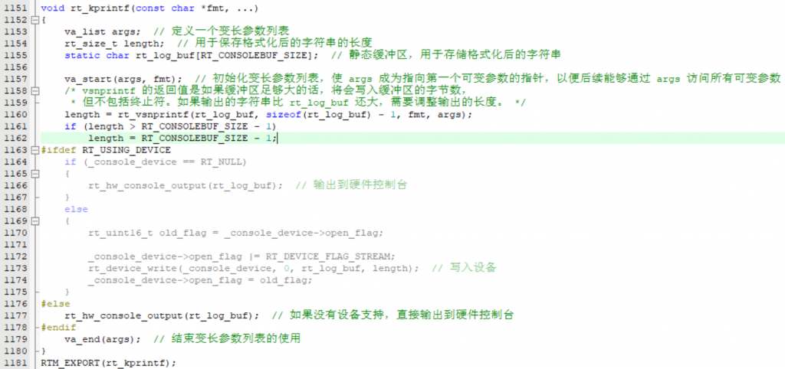

由于我们不使用设备驱动，所以其输出的内容由rt\_hw\_console\_output(rt\_log\_buf);发送出去，我们需要实现这个函数，使用串口将这个buf发送出去。

发送的函数也很简单，当TXE不为空的时候就等待发送完毕，接着发送。

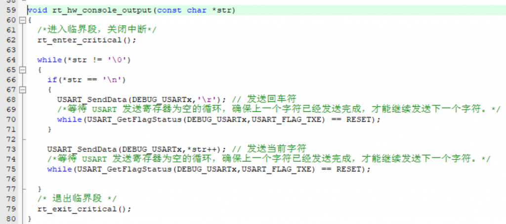

最终在shell中能够看到：

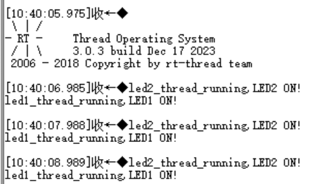

收！

#### RTT的启动流程

在RTOS中有两种启动方法，一种是将所有的线程创建好后，开启调度器，就像是我们在之前的手搓RTT基本单元进行仿真的时候使用的就是以上的方法，在最后进行rt\_schedule()。

另一种是先创建一个启动线程，然后启动调度器，最后在启动线程中创建多线程。

一般来说我更喜欢第一种方法，但是RTT默认是使用的第二种方法。

但是说到启动流程那么不得不看一看启动文件了，startup\_stm32f10x\_hd.s。  
这个文件主要做以下任务：

*   **设置初始SP（堆栈指针） ;**
*   **设置初始PC（程序计数器），指向Reset\_Handler ;**
*   **使用异常ISR地址设置向量表项 ;**
*   **配置时钟系统，也配置STM3210E-EVAL板上的外部SRAM ;**
*   **用作数据存储器（可选，由用户启用） ;**
*   **跳转到C库中的\_\_main函数（最终调用main()） ;**
*   **复位后，CortexM3处理器处于线程模式，权限为特权级， ;\* 堆栈设置为Main。**

首先先给堆栈分配内存，接着将中断向量表映射到复位时地址0，中断向量表存储了处理器中断服务程序入口的地址，由于在大多数嵌入式系统中，复位后处理器会从地址0开始执行程序，所以将NVIC放置在地址0。

`; 将向量表映射到复位时的地址0  
AREA RESET, DATA, READONLY  
EXPORT __Vectors ; 导出中断向量表的起始地址  
EXPORT __Vectors_End ; 导出中断向量表的结束地址  
EXPORT __Vectors_Size ; 导出中断向量表的大小`

接着我们将各入口函数的地址丢进中断向量表，比如第一行就是初始化栈指针，DCD代表着"Define Constant Doubleword"，定义一个32位的常量：

`__Vectors DCD __initial_sp ;` 向量表的第一项：堆栈顶部地址

我们将很多入口函数的地址丢进中断向量表后，进入复位函数Reset\_Handler:

`; Reset handler  
; 复位处理程序  
  
Reset_Handler PROC  
; 标识Reset_Handler过程开始  
  
EXPORT Reset_Handler [WEAK]  
; 导出Reset_Handler符号，[WEAK]表示此符号是弱引用，可以被覆盖  
  
IMPORT __main  
; 引入__main符号，__main通常是C语言主程序的入口  
  
IMPORT SystemInit  
; 引入SystemInit符号，通常是用于初始化系统的函数  
  
LDR R0, =SystemInit  
; 将SystemInit符号的地址加载到寄存器R0中  
  
BLX R0  
; 调用函数，BLX用于跳转并保留返回地址，R0中存储了SystemInit的地址  
  
LDR R0, =__main  
; 将__main符号的地址加载到寄存器R0中  
  
BX R0  
; 跳转到__main，即C语言主程序的入口  
  
ENDP  
; 标识Reset_Handler过程结束`  
这段代码首先调用了SystemInit函数初始化系统，接着调用\_\_main函数。  
当我们使用硬件仿真然后reset后，会发现程序停在了最开始的地方：

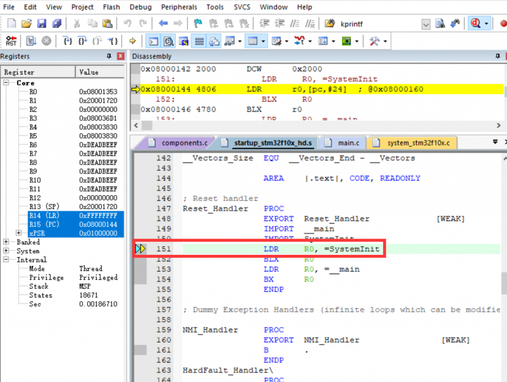

当我们单步调试进入到\_\_main函数的时候，我们会发现跳转到了一个奇怪的地方：

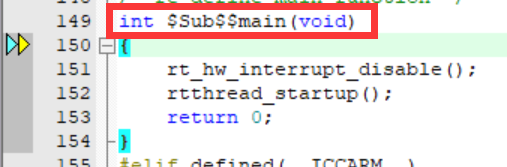

这是main函数的子函数，我们先在这个函数中进行RTT实时内核的初始化后就会进入到它的爸爸main函数中。

这个函数我们不详细解释了，反正在其中也是各种初始化，最后打开调度器：

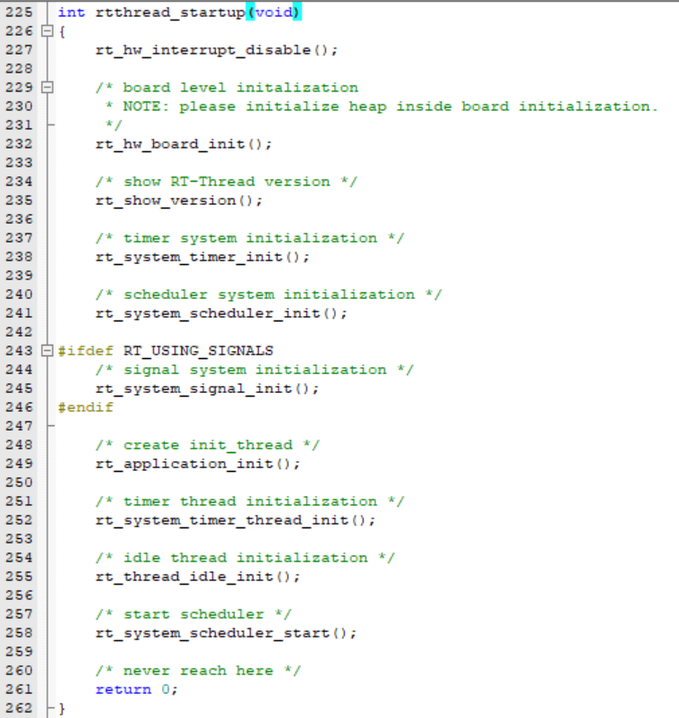

在rt\_application\_init()函数中我们创建初始线程，将main函数作为初始线程创建：

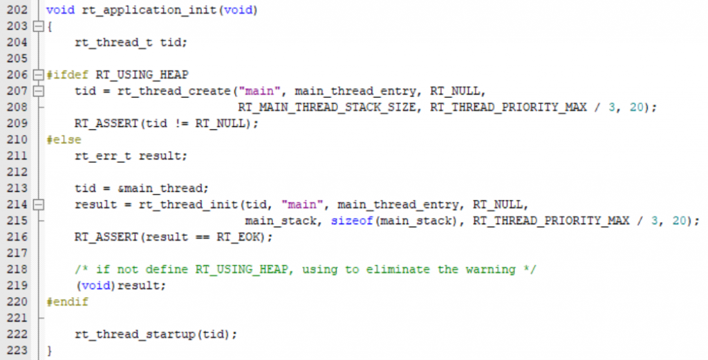

但是我们并不是将main函数直接作为入口函数，而是定义了一个main\_thread\_entry，并在这个线程中调用$Super$$main()回到main（）中：

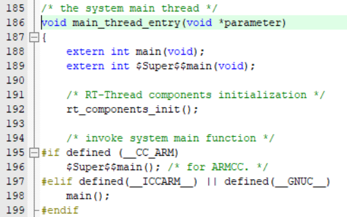

在main函数的最后，通过LR寄存器指定的链接地址退出，在创建线程时LR的内容是rt\_thread\_exit()函数，在这个函数中会将main线程占用的资源释放。

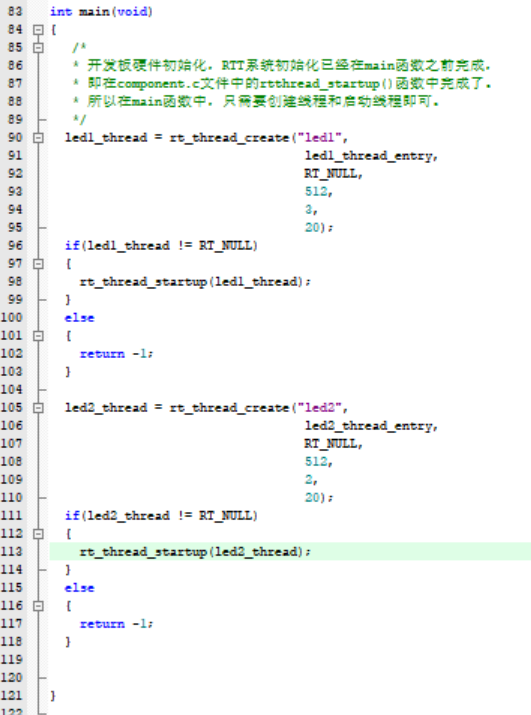

main函数

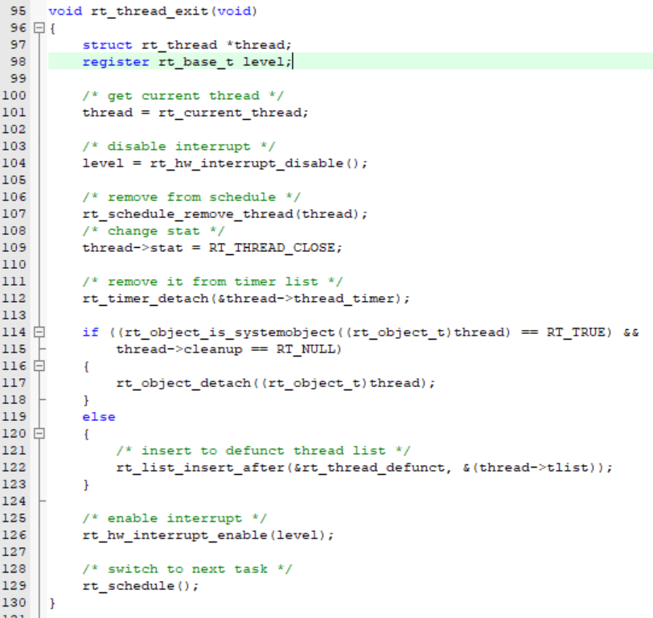

rt\_thread\_exit()函数

那么是如何实现LR自动返回到删除线程呢？我找到了！

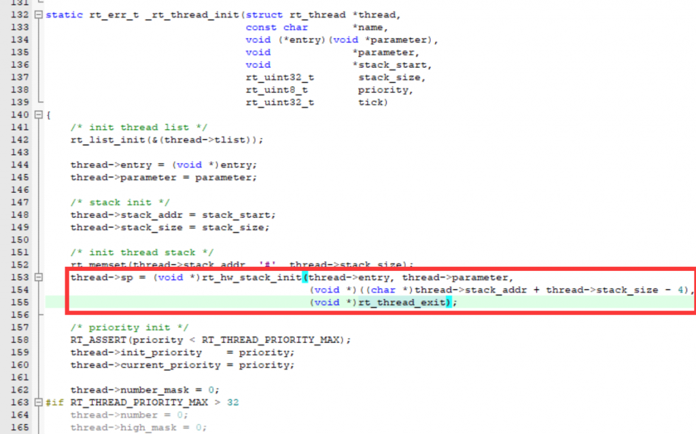

在我们之前手搓RTT的时候，当我们初始化一个线程的时候，我们首先会给它开辟内存空间，用于存放r0~r15寄存器，就是在那个时候设置了线程的LR返回值！

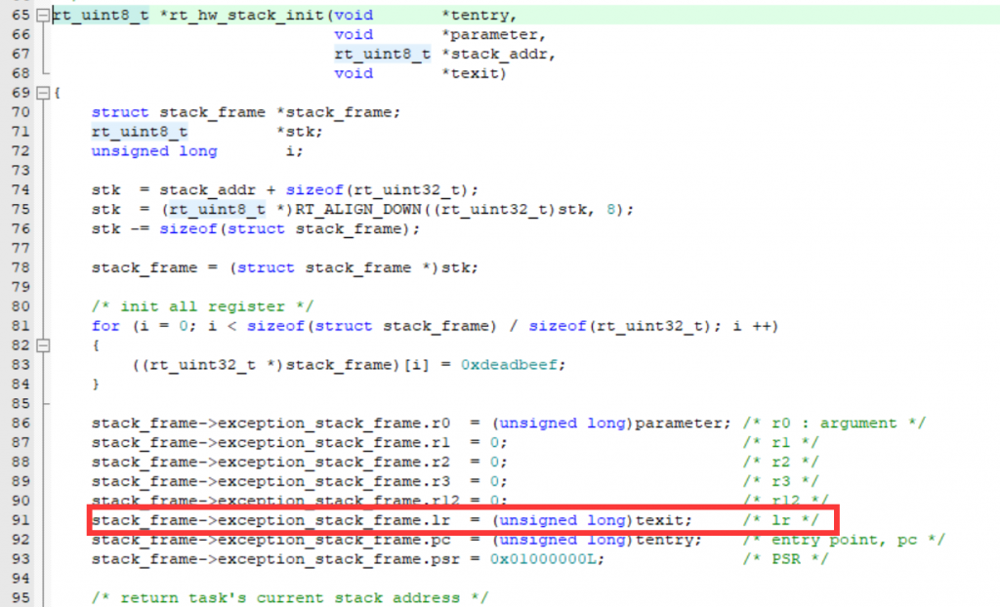

那么，当线程运行结束（因为main函数没有放在一个while循环中，它是会结束的），就会自动根据LR寄存器的值，也就是出口函数的地址，加载出口函数，此时current\_thread还是当前线程，就由出口函数删除掉这个线程并释放空间！

#### 注意

在这种模式下需要注意的是main线程中需要初始化的线程的优先级：因为main线程的优先级是10，所以在10的前后的线程初始化的时间是不一样的。

完美！
