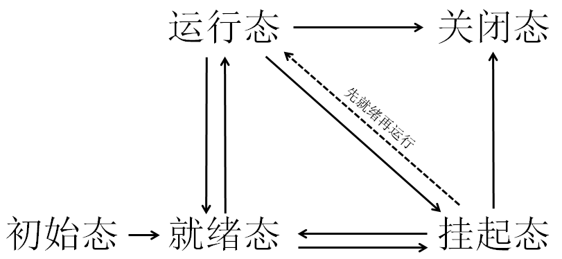
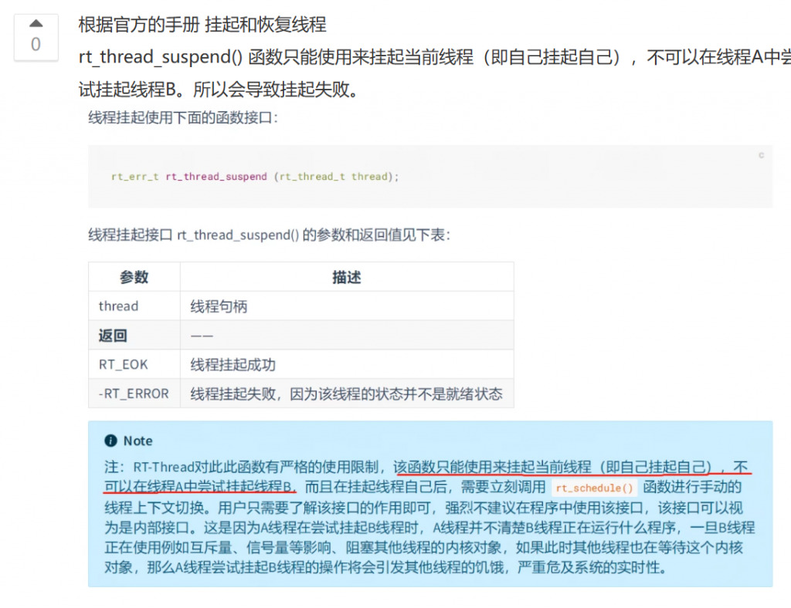
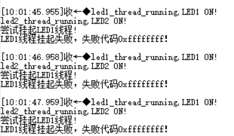
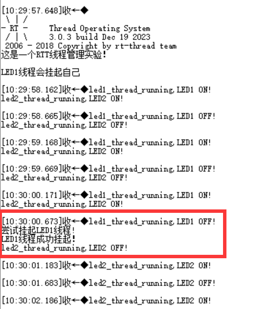
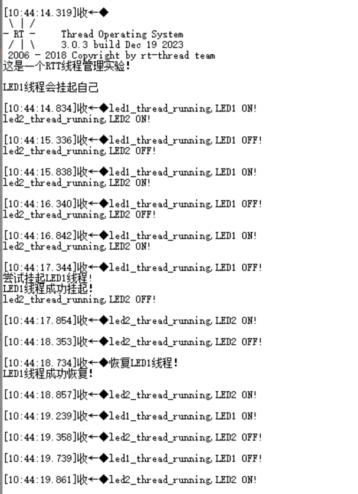
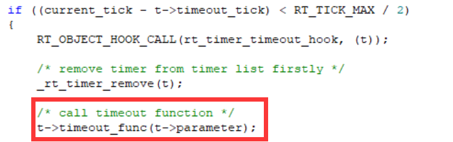
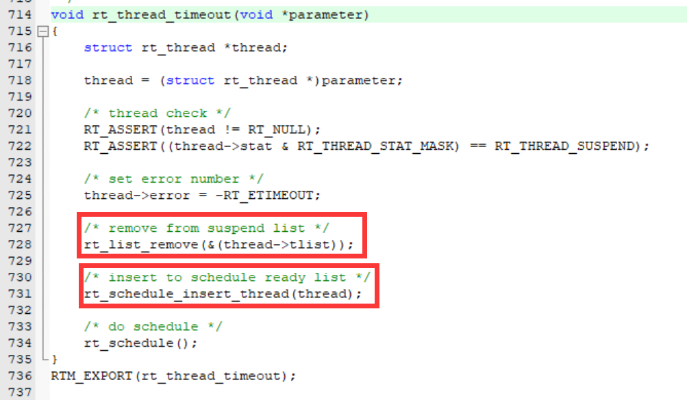
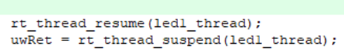
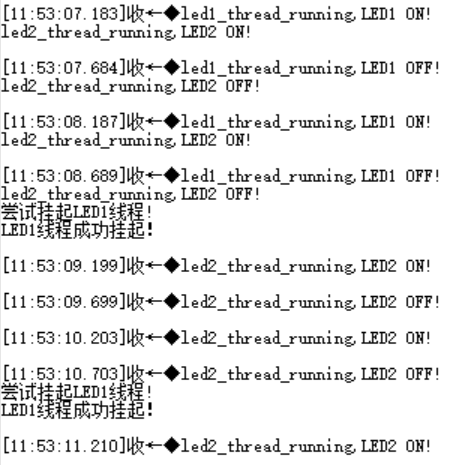

Github链接：[HawkJ02/RT-Thread\_Handmade: 手搓Rt-Thread (github.com)](https://github.com/HawkJ02/RT-Thread_Handmade)

如何做一个线程管理大师呢，在之前手搓RTT的时候，我们的线程是通过就绪表（一个32位的变量，每一位对应一个优先级列表）来进行管理的，然后每个优先级又使用时间片来进行管理。

线程们是有多种状态：

*   初始态（RT\_THREAD\_INIT）：创建线程的时候会将线程的状态设置为初始态。
*   就绪态（RT\_THREAD\_READY）：该线程在就绪列表中，就绪的线程已经具备执行的能力，只等待CPU。
*   运行态（RT\_THREAD\_RUNNING）：该线程正在执行，此时它占用处理器。
*   挂起态（RT\_THREAD\_SUSPEND）：如果线程当前正在等待某个时序或外部中断，我们就说这个线程处于 挂起状态，该线程不在就绪列表中。包含线程被挂起、线程被延时、线程正在等待信号量、读写队列或者等 待读写事件等。
*   关闭态（RT\_THREAD\_CLOSE）：该线程运行结束，等待系统回收资源。

#### 线程挂起的悖论

RTT的线程挂起是一个悖论，我认为是由于其启动方式还有内核调度的局限性。简单来说，如果有两个线程，首先在线程1运行的时候，线程2就处于挂起态，所以线程1想要去挂起一个处于挂起状态的线程根本不可能。

LED2线程尝试挂起LED1（LED2优先级低于LED1）

LED1挂起自己

当LED1将自己挂起之后，内核会自动调度线程就绪优先级列表中最高优先级的线程。

KEY线程虽然无法挂起LED1，但是可以恢复LED1：

rt\_thread\_delay()的挂起和suspend()的挂起是不一样的，delay的底层是thread会创建定时器并被添加到timer里面，当发生延时的时候，系统滴答定时器会每隔一定时间自增，然后扫描timer列表中有无定时到期的线程，然后进入timeout函数：

线程定时器链表扫描

timeout函数

而suspend就无线程问津了，只能通过主动恢复的方式加入到就绪链表。

#### 鞭尸操作

我愿称之为“鞭尸”，这样就可以把别的线程从阻塞延时的挂起中拖出来，然后狠狠地给他挂起！

