Github链接：[HawkJ02/RT-Thread\_Handmade: 手搓Rt-Thread (github.com)](https://github.com/HawkJ02/RT-Thread_Handmade)

### 消息队列

队列是线程与线程间通信的一种方式，实现了线程接收来自其他线程或中断的不定长消息，并根据不同的接口选择传递消息是否存放在线程自己的空间，其是一种异步通信。

就最外层的应用层而言，可以类似于串口的操作，一个发送，一个等待数据到来然后接收。

#### 为什么要用？

比如在传感器采集的系统中，线程A用于采集温湿度数据，线程B用于上传数据，线程C用于处理数据。

*   解耦：降低耦合度，如果线程A产生的数据要进行分发就不需要一个一个对接了，只需要把数据丢进消息队列里，由B、C线程读取就可以了。并且，如果添加了线程D用于保存数据至本地，那么也不用多写接口了，多发一次数据就行。
*   异步：降低等待时间消耗，如果不使用消息队列，那么线程A调用线程B并等待，再调用线程C进行等待；如果使用了，直接把数据甩到消息队列里就可以了。
*   削峰：详见下方实验——当你按下的足够快的时候，你会发现在你突然松手之后，数据还在接收，这是因为虽然说当时没有接收到数据，但是都存放在消息队列中等待接收，大大减轻了数据的瞬时压力。

首先我们需要在rt\_config.h中选择使用消息队列：

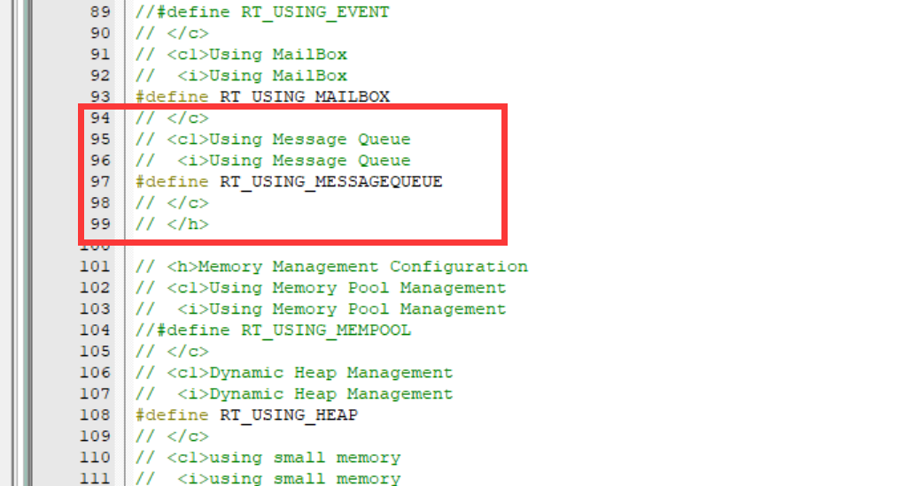

接着我们创建一个消息队列的控制块，类似于线程控制块：

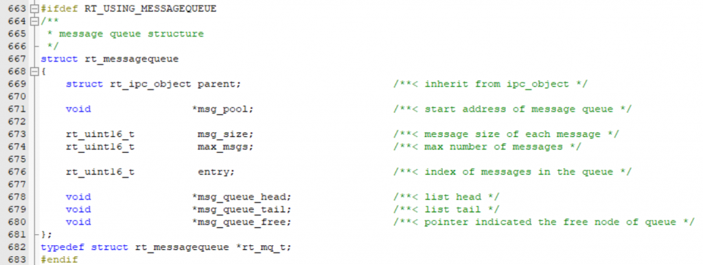

一个队列由这些部分组成，不要被空闲链表和消息链表懵住了，就相当于在初始化的时候，我们设置这个消息队列中能容纳的消息个数是40，首先我们初始化了40个节点，但是此时并没有用到，所以他们都是空闲的，像没有外卖可送的美团小哥一样，当他们收到消息之后就拿着你的晚饭进入了马路，也就是消息链表，逐个进小区，如果有快要超时的小哥，那么就让他插个队优先进小区。

消息队列的链表是单向链表：

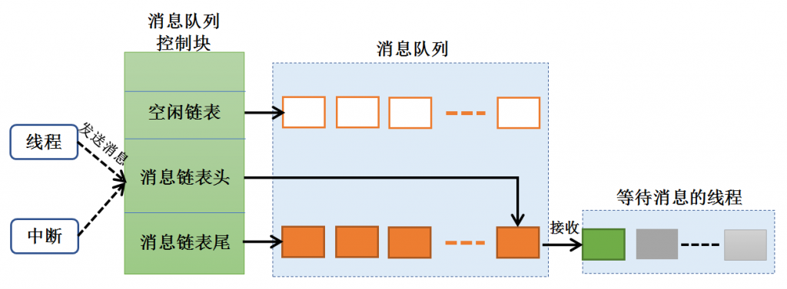

就像我们之前学过了无数次链表的操作，我们可以通过链表来获取这个数据在消息链表中位置，并且类似于定时器链表的操作，一切都是有顺序可言的。

注意到队列的结构体中“继承”了ipc(进程间通信 inter-process-communication)对象结构体：

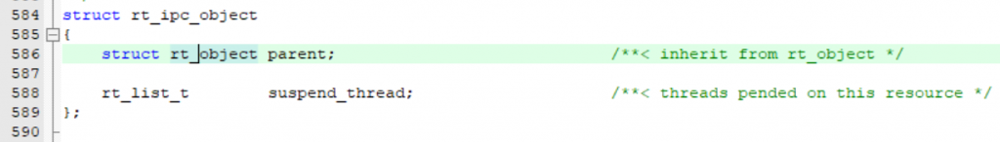

ipc对象结构体中唯一增加的是挂起在这个ipc上的线程，也就是如果线程在等待接收消息队列的数据，他可以选择三种方式：

*   不再等待
*   舔狗线程继续等待，进入阻塞态
*   狼王线程设置等待时间，舔一段时间后就不再等待

IPC的几种模式，是当FOREVER的舔狗，还是勇敢说NO的狼王呢？

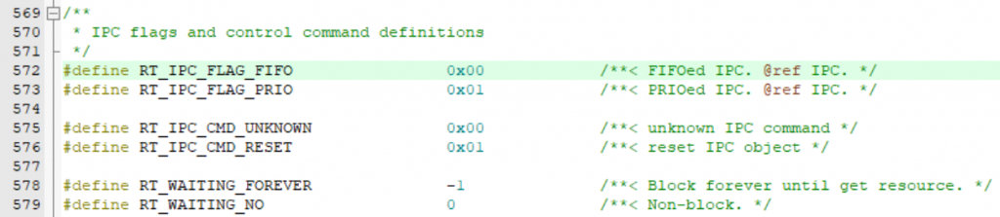

而ipc对象结构体也继承了对象结构体：

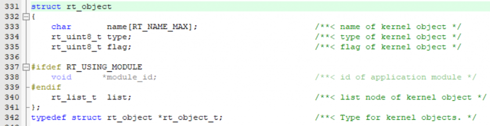

#### rt\_mq\_create()

消息队列的创建类似于线程的创建，分配对象内存，设置对象的flag，  
初始化ipc对象（也就是初始化挂起舔狗线程的链表），字节对齐，设置参数，分配消息队列各参数节点的内存，最后消息链表头与空闲链表相互指向，设置目前消息个数为0（mq->entry = 0）。

#### rt\_mq\_send()

从空闲链表中取出一个新鲜的节点：将msg设置为此时空闲链表的地址，然后将空闲链表的地址移至下一个节点，表示刚刚分配的消息将不在被认为是空闲的，接着将刚刚分配的msg节点的next设置为RT\_NULL，因为准备将其插入消息队列的最后，所以提前准备好让其后面没有节点。

简单来说，就像是有消息需要传递的时候，空闲链表节点！出列！

然后这个节点就带着数据进入队伍的末尾。

最后将buffer的值放入msg+1的位置，因为消息之前在初始化的时候开辟内存，初始化消息队列空闲链表的时候，分配内存是通过【消息头大小+消息大小】\*消息队列容量。每个消息节点都有一个消息头，用于链表链接，指向下一个消息节点。

`msg + 1` 这样的写法是为了获得结构体之后的内存位置。当你使用 `msg + 1` 时，实际上是在 `struct rt_mq_message` 结构体的地址上向后偏移一个单位，因此指向了结构体之后的位置。于是就能获取到msg+1的位置了。

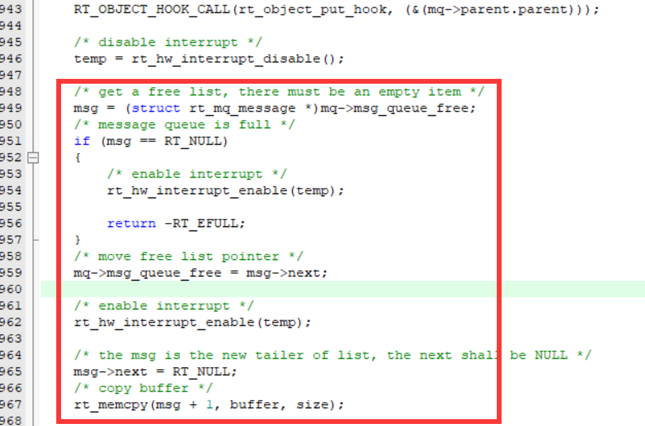

msg+1的根本原因是在初始化空闲链表时设置：

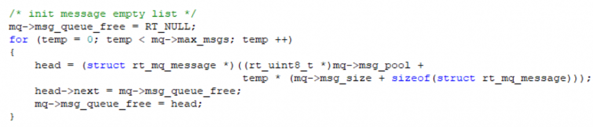

1.  `mq->msg_queue_free = RT_NULL;`：首先，将消息队列的空闲列表 `msg_queue_free` 初始化为空（RT\_NULL）。
2.  `for (temp = 0; temp < mq->max_msgs; temp ++)`：通过一个循环，遍历消息队列中的每个消息节点。
3.  `head = (struct rt_mq_message *)((rt_uint8_t *)mq->msg_pool + temp * (mq->msg_size + sizeof(struct rt_mq_message)));`：为每个消息节点分配内存。`mq->msg_pool` 是消息队列的内存池，`mq->msg_size` 是每个消息节点的大小，而 `sizeof(struct rt_mq_message)` 则是消息头的大小。这一行代码将计算出每个消息节点的起始地址，并将其转换为 `struct rt_mq_message*` 类型的指针，存储在 `head` 变量中。
4.  `head->next = mq->msg_queue_free;`：将新分配的消息节点加入空闲列表。将 `head` 的 `next` 字段设置为当前空闲列表的头部（即 `mq->msg_queue_free`），表示新分配的节点将成为空闲列表的新头部。
5.  `mq->msg_queue_free = head;`：更新空闲列表的头部，将头部指针指向新分配的节点。现在，这个节点成为新的空闲节点。

可以理解为，不断在前面插入节点，新插入的节点就是链表头头。

以上是本章的一个小重点。

#### rt\_mq\_recv()

在这个函数中，如果队列中没有消息并且设置了不等待，立刻恢复中断并返回。

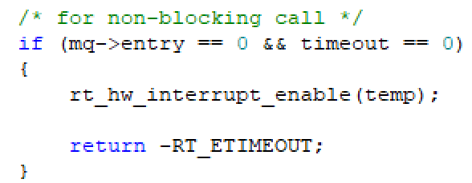

如果队列中没有消息但设置了舔狗等待，则进入循环：  
首先挂起当前线程，因为他是舔狗，所以设置当前线程的超时阻塞时间，并启动定时器。

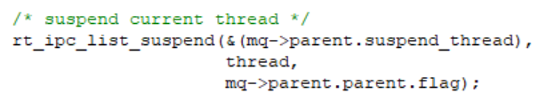

那么当数据到来的时候，谁会叫醒这个挂起的舔狗线程呢，在recv的线程中只有挂起和接收数据的操作。

回到之前的send线程中：

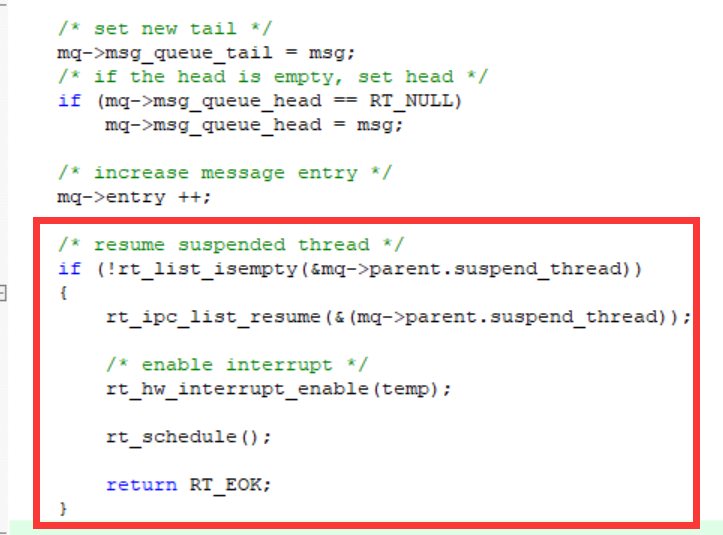

当消息队列有新的数据进来之后，如果此时存在由等待队列数据而挂起的舔狗线程，那么就会恢复当前最靠前的舔狗，然后进行调度。

当你按下的足够快的时候，你会发现在你突然松手之后，数据还在接收，这是因为虽然说当时没有接收到数据，但是都存放在消息队列中等待接收，这个也许就是消息队列的功能之一。

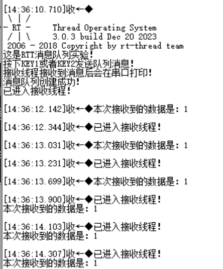

接收消息（舔狗等待）

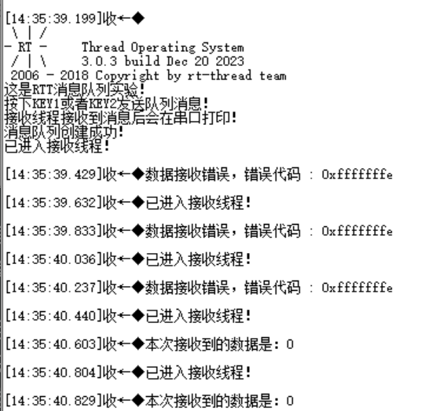

接收消息（就等待一会儿或者不等待）

### 信号量

我认为，信号量类似于flag的操作，也就是比如我们有两个线程，线程A负责采集温湿度传感器的数据，线程B负责将数据上传，那么线程B是依赖于线程A采集的数据的。如果说每隔1s上传一次也是可以的，但是采集数据的间隔可能是0.1s或者10s，所以信号量就能够实现，当线程A数据采集完之后通知线程B，提高效率。

信号量分为二值信号量、计数信号量，我觉得信号量就是设定有限的资源，线程只有在资源有剩余的情况下才能获取，否则要么挂起等待，要么直接走开。

#### 出现问题

因为我是将消息列表与信号量的程序放在了一起，就莫名其妙导致了——在main线程中的最后一个初始化的线程是不运行的，在各种尝试debug后我认为可能是线程分配的内存所影响。

在将每个线程分配的内存大小从512-->256后，程序成功运行！

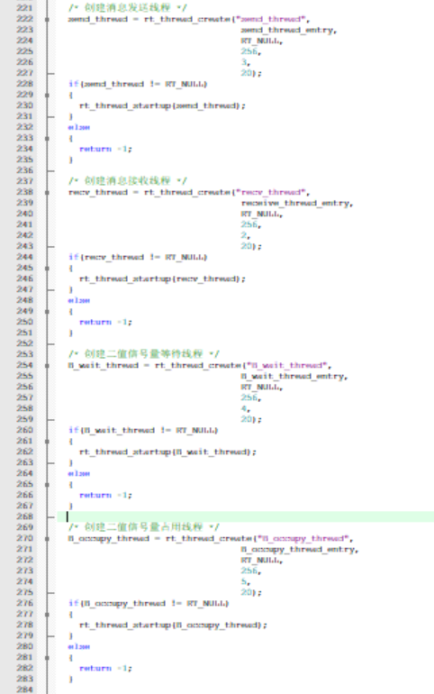

那么，作为努力上进的程序员，我们深入挖掘一下这个问题。

#### stm32以及RTT的堆栈分析

4个256字节空间的线程，1个512字节空间的main线程

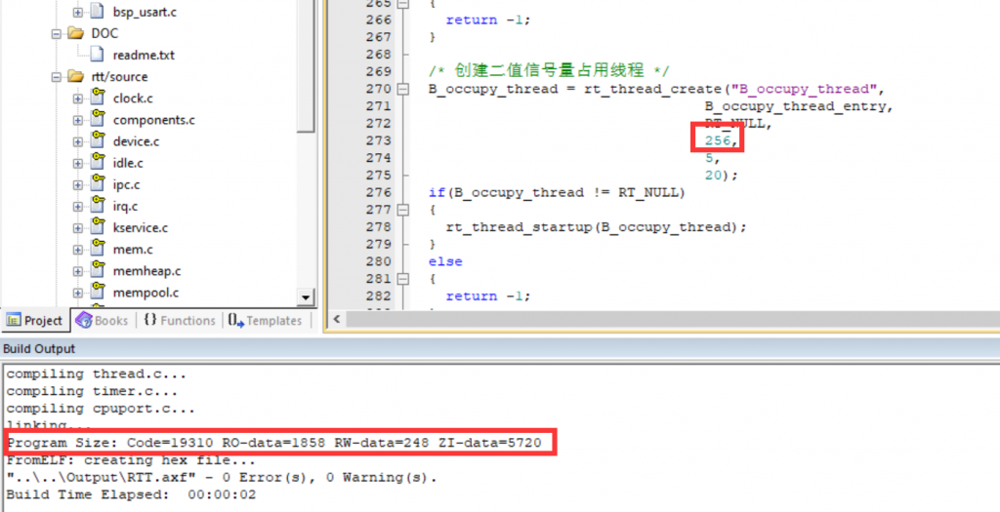

将其中两个线程内存大小256-->512

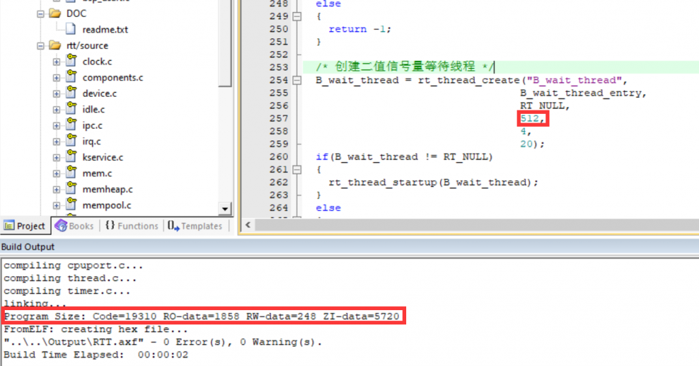

可见，内存空间并没有变化，因为我们是动态开辟堆空间的，线程是在运行时开辟内存空间。

如果在startup程序中，把堆内存分配为0，也不会影响程序的运行，因为RTT中没有用到malloc，而是写了一个轮子rt\_malloc()：

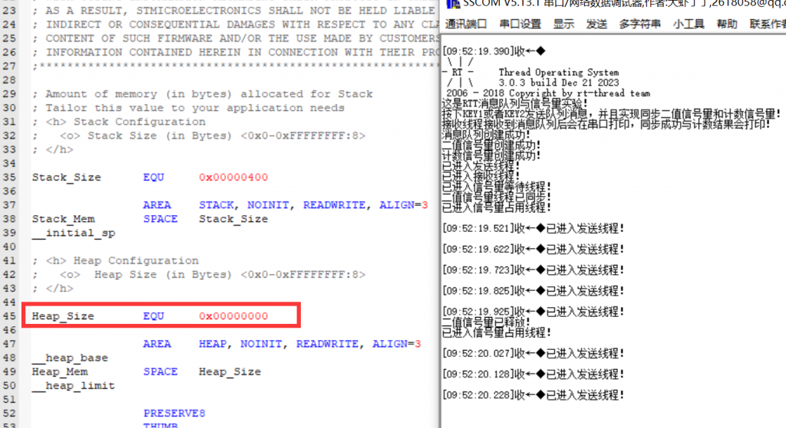

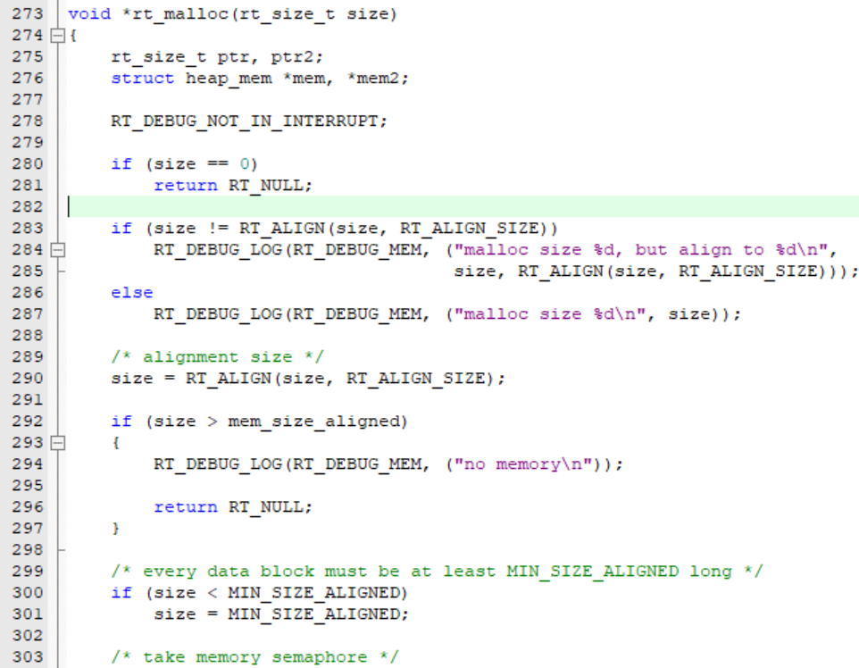

那么，到底如何才能查看到RTT在线程开辟过程中，堆栈是否溢出了呢（在不使用finsh端口的情况下）？

我找到了rt\_config.h里面的一个接口，可以直接监测堆栈是否溢出。

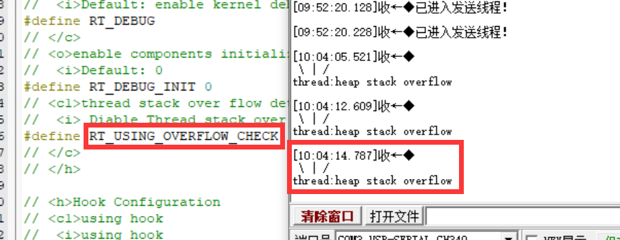

既然找到这个切入点，我们观察下RTT是如何实现的，应该就能找到底层的函数。

找到了函数\_rt\_scheduler\_stack\_check()，但是这就有些抽象了吧，这个根本就是没法用，heap stack overflow，意思就是在最开始的heap\_thread就溢出了，这不应该呀...

我所理想的是，在创建第四个线程的时候发生overflow，这样就说得通了，那么继续挖，\_rt\_scheduler\_stack\_check()这个函数实现的机制是：

`// 检查线程栈是否溢出的条件：`  
`// 1. 栈底标记不等于 '#'（可能是用于初始化栈的标记）`  
`// 2. 当前栈指针小于等于栈底地址`  
`// 3. 当前栈指针大于栈底地址加上栈的大小`  
`if (*((rt_uint8_t *)thread->stack_addr) != '#' || (rt_uint32_t)thread->sp <= (rt_uint32_t)thread->stack_addr || (rt_uint32_t)thread->sp > (rt_uint32_t)thread->stack_addr + (rt_uint32_t)thread->stack_size)`  
`{}`

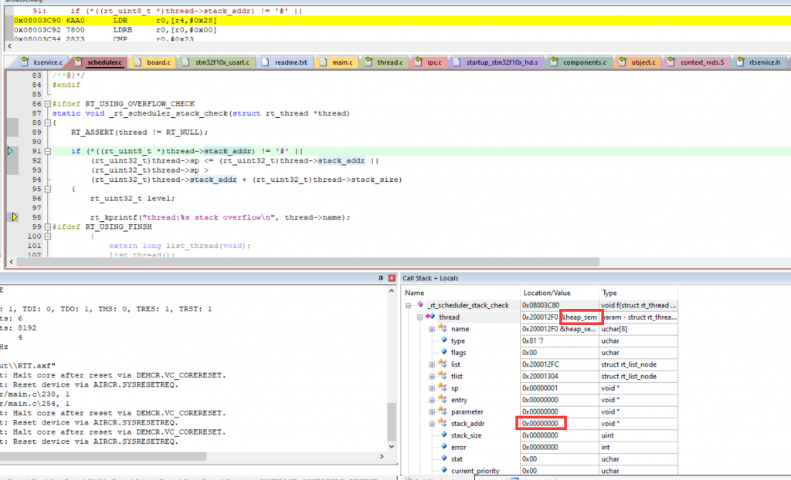

首先单步调试，程序崩溃在heap stack，你一个检测栈溢出的程序在heap\_sem这个堆信号量的位置崩掉了就很奇怪，我认为是这个程序的bug，因为本来就不应该用检测栈的程序来检测堆吧，太抽象了。

所以我将下面这段打印version的函数删掉，观察程序是否正常运行：

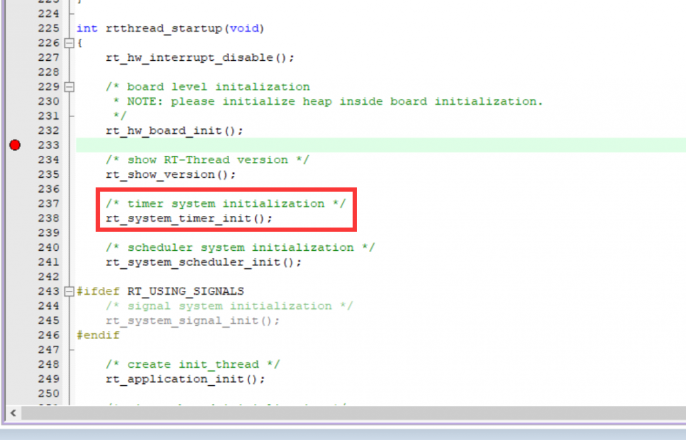

您猜怎么着？还真跑起来了，虽然在后面又崩掉了（如果不开启堆栈溢出检测就不会崩）

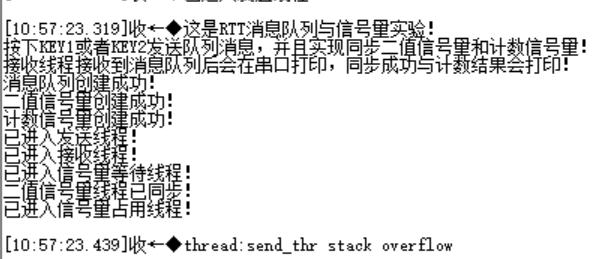

看来是与最开始kprintf有关，再来解决send\_thread线程出现的栈溢出问题，这个我很快就想到，我给每一个线程分配的就只有128字节，那肯定少了啊！

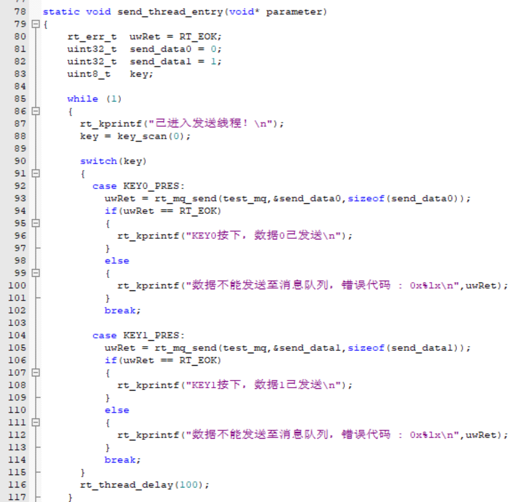

接着，我给每个线程增加分配的内存数量，增加至256，就可以正常运行了，此时，我已将版本输出函数放在了main线程里：

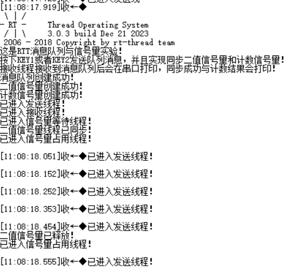

那么，现在我就可以测试，是否是由于四个线程分配了512字节而导致的栈溢出！

晕，，，不知道改动了哪里，它又正常运行了，，，

好好好，我把四个线程分配1024字节，终于导致程序绷不住了，后两个线程已经不工作了，但是stack检测器并没有检测到，看来他是无法检测到堆溢出的（我的问题，应该早就意识到那个是检测栈的，从代码上看就是这样子的）。

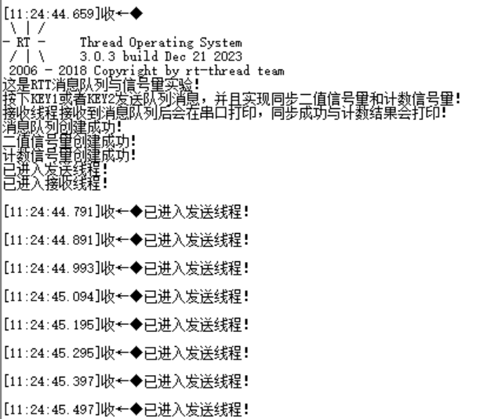

到此就一筹莫展了，但至少这个上午我知道了如何检测栈溢出，也对内存管理有了更深层次的理解，但是目前我还是处于模糊阶段，几章之后会更加深入地学习内存管理以及算法。

#### 根本原因：

将RT\_HEAP\_SIZE修改为4096后，我就可以启动4个分配了1024字节的线程了！爽！

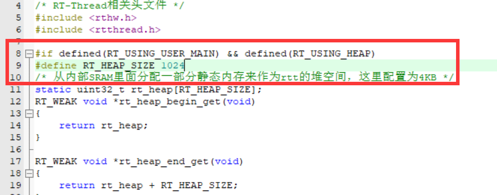
