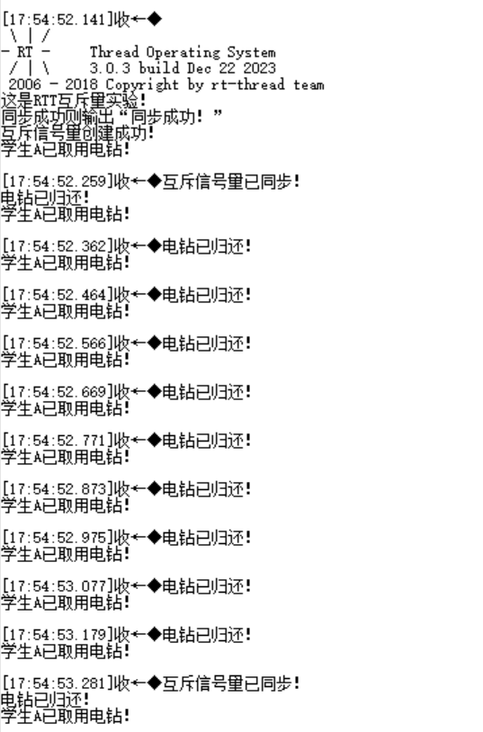
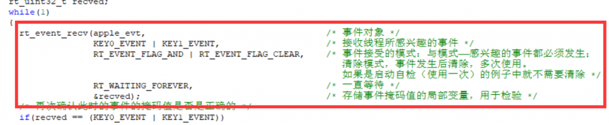
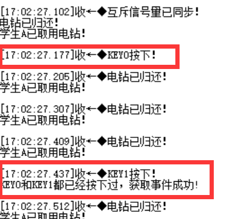
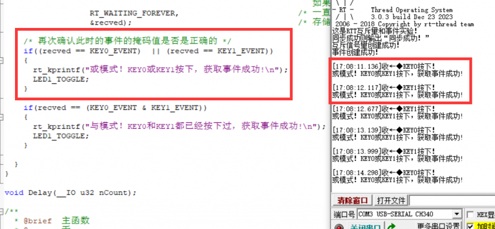
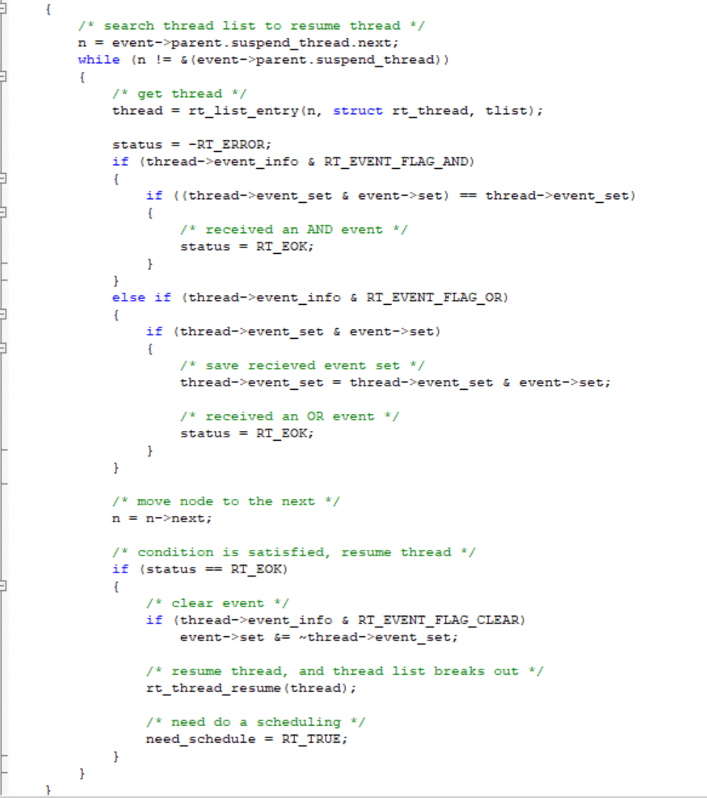

Github链接：[HawkJ02/RT-Thread\_Handmade: 手搓Rt-Thread (github.com)](https://github.com/HawkJ02/RT-Thread_Handmade)

#### 互斥量

私以为，互斥量就是pro max版本的二值信号量，就像是实验室里面有一个电钻，同学A先拿着用了，然后老师B也需要用，不用的话手头里的项目就进行不下去，所以老师B就需要等待，这样子就构成了互斥量——电钻。

但是我们如果将优先级排序，加入同学C，设定老师B > 同学C > 同学A，但你会发现，同学A占用了电钻，老师B就开始等他，明明老师的优先级更高啊，凭什么要等他！但是sorry，互斥量就是这样子的，互斥面前一律平等，这就导致了优先级高的线程（更重要的）被卡住，卡住的时间的是同学A使用电钻的时间。

不仅如此！同学C出现了，他并不跟同学A抢电钻 ，但是作为同学A的团支书，他让同学A赶紧填青年大学习，于是同学A放下电钻（依然占用）去填问卷了。

虽然此刻老师还在等同学A用电钻，但是他还是占用着电钻，跟着同学B看青年大学习去了，那么最惨的就是老师，作为优先级最高的线程从来没遇到过如此憋屈的时候！他不仅要等同学A，还得等同学C叫同学A填完青年大学习的时间！

这个就叫做：**优先级翻转**

那么怎么解决这个问题呢？RTT使用的解决方案是，将同学A的优先级暂时提高到老师B的优先级，那么同学C就不能让同学A去填青年大学习了，这样子，老师B只需要等待同学A用完电钻就可以了！而不是要等一堆同学打扰同学A用电钻，耽误老师B的时间！代码跟前面的代码类似，运行结果如下：



由于老师线程的周期是1s，学生每次占用电钻0.1s，所以出现以上结果。

互斥量主要用于对于设备的访问，比如多个线程不能同时使用串口，  
但是占用互斥锁之后，本线程是可以不断递归调用互斥锁的，在互斥锁的结构体中会记录是不是本线程以及递归调用了几次，等到每一轮的递归都结束并释放互斥锁的之后，才会真正释放互斥锁。

就像我们每次disable中断都会保存那时候的PRIMASK的值。

#### 递归调用互斥锁

一个简单的例子是任务递归地调用一个函数，该函数对共享资源进行访问，并使用递归锁来确保在整个递归过程中对资源的安全访问。

`// 定义递归互斥锁`  
`pthread_mutex_t recursive_mutex = PTHREAD_RECURSIVE_MUTEX_INITIALIZER_NP;`  
`// 共享资源`  
`int shared_variable = 0;`  
`// 更新共享资源的递归函数`  
`void recursive_function(int counter)`  
`{ // 获取递归互斥锁`  
`pthread_mutex_lock(&recursive_mutex);`  
`// 执行一些需要互斥访问的操作`  
`printf("Counter: %d, Shared Variable: %d\n", counter, shared_variable); // 递归调用`  
`if (counter > 0)`  
`{`  
`shared_variable++;`  
`recursive_function(counter - 1);`  
`}`  
`// 释放递归互斥锁`  
`pthread_mutex_unlock(&recursive_mutex);`  
`}`

#### 事件

私以为，事件相较于最基础的信号量的区别在于以下几点：

*   信号量的数量可以定义，事件只有发生和没有发生
*   信号量只能逐个提醒线程，事件可以设定条件，条件都满足或者条件满足其中之一就可以接收通知。

比如说有一个发动机，在启动之前需要自检三项，电机、主控、电池状态，这三个条件缺一不可，如果是信号量的话也可以做到，但是很麻烦（启动线程先后分别挂起在自检三项线程上，逐一等待信号量）；

使用事件的话，启动线程会使用类似于就绪优先级列表（一个32位变量）的方式，可以有32个事件挂载到这个32位变量上，以掩码的形式存在。

在启动线程中我们打开“事件接收等待”，在其中可以设置条件，可以设置“与模式”和“或模式”，前者是所有条件全都满足，后者是条件满足其一：

```
rt_event_recv(
apple_evt,                                                                  /* 事件对象 */
KEY0_EVENT | KEY1_EVENT,                                        
/* 接收线程所感兴趣的事件 */
RT_EVENT_FLAG_AND | RT_EVENT_FLAG_CLEAR,        
/* 事件接受的模式：与模式——感兴趣的事件都必须发生；清除模式，事件发生后清除，多次使用。如果是启动自检（使用一次）的例子中就不需要清除 */
RT_WAITING_FOREVER,                                                 
/* 一直等待 */
&recved);                                                                       /* 存储事件掩码值的局部变量，用于检验 */
```



使用了“与模式”的现象是酱紫的：  



使用了“或模式”的现象是酱紫的：



在每一次事件发送的时候（比如电机检查完、电池检查完），都会根据链表的顺序查询挂起在该事件上的线程是否符合条件（都满足或者满足其中之一），如果符合条件就唤醒，加入到就绪优先级列表中，等待调度。


