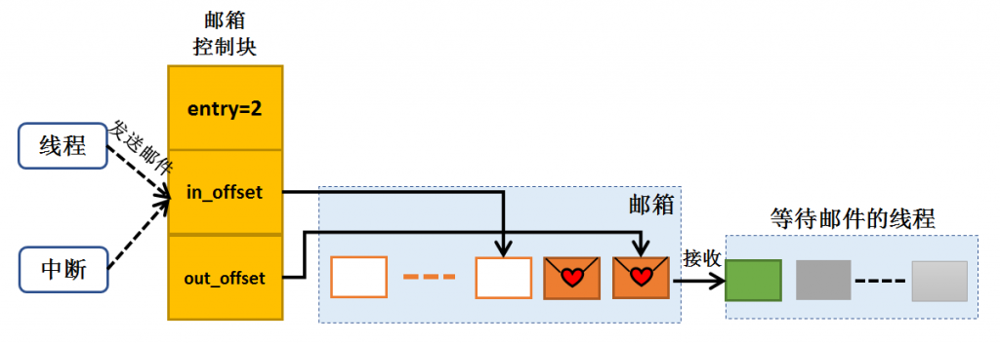
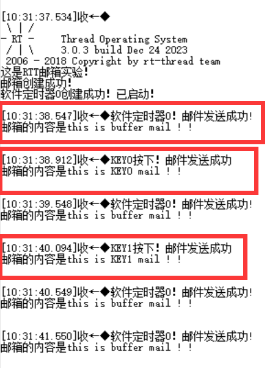

Github链接：[HawkJ02/RT-Thread\_Handmade: 手搓Rt-Thread (github.com)](https://github.com/HawkJ02/RT-Thread_Handmade)

邮箱就是邮箱，线程间可以通过发邮件的形式进行通信，与消息队列类似，但是比消息队列更加节省空间，因为邮箱中存储的都是32位的地址，就像是邮寄圣诞卡片一样，我不需要把超级无敌大的圣诞礼物塞到邮箱里，而是把这个礼物在屋子里的位置写在卡片上，然后放到邮箱里面，那么朋友就可以根据这个地址去找到礼物，这样便提高了效率。

下图可见，线程和终端将圣诞卡片放到邮箱中，in\_offset会偏移，可以选择FIFO模式或者PRIO模式，选择是先进先出还是优先级，发送和接收线程如果在等待都会挂起在邮箱上，接受时接收线程会把卡片取走，out\_offset也会偏移，然后接收线程可以通过卡片上的地址获取到数据。

软件定时器在以前的章节中已经详细介绍过了，看看现象叭！

#### 发射结构体

在定义时：  
`// 定义消息结构体`  
`struct msg {`  
`rt_uint8_t *data_ptr; // 指向数据块的指针`  
`rt_uint32_t data_size; // 数据块的长度`  
`};`

在发射线程中：  
`struct msg* msg_ptr;  
// 分配消息结构体内存  
msg_ptr = (struct msg*)malloc(sizeof(struct msg));  
// 假设有一段数据需要发送  
char data[] = "Hello, Embedded Systems!";  
int data_length = sizeof(data);  
// 填充消息结构体  
msg_ptr->data_ptr = (rt_uint8_t*)data;  
msg_ptr->data_size = data_length;  
// 发送消息指针给消息邮箱  
rt_kprintf("Sending message...\n");  
rt_mb_send(&mb, (rt_uint32_t)msg_ptr);`  
rt\_free(`msg_ptr`);  

在接收线程中：  
`struct msg* received_msg_ptr;  
if (rt_mb_recv(key_mail, (rt_uint32_t_)&received_msg_ptr,RT_WAITING_FOREVER) == RT_EOK) {_  
// "Received message: %.s\n" 是格式化字符串，其中 %.s 是格式控制符。  
//在这里，%.s 用来输出长度可变的字符串，前面的 .* 会被后面传入的参数替换。  
//具体来说，%.*s 中的 * 表示长度由后面的参数指定，而 s 表示参数是一个字符串。  
rt_kprintf("Received message: %.*s\n", received_msg_ptr->data_size, received_msg_ptr->data_ptr);  
// 释放内存  
rt_free(received_msg_ptr);  
}`
