既然我们使用了RTT实时操作系统，那么相应的，系统也会管理stm32的中断。无论线程具有怎么样的优先级，终端都能够打断线程的运行。一般在操作系统中使用信号量、消或时间标志组等标志中断的发生，将这些内核对象发布给处理线程。

##### 异常与中断的概念

异常与中断的区别主要是事件的来源：

*   异常主要来源于内部，比如系统异常，hardware\_fault等
*   中断主要来自于外部，比如按键中断、串口中断等

##### RTT中的中断

在RTT中我们知道有一个critical函数（临界段），可以保证不被外界的中断所打扰，但是这就造成了在临界段中，中断会被挂起，所以临界段和中断都需要快进快出。

在第六章中我们介绍了stm32的启动文件：[\[手搓RT-Thread\]6、RTT的Shell、启动方式](http://www.hawkjgogogo.com/2023/12/22/%e6%89%8b%e6%90%93rt-thread6%e3%80%81rtt%e7%9a%84shell%e3%80%81%e5%90%af%e5%8a%a8%e6%96%b9%e5%bc%8f/)，在刚开始设置了内存空间后，我们便将中断向量表映射到复位时地址0，中断向量表存储了处理器中断服务程序入口的地址，由于在大多数嵌入式系统中，复位后处理器会从地址0开始执行程序，所以将NVIC放置在地址0。

接着我们将各入口函数的地址丢进中断向量表，比如第一行就是初始化栈指针，DCD代表着”Define Constant Doubleword”，定义一个32位的常量：

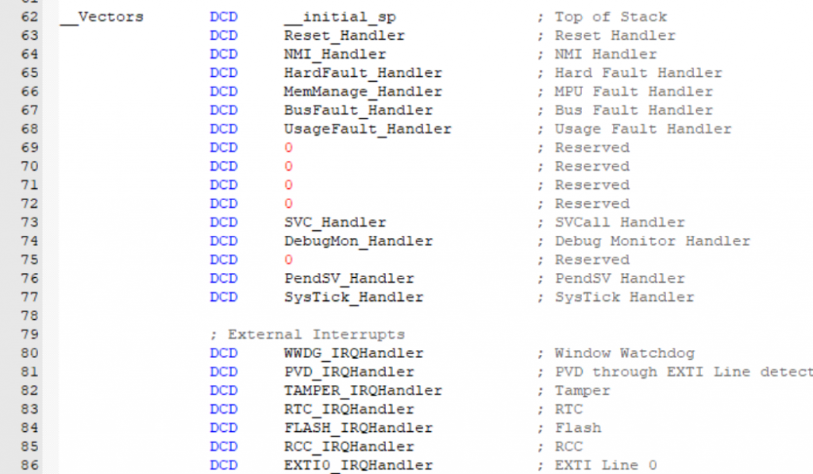

当中断产生时，处理机将按如下的顺序执行：

1.  保存当前处理机状态信息
2.  载入异常或中断处理函数到PC寄存器
3.  把控制权转交给处理函数并开始执行
4.  当处理函数执行完成时，恢复处理器状态信息
5.  从异常或中断中返回到前一个程序执行点

##### 中断产生的时机

中断要么在线程运行时发生，要么在其他中断运行时产生：

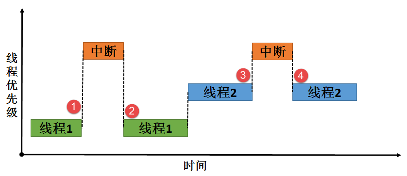

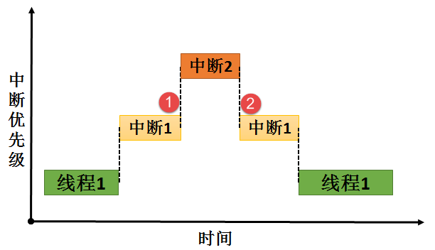

##### 中断延迟

中断延迟就是会在一个卑微的舔狗中断上会发生的事情，作为一个低优先级的中断，在最惨的情况下它需要等待：

出临界段时间+高优先级中断运行时间+在NVIC中断向量表中寻找舔狗中断的时间

真惨！

##### 使用信号量的空闲串口中断接收程序

在之前的文章：[\[stm32宇宙\]\[HAL\]深入学习三种UART模式及其实现](http://www.hawkjgogogo.com/2023/11/21/stm32%e5%ae%87%e5%ae%99hal%e6%b7%b1%e5%85%a5%e5%ad%a6%e4%b9%a0%e4%b8%89%e7%a7%8duart%e6%a8%a1%e5%bc%8f%e5%8f%8a%e5%85%b6%e5%ae%9e%e7%8e%b0/)中我们已经初步了解了USART的三种模式

之前用HAL库写过一次IDLE空闲中断串口接收的程序，今天用标准库复现一下。

首先是一些define：

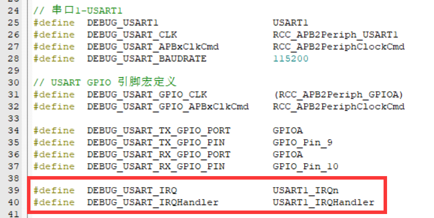

接着修改串口收发的bsp程序，设置NVIC中断向量优先级：

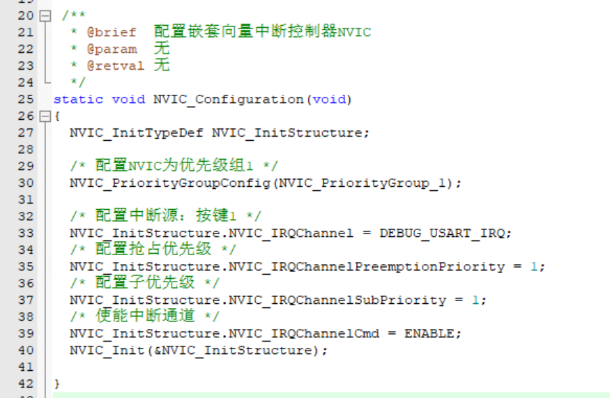

添加idle以及DMA接收相关函数，当使用USART\_DMAReq\_Rx时，USART外设将接收数据并将其存储到接收缓冲区，然后DMA传输将从接收缓冲区将数据传输到内存中：

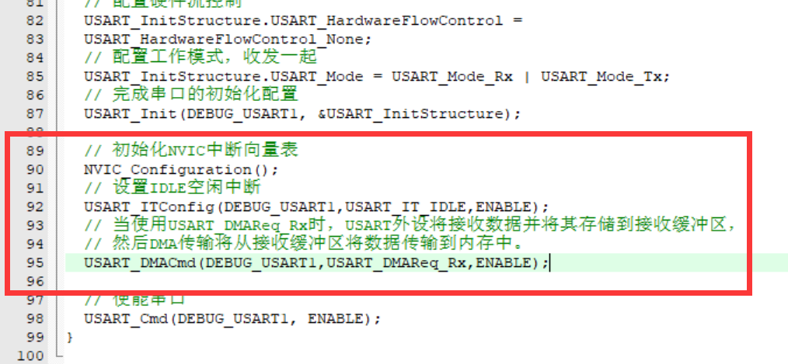

接着就是配置DMA的函数：

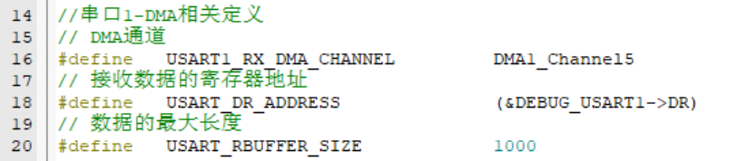

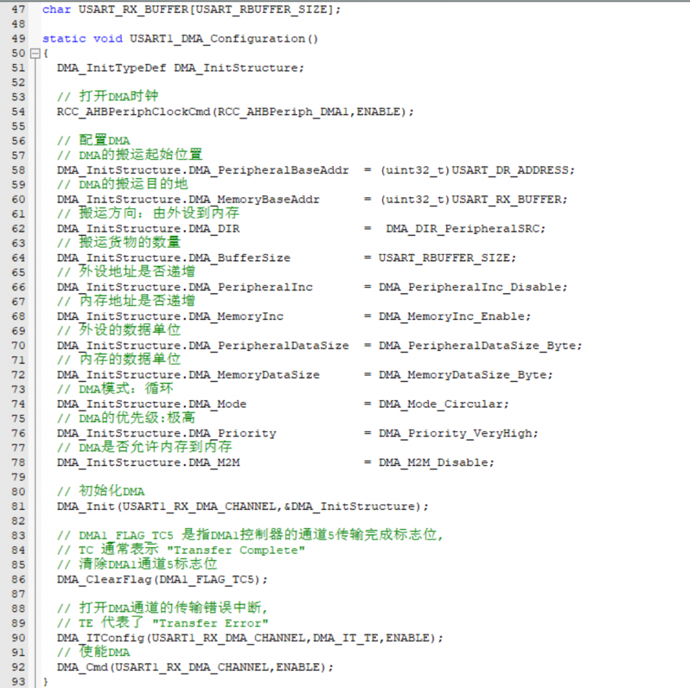

因为USART1\_RX与通道5相连，所以最下方在使能之前清楚了标志位并打开了错误中断。

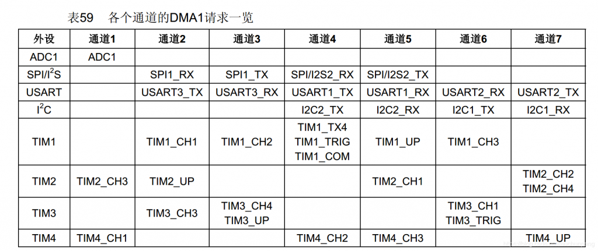

在初始化USART的时候加入DMA初始化函数：

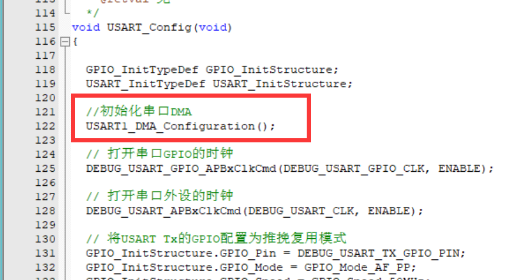

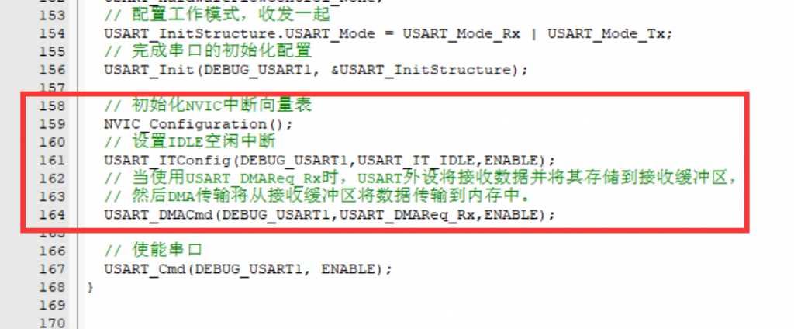

接着写一个使用DMA接收的函数：

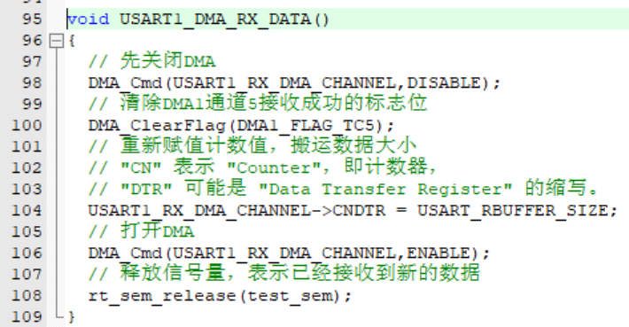

最后，完成串口idle中断处理函数：

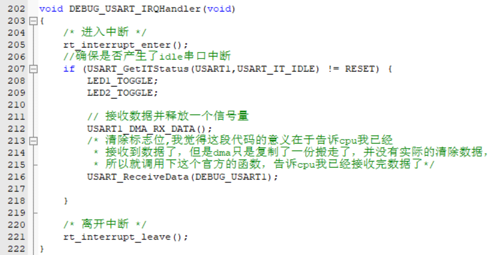

在这个函数中需要注意的是在调用DMA\_RX后，如果仅仅是清除了IT\_IDLE标志位并不能实现，我认为此时mcu还是认为你没有接受数据，会出现：

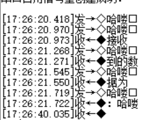

在加上官方的数据接收函数后，虽然说我们没有保存返回值，但我认为这个操作会让cpu默认认为你已经接收了数据，清空标志位。

最后的实验结果是：

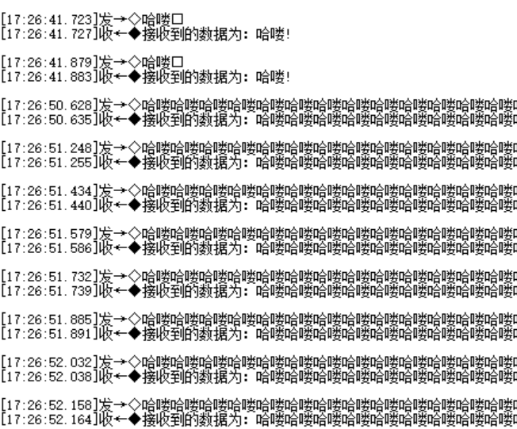
