#### 异步与同步

usart的全称是 **Universal Synchronous/Asynchronous Receiver/Transmitter，**  
**通用同步或异步收发器。  
**我们常用是usart的uart功能即它的异步模式，同步与异步的帧格式如下图所示  

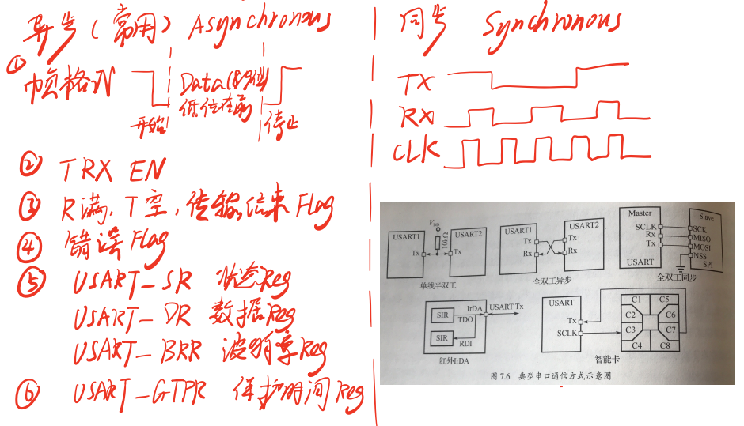

异步通讯只需要三根线，TX、RX、GND，而异步通讯还需要一根时钟线。  
典型的串口通信方式按照下图接线：

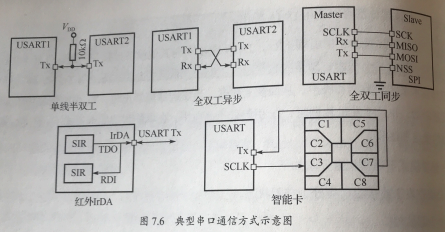

UART（异步通信）是stm32最基础的使用模块之一，其常用模式有三种：轮询，中断，IDLE。

#### UART的主要寄存器

首先UART的寄存器架构如下图所示：

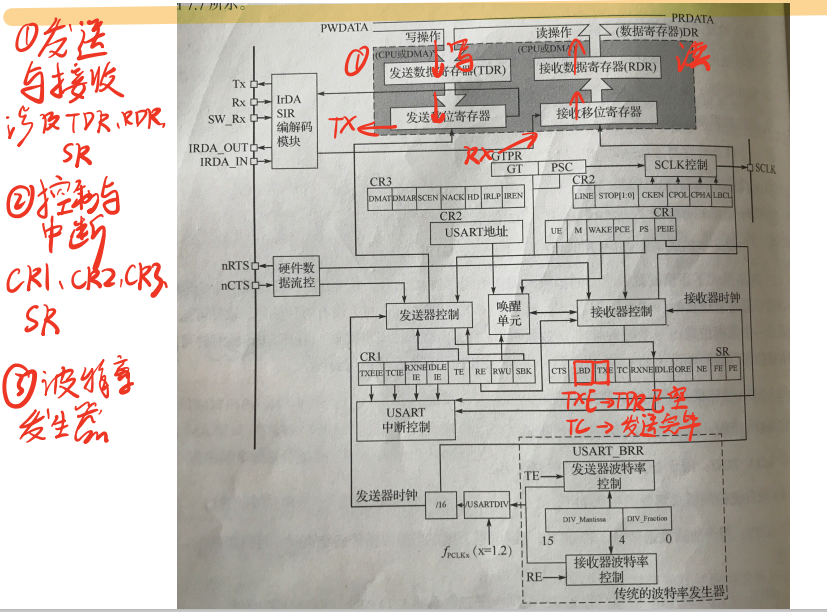

其可以分为三个部分。下图是寄存器表：

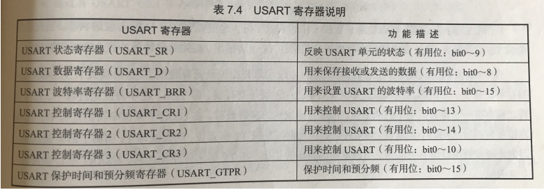

#### 发送字符

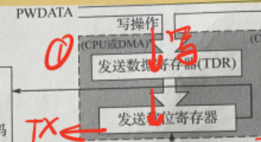

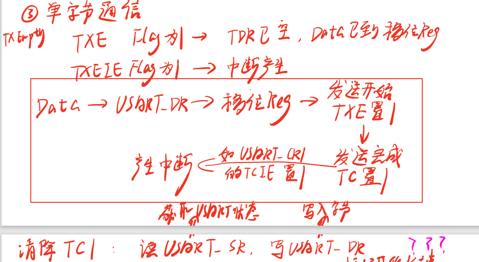

通过检查TXE、TXEIE、TC等寄存器就可以知道串口发送过程的进度并通过判断语句进行进一步的操作

#### 接收字符

下面是接受字符的流程：

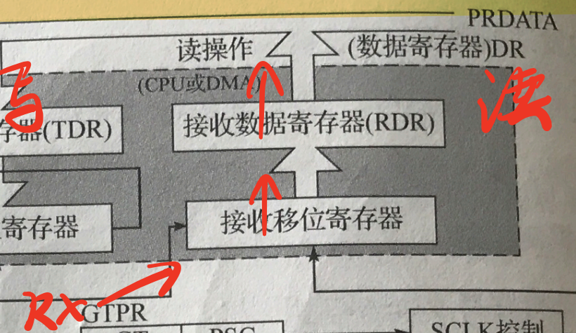

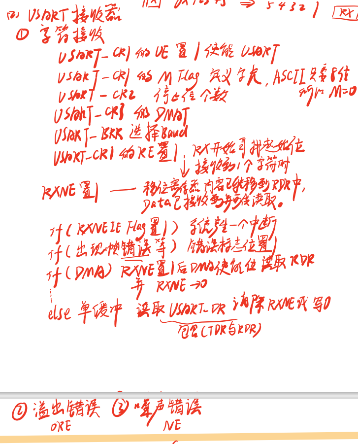

当RE置1后开始寻找起始位，接收到一个字符后，RXNE置1，代表RX NOT EMPTY，接受数据寄存器不是空的，这个时候便叫mcu来读取数据到变量中。

#### 波特率的计算

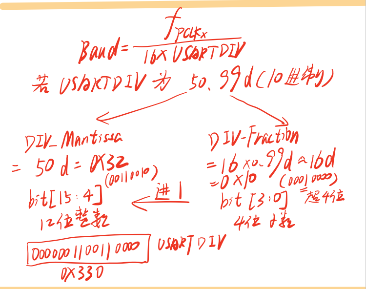

#### 间隙字符

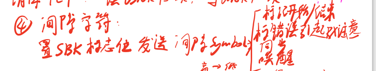

实战部分
----

首先我们需要配置引脚，我使用的是stm32G4开发板，使用cubemx进行初始化。  
配置PC8-15作为GPIO\_Output控制led，配置PD2为GPIO\_Output控制锁存器（锁住led的电平）的控制脚。

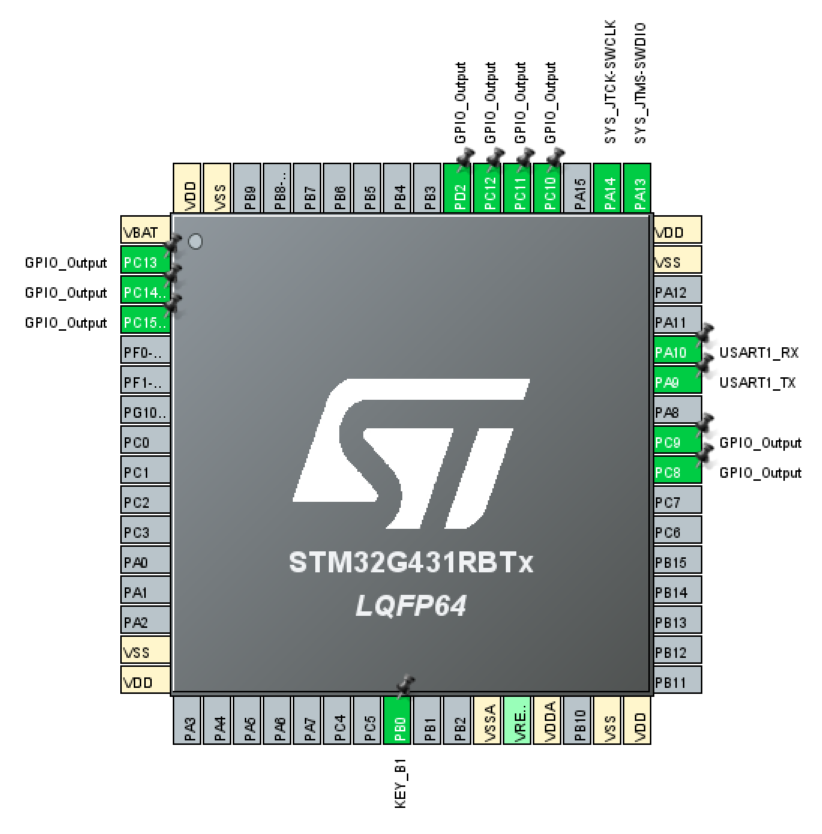

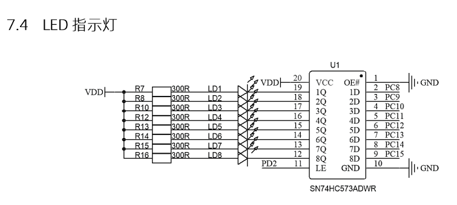

#### 轮询方式

配置UART1为异步通信 Asynchronous。主要用到两个函数

HAL\_UART\_Receive(&huart1,rec\_buffer,2,HAL\_MAX\_DELAY);  
HAL\_UART\_Transmit(&huart1,rec\_buffer,2,100);

注意不要在此while循环中delay过长时间，并且在delay过长时间后连续发送数据，否则可能会导致堵塞。因为程序还在delay程序中时发送的数据没有RX进行接收（也有可能是NVIC优先级的问题，HAL\_DELAY使用的系统滴答时钟优先级最低），导致程序堵塞。

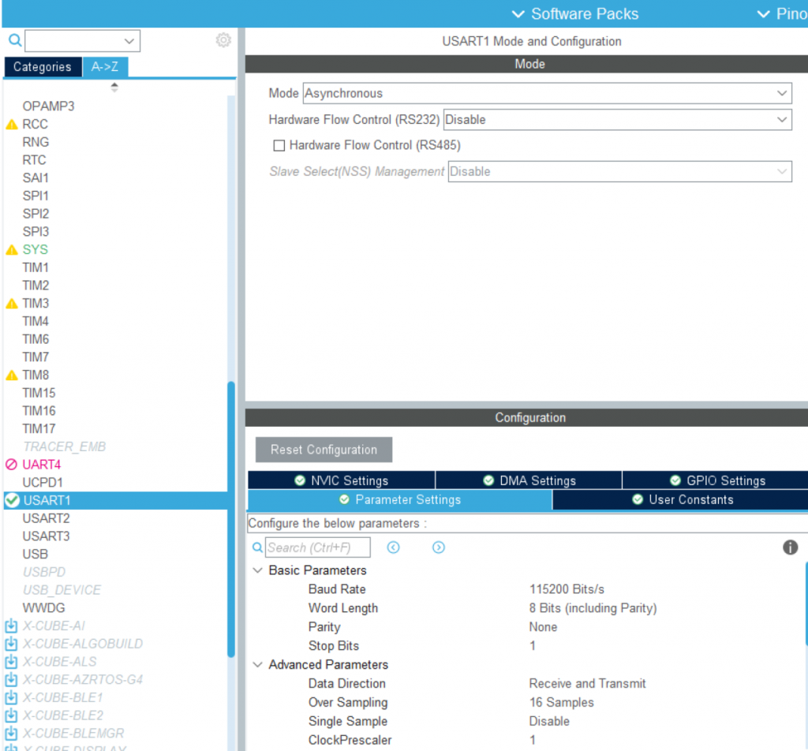

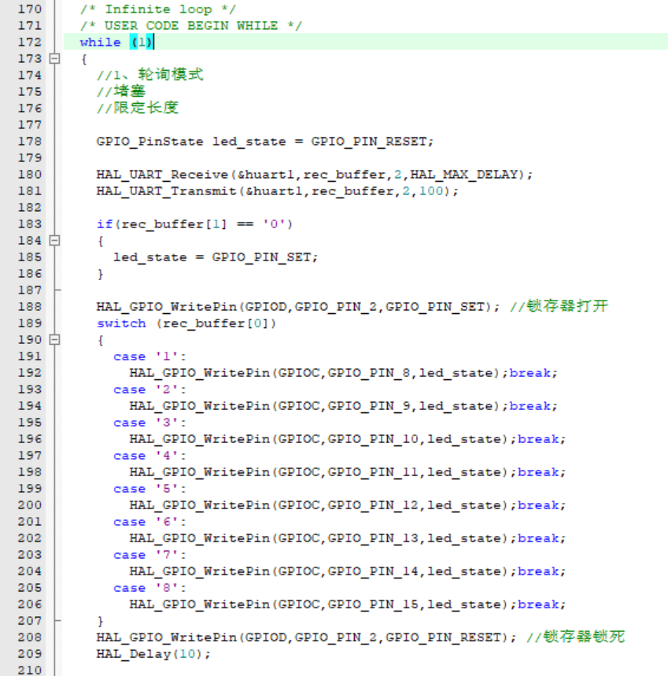

#### 中断（DMA）方式

使用DMA会自动使用到中断，所以我们配置DMA：

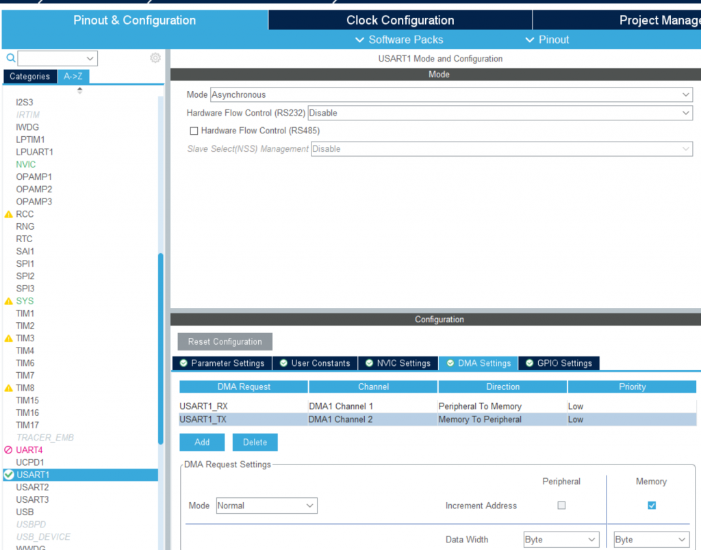

再配置中断：

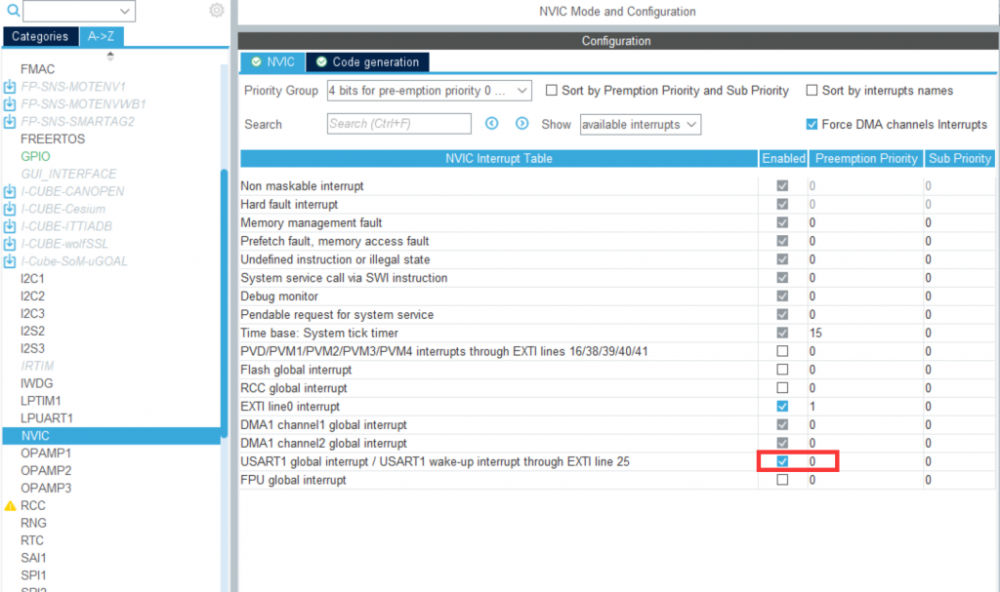

主要用到的函数是：

```
HAL_UART_Receive_IT(&huart1,rec_buffer,2);
或者HAL_UART_Receive_DMA(&huart1,rec_buffer,2);
```

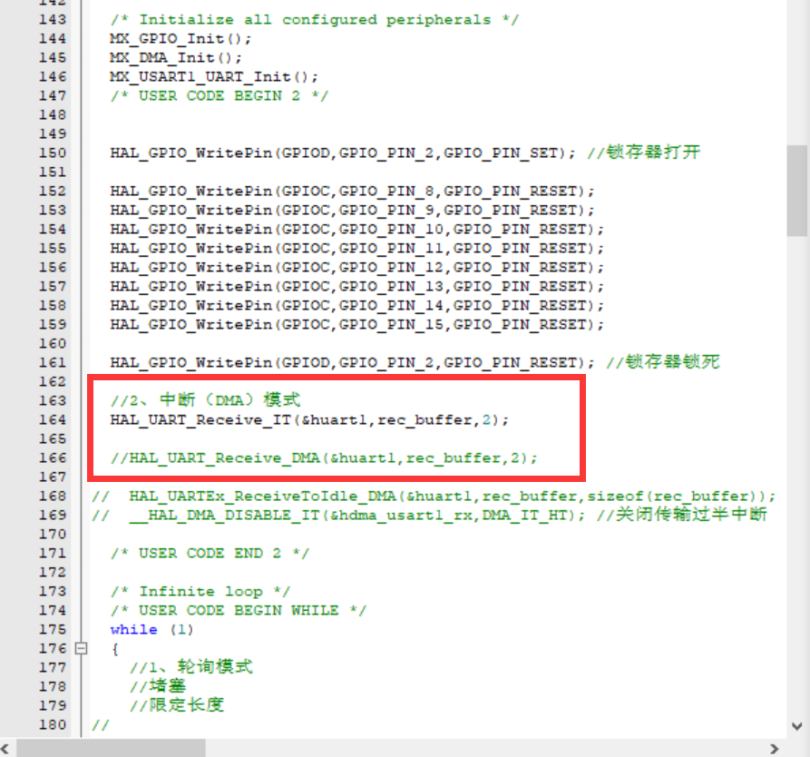

与之前在while循环中写轮询模式不同，  
HAL\_UART\_Receive\_IT(&huart1,rec\_buffer,2);需要写在while循环的上面，类似于一个初始化的操作——打开UART接收器的中断。接下来如果RX有数据进来就会进入中断处理函数。

接下来中断处理函数会调用回调函数：定义  
void HAL\_UART\_RxCpltCallback(UART\_HandleTypeDef \*huart)  
这样我们的进入中断后就会执行这段程序，但是我们还需要在这段回调函数的最后添加HAL\_UART\_Receive\_IT(&huart1,rec\_buffer,2);为的是再一次开启接收中断，否则RX就不会再监听中断了。

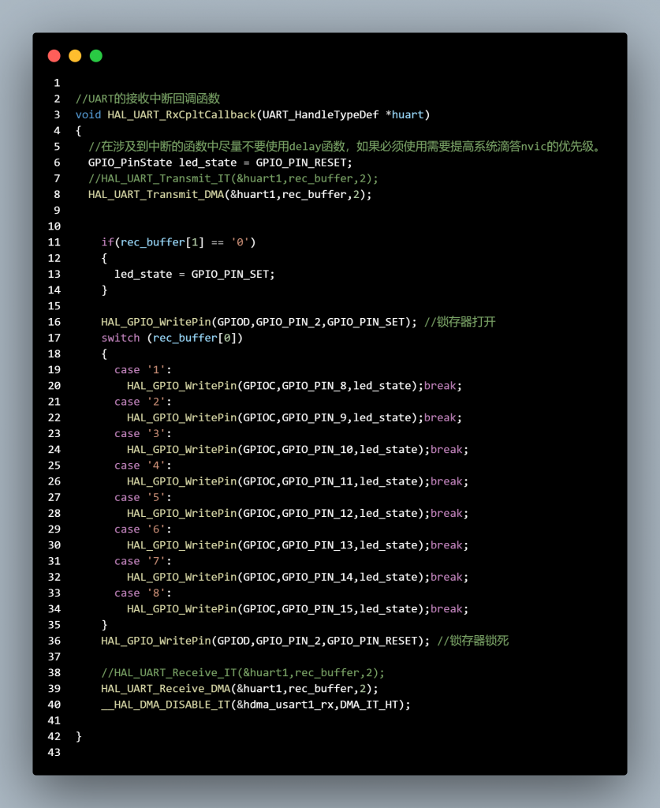

### IDLE空闲中断

这个是一个非常有价值的概念，因为无论是轮询还是dma中断都需要知道信息的长度，如果你想要给单片机发送无限长的一个数据，就必须使用IDLE空闲中断。

类似于中断的方式，我们使用：HAL\_UARTEx\_ReceiveToIdle\_DMA(&huart1,rec\_buffer,sizeof(rec\_buffer));  
打开IDLE中断的接收监听。

修改回调函数（不是上面的，IDLE是扩展的UARTEx），这里也需要在中断处理完毕后重新打开IDLE中断：

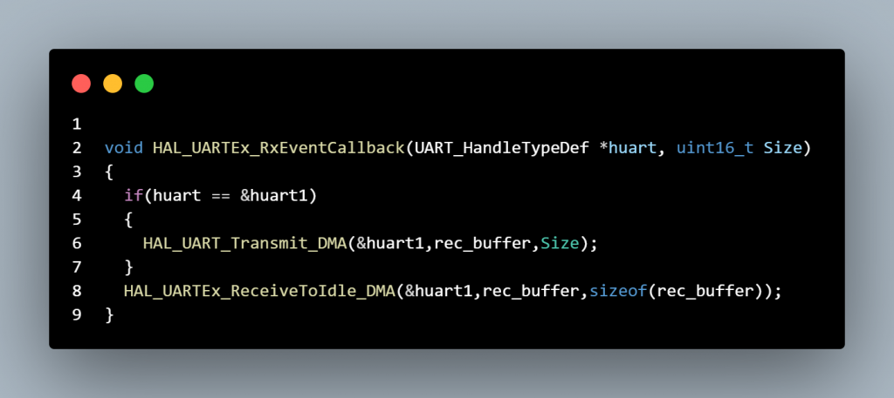

总结
==

轮询：最快捷，但是必须放在while里会堵塞，有限长

中断（dma）：最方便，但是数据有限长

IDLE空闲中断（dma）：在一定程度上最完美。
