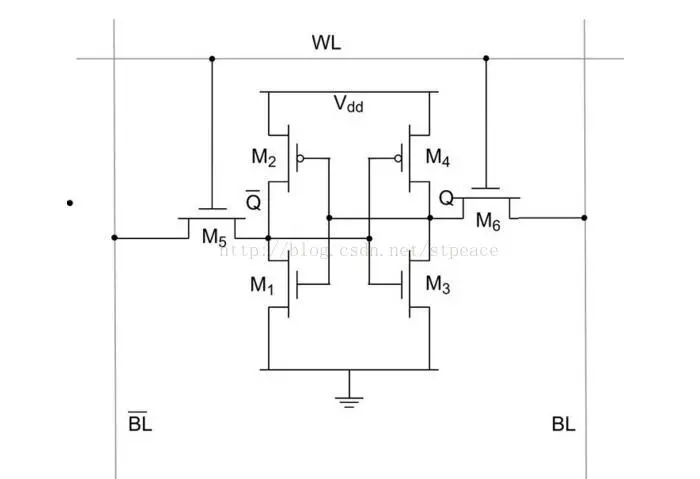
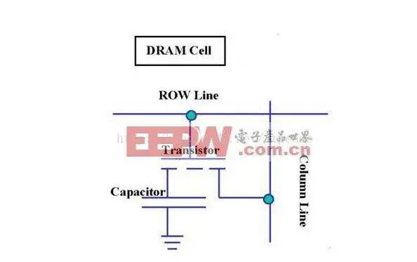

其实这俩玩意儿并没有什么爱恨情仇，DRAM大致是SRAM的儿子罢了（笑）。

SRAM是静态随机存储器，想访问哪里就访问哪里，SRAM的电路：

SRAM保存一个BIT居然需要6个晶体管！所以它贵！但是快啊！它进行的都是晶体管运算。SRAM一般用于做高速缓存存储器，在CPU和内存之间做高速缓存。

那么它的儿子DRAM就是为了降低它的造价，DRAM的电路图：

可以看到DRAM存储一个BIT只需要一个晶体管和一个电容，它的数据实际上是存储在电容里面的，所以需要实时进行动态的刷新，即Dynamic RAM，动态RAM，一个需要动态刷新的RAM。

因为电容你充满电了之后它会不断地漏电，没有电之后会不断地充电，所以需要不断地去刷新电容，以1/2为分界线，大于的充满电，小于的清空电量。

由于DRAM的价格低，集成度高，所以可以用做内存，量大！

#### 总结

SRAM：工艺复杂，速度快，价格高——高速缓存。

DRAM:电容+一个晶体管，速度较慢，便宜——内存。
