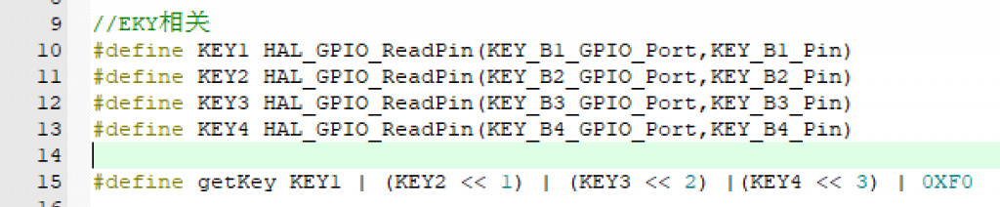
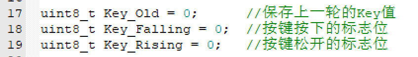
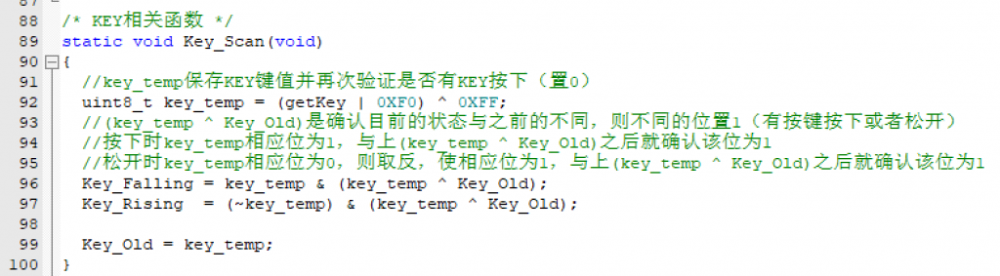
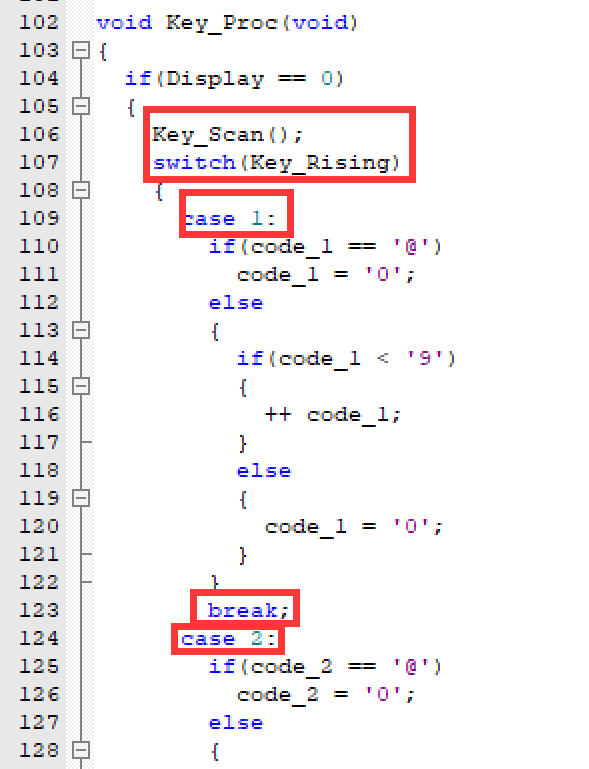

在每一届蓝桥杯的赛题中都会使用到B1-B4这四个按键中的几个，那么在没有参考的情况下，我认为理解是最好的记忆方式。

##### 基础模块

基础模块包含了按键触发以及消抖，本模块提供一种标准化的写法，并使用逻辑消抖，可能乍一看很复杂，但是理解之后你就能得心应手地在考场中写出来。

首先是最基础的读取四个按键当前值的操作，我使用的是类似于操作系统中的就序列表的操作：用一个8位二进制数的低四位分别存储四个按键的键值。

例子：四个按键在没有被按下时都是高电平，则二进制数-1111 1111-（高四位无效），如果第一个按键按下（该按键对应位变成低电平）就会变成二进制数  
\-1111 1110-，在理解这个的基础上我们就继续处理数据。

接着我们需要声明三个全局变量：

然后我们开始重头戏，逻辑消抖，处理数据，**详见注释**：

例子：当key\_Old = 0xFF （初始状态，没有按键被按下），按键B1被按下，  
getKey = 0XFE（二进制-1111 1110）  
key\_temp = (0XFE | 0XF0) ^ 0XFF = 0XFE ^ 0XFF （异或就是找不同）  
\= 0X01（二进制-0000 0001）  
接着keyFalling首先通过(key\_temp ^ Key\_Old)找上一次数据与这次数据的不同，如果确实有所改变，那么就把有变化的那个地方赋值给Key\_falling（key\_temp的计算结果），KeyRising同理。  
最后将当前值赋值给Key\_Old。实现了逻辑消抖的功能。

此时，Falling或者Rising中存储的就是改变的位

*   值为1（0000 0001）——KEY1
*   值为2（0000 0010）——KEY2
*   值为4（0000 0100）——KEY3
*   值位8（0000 1000）——KEY4

最后就是使用switch语句检测Key\_Rising，也就是按键松开的时候，**记得break;**

后面如果有做到类似的题目会拓展双击、短按、长按等代码。
