13届省赛题目在一定程度是比较简单的，考察的十分基础。  
类似于制作了一个保险箱的基本功能。

题目：  
首先硬件框图可以大致看一看，使用到的模块有

*   LED
*   LCD
*   PA1输出PWM波
*   按键（4个）
*   串口通信

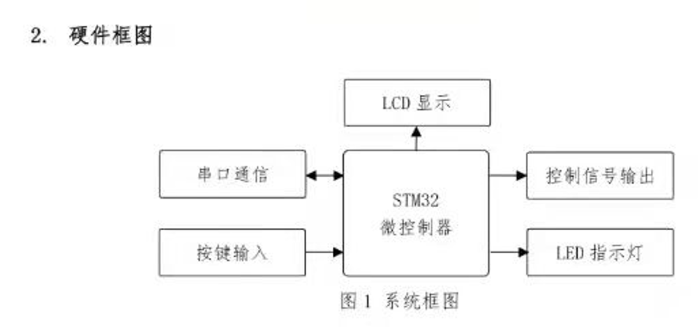

我们用模块化的思想去解构这个设计。首先查看文档中的基础功能：

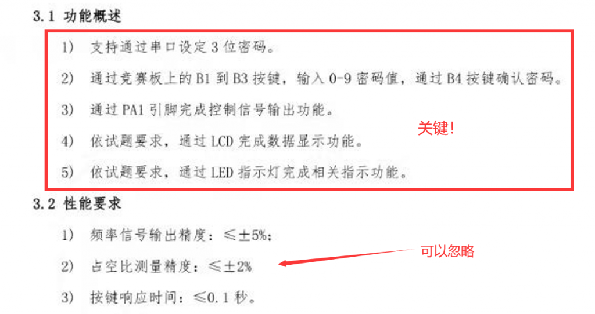

在配置stm32cubemx的时候，我的习惯是先尽可能找齐所有的需要配置的引脚，然后再生成文件。

赛题软件包里面应该是有HAL\_06\_LCD这个参考例程的，我们在其上进行修改即可。

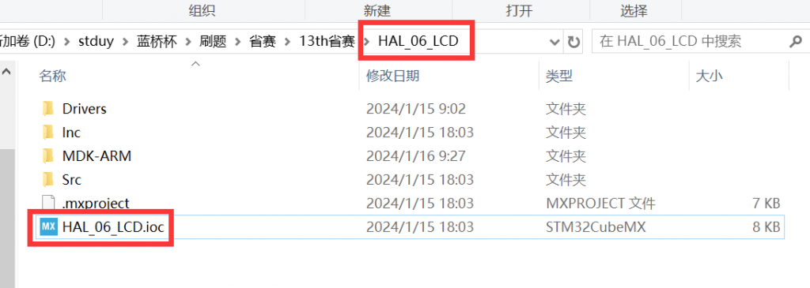

##### 第一步 确认RCC配置

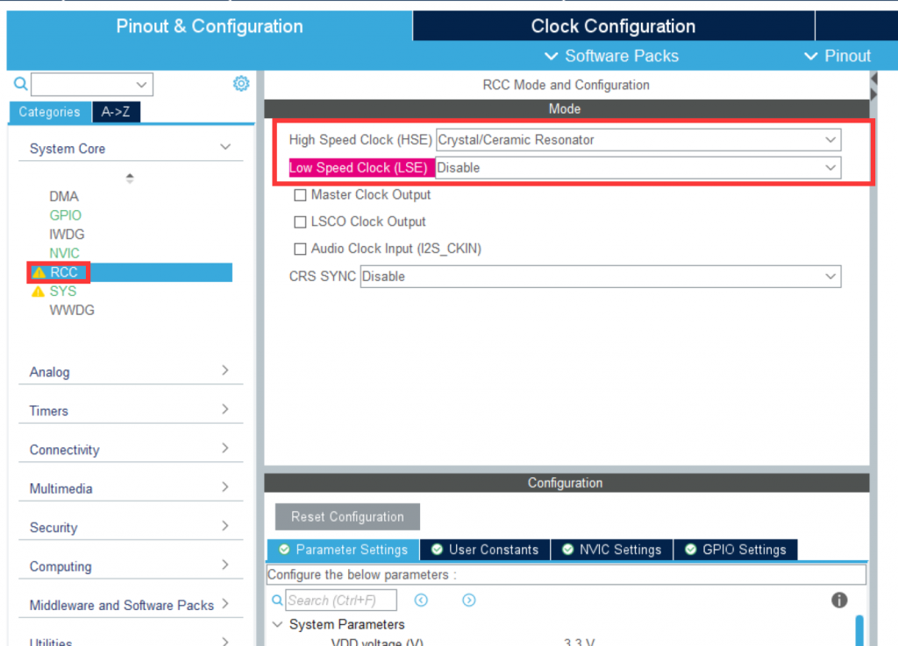

##### 第二步 确认SYS系统时钟配置

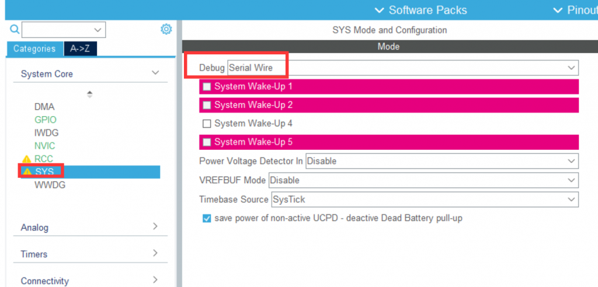

##### 第三步 在右侧窗口配置引脚

详见图中注释，复习一下上面我们提到的需要配置的模块引脚：

*   LED
*   LCD（自带）
*   PA1输出PWM波
*   按键（4个）
*   串口通信

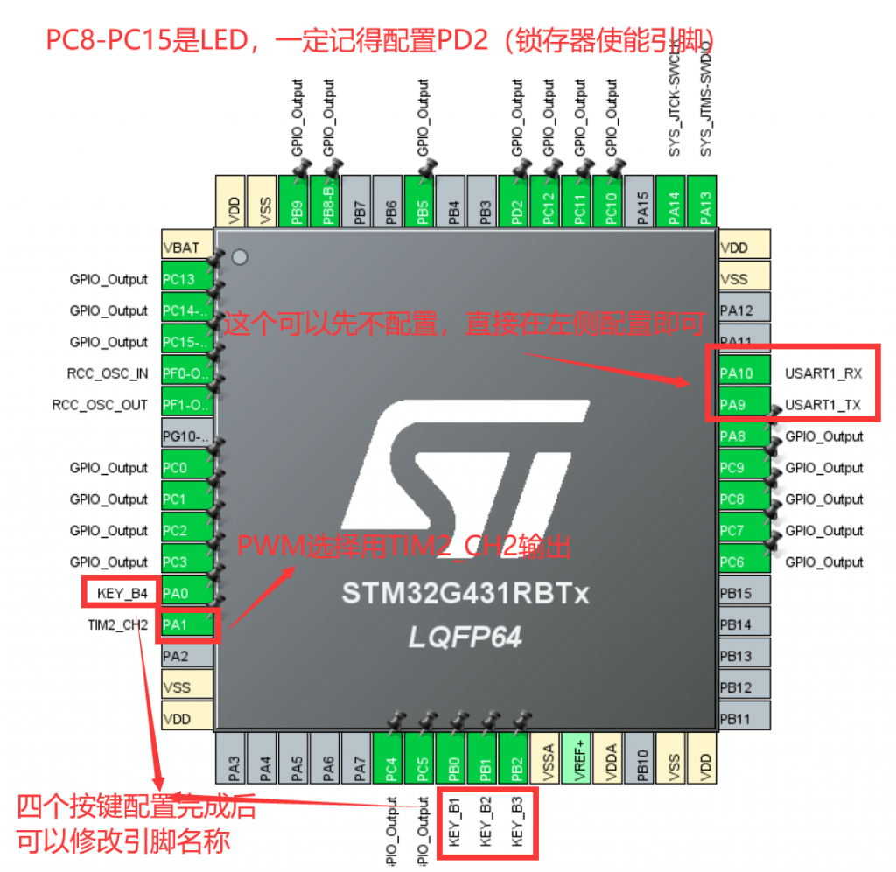

##### 第四步 配置串口通信

我们使用的是中断接收模式，就是如果有消息进来就会触发中断然后接收数据。  
参考以往文章：[\[stm32宇宙\]\[HAL\]深入学习三种UART模式及其实现](http://www.hawkjgogogo.com/2023/11/21/stm32%e5%ae%87%e5%ae%99hal%e6%b7%b1%e5%85%a5%e5%ad%a6%e4%b9%a0%e4%b8%89%e7%a7%8duart%e6%a8%a1%e5%bc%8f%e5%8f%8a%e5%85%b6%e5%ae%9e%e7%8e%b0/)

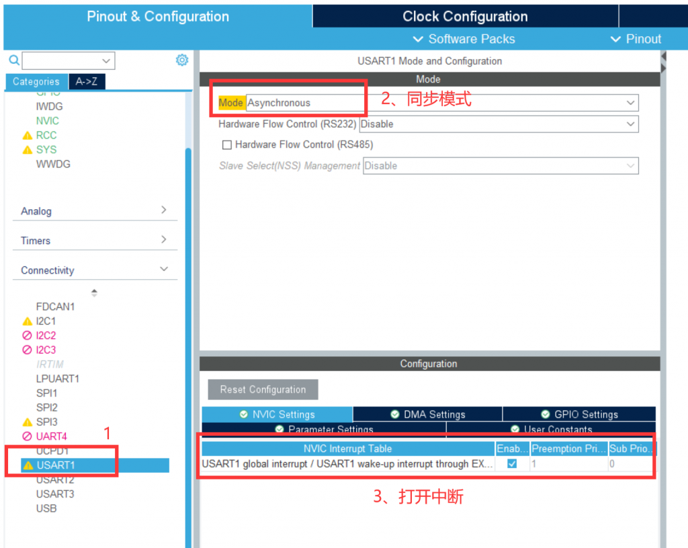

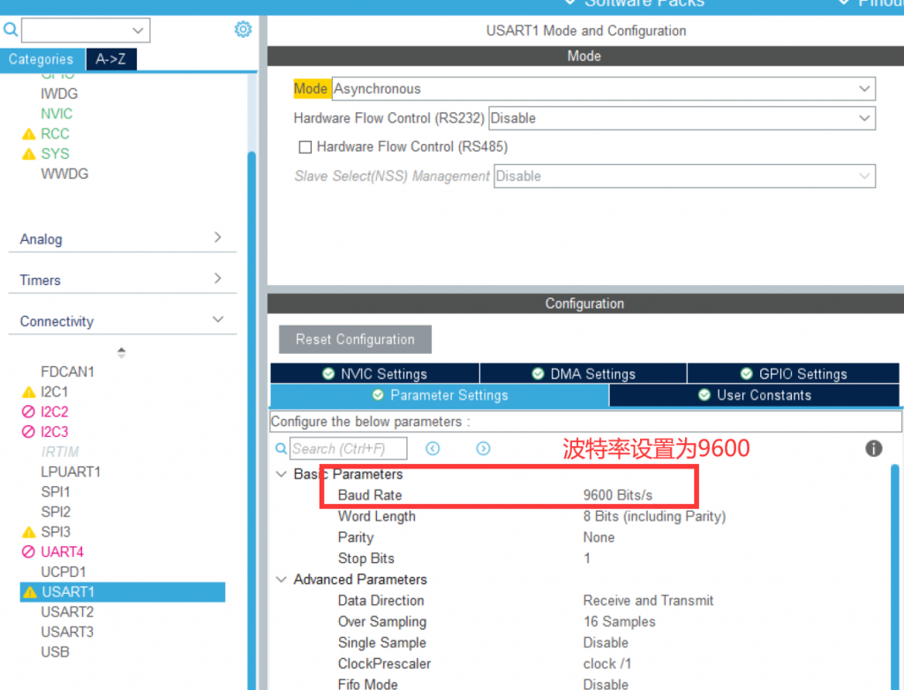

##### 第五步 设置按键输入GPIO为高电平

懂得都懂（狗头）

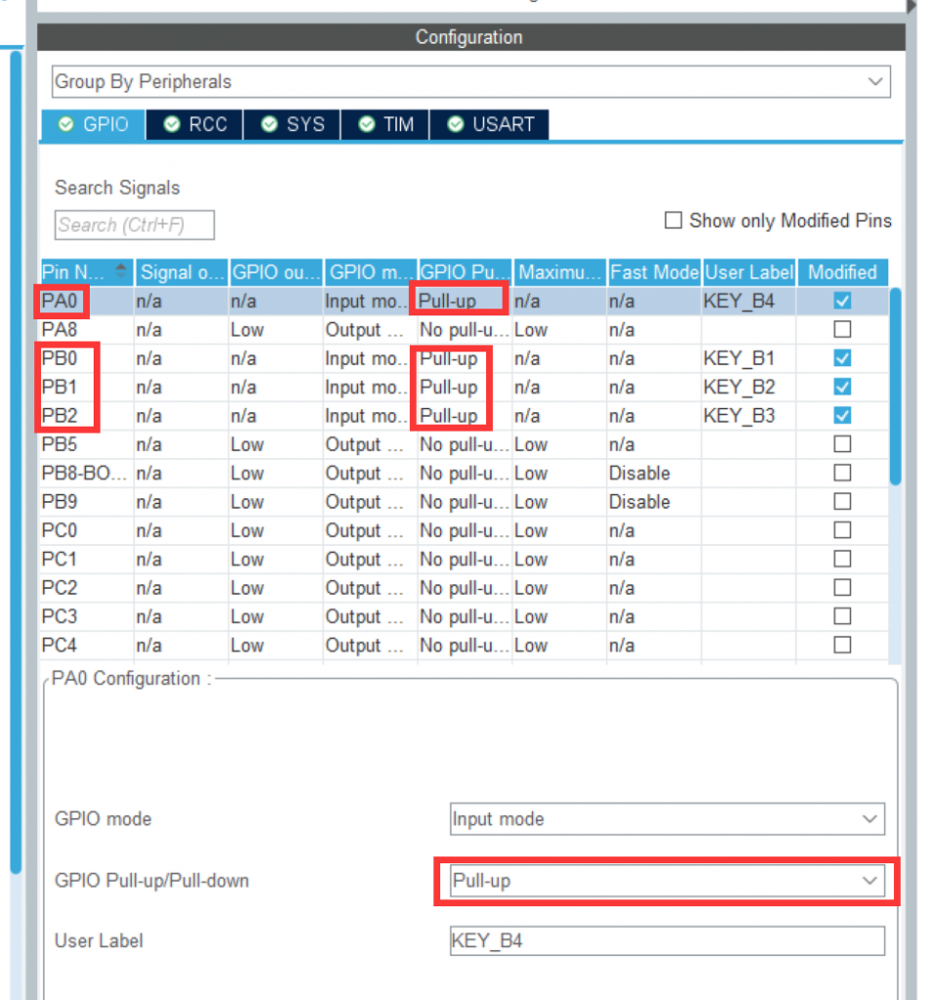

##### 第六步 设置TIM2（通过PA1输出PWM波）

下图要认真看噢，在后面如果有时间还会更新更详细的解释。

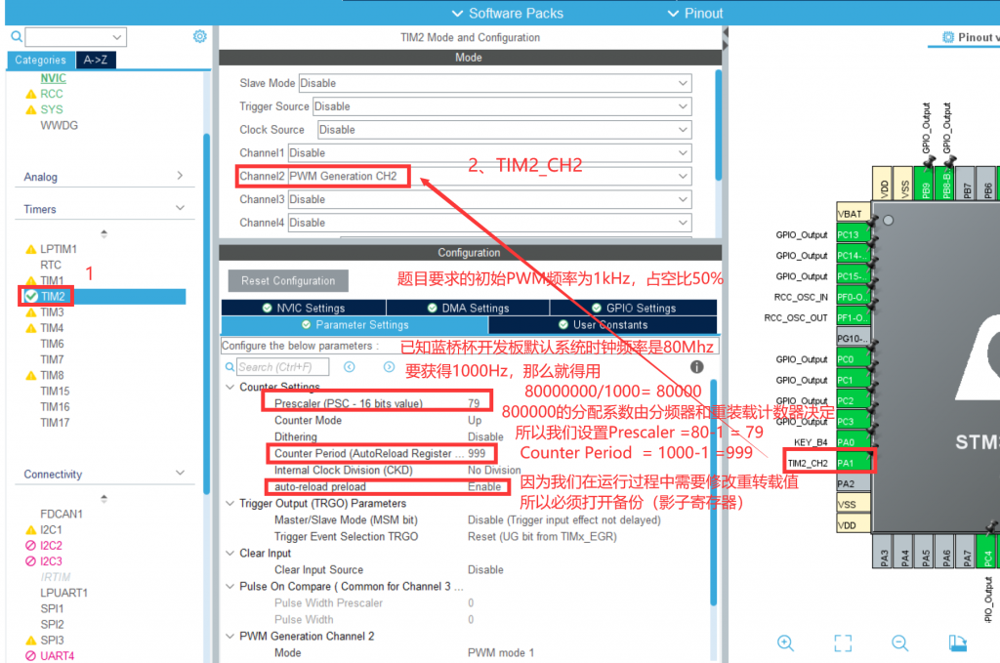

##### 第七步 生成MDK文件

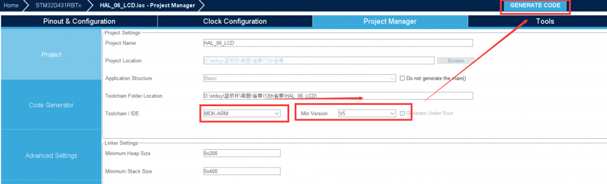

**我习惯新建一个config.c和config.h，在其中防止我的代码，而不是创建很多比如led.c、key.c类型的文件，因为这只是比赛，能方便则方便，当然在日常开发过程中，高质量的程序是必须。**

在main.c中我们只使用两个函数：

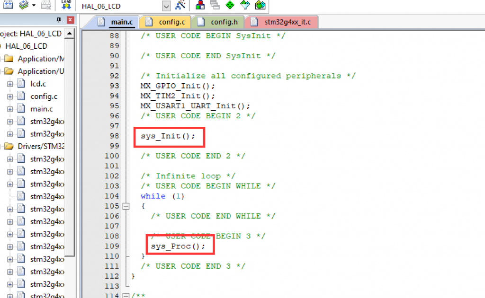

sys\_Proc()中就是不同模块的代码在循环执行，详见下文。

##### 第八步 LCD模块

都做成模块了，那么直接传送到下面的文章吧！

[\[蓝桥杯\]LCD模块 - www.hawkjgogogo.com](http://www.hawkjgogogo.com/2024/01/16/%e8%93%9d%e6%a1%a5%e6%9d%aflcd%e6%a8%a1%e5%9d%97/)

接着我们看看13th省赛赛题要求：

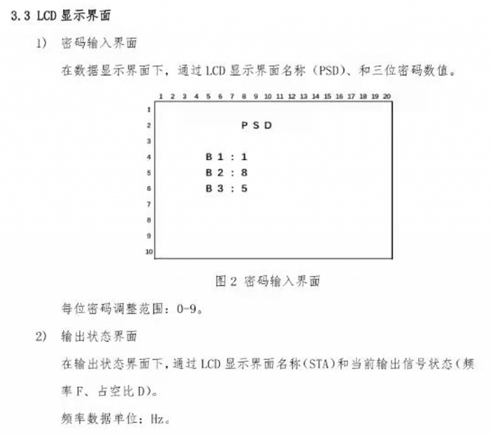

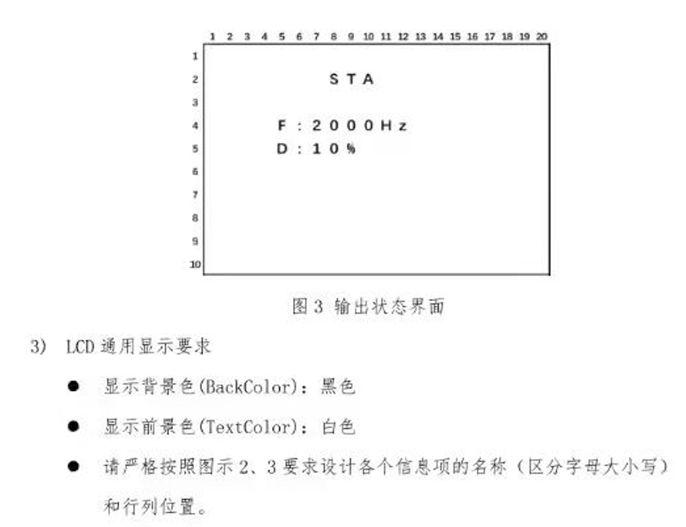

本赛题中的LCD处理代码如下图所示。

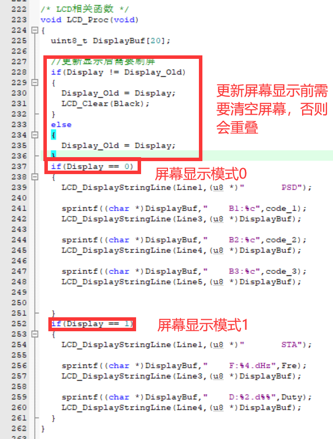

##### 第九步 LED模块

都做成模块了，那么直接传送到下面的文章吧！

[\[蓝桥杯\]LED模块 - www.hawkjgogogo.com](http://www.hawkjgogogo.com/2024/01/16/%e8%93%9d%e6%a1%a5%e6%9d%afled%e6%a8%a1%e5%9d%97/)

接着我们看看13th省赛赛题要求：

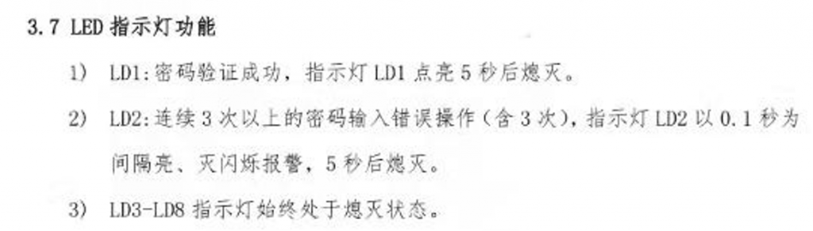

这个要求中有定时的要求，所以我们之后在系统时钟模块中详细介绍，那边是关键哦。

还需要注意的就是LED3-LED8处于熄灭状态，由于LED和LCD的冲突，可能会导致乱闪，所以建议如果发现有这种状况一定要记得添加shutup的函数。

##### 注意事项 LCD与LED冲突

解决方案建议参考下文，可以不改，但是修改一点也很简单：

[\[蓝桥杯\]解决LED与LCD显示冲突（LED乱闪） - www.hawkjgogogo.com](http://www.hawkjgogogo.com/2024/01/16/%e8%93%9d%e6%a1%a5%e6%9d%af%e8%a7%a3%e5%86%b3led%e4%b8%8elcd%e6%98%be%e7%a4%ba%e5%86%b2%e7%aa%81%ef%bc%88led%e4%b9%b1%e9%97%aa%ef%bc%89/)

##### 第十步

都做成模块了，那么直接传送到下面的文章吧！

[\[蓝桥杯\]按键模块 - www.hawkjgogogo.com](http://www.hawkjgogogo.com/2024/01/15/%e8%93%9d%e6%a1%a5%e6%9d%af%e6%8c%89%e9%94%ae%e6%a8%a1%e5%9d%97/)

接着我们看看13th省赛赛题要求：

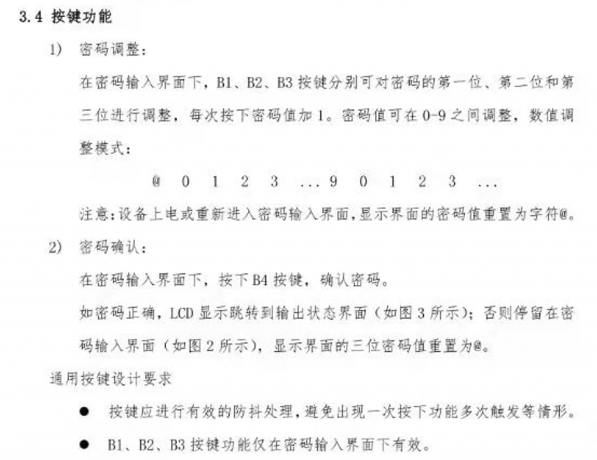

在这一步我们就可以过渡到项目的实施过程，首先我们需要用三个char变量或者一个char\[3\]数组存储密码。

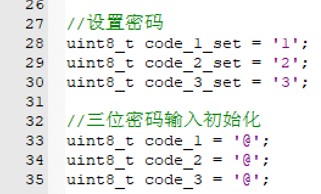

注意此处的char型变量的赋值一定要加引号。

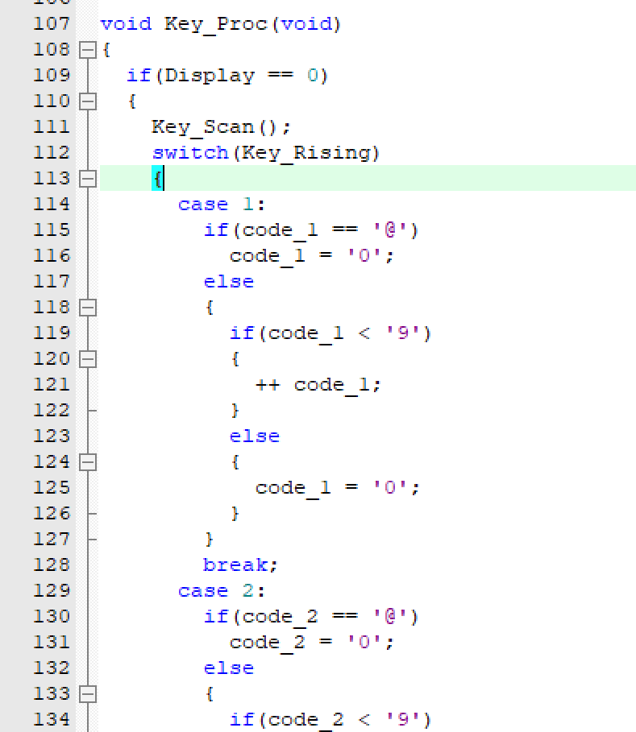

在switch的case语句中按照题目设计代码。

##### 第十一步 系统初始化

初始化LCD以及串口，并打开串口接收中断，启动定时器PWM输出。

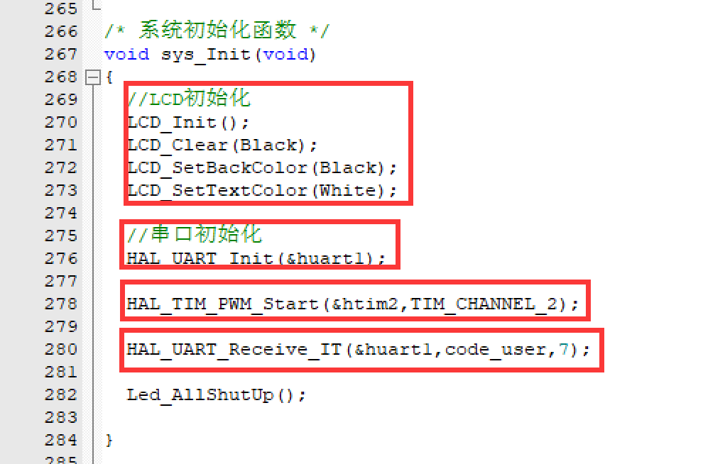

##### 第十二步 系统运行函数

系统运行函数放在while（1）循环中，反复运行。

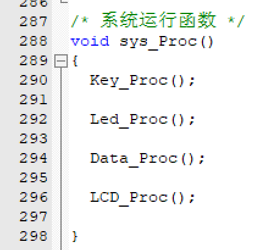

##### 第十三步 进一步设计

以上是所有基础模块的设计步骤，接下来我们需要根据题目要求完善设计，首先是基础功能——密码正确就会进入输出界面5s并使LED灯常亮。

##### 第十四步 使用系统滴答时钟进行定时

在上文配置cubemx的时候我们已经设置了开启系统滴答时钟，其每1ms会触发一次中断进入stm32g4xx\_it.c中的void SysTick\_Handler(void)函数中。所以我们需要定时的话就设置一个全局变量sysCount\[\]，当开启这个计数之后每次进入sysCount就会+1，然后在void SysTick\_Handler(void)中断中再进行判断，是否到达计数时间，这样我们就能够实现定时。

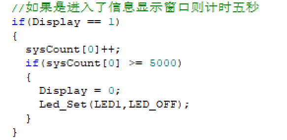

很简单的逻辑，当密码正确，我们只需要设置Display = 1，接着设置sysCount\[0\]=0，然后在系统滴答定时器中断中就会进行计时操作，当进入5000次之后，sysCount\[0\]=5000，那么就会设置Display = 0，下次在进入，就不会满足if条件了，非常完美！

同理，密码输入错误后LED2以0.1s为周期闪烁5s也可以通过这种方法设置。

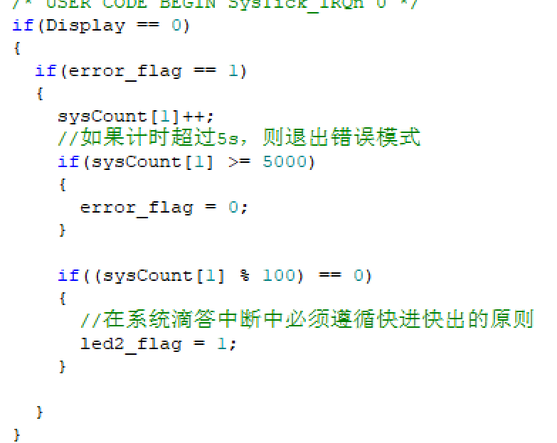

**一定要注意，在中断处理函数中要遵循快进快出的原则。**

我们尽量使用全局变量标志位，比如error\_flag来在标记是否发生错误以及LED2闪烁时间是否到达。详细代码请参考GIT。
