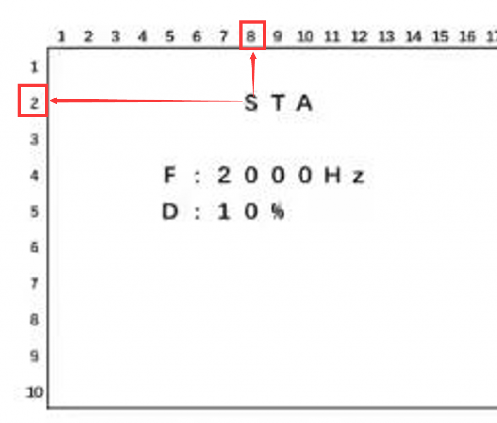
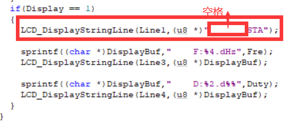
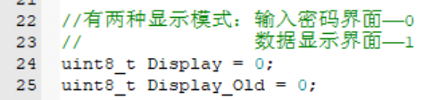
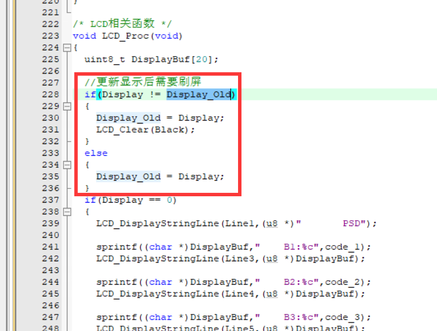
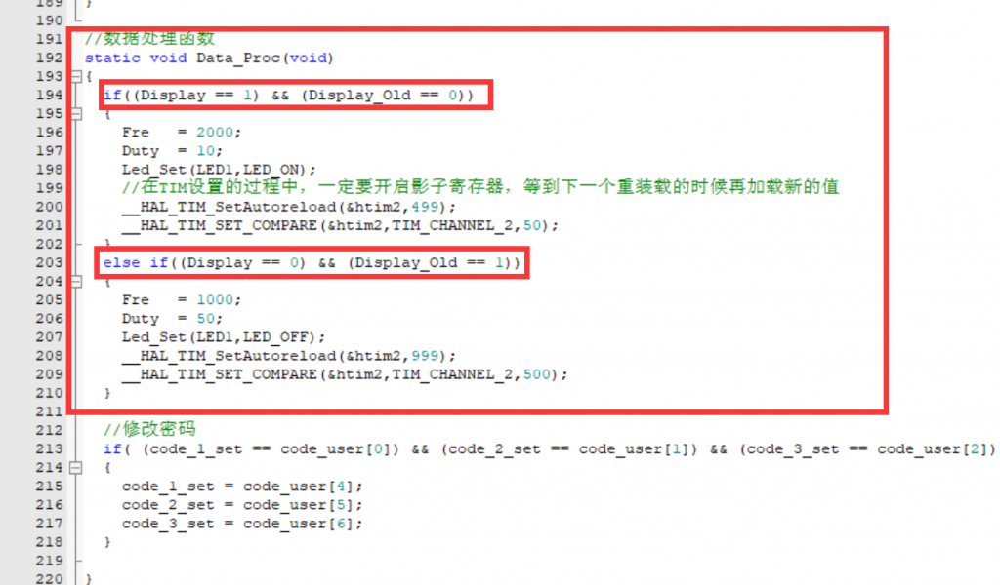
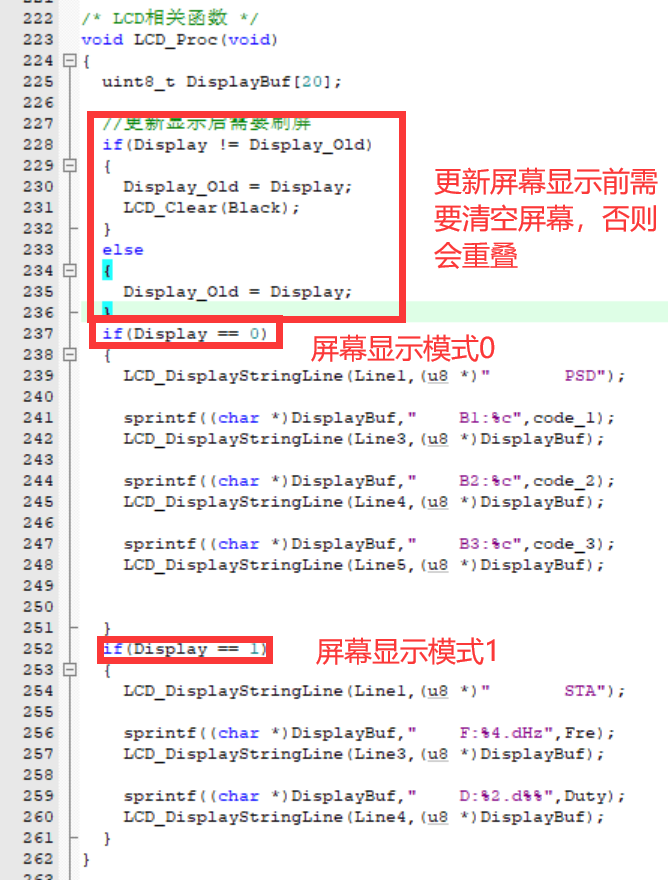
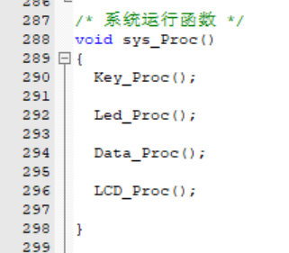

LCD模块基本是调用lcd.c中定义的函数。

#### 着重注意点

显示并不困难，容易出错的是LCD上显示的位置，比如下题

有几个注意的要点：

*   字母大小写！STA别写成sta，没有分的！
*   每个字符的位置！

参考：STA前有七个空格，第一个字符‘S’是从第八位开始的。

##### 基本显示思想

在蓝桥杯的赛题中，LCD显示界面大概率是有多个的，那么使用一个全局变量Display便可以将他们区分出来。

我的建议是最好定义一个Display\_Old，这样的话就可以更方便地切换，在一定程度上防止屏幕闪烁。

并且在切换显示的时候切换数据也能更加方便地设置，比如下方的代码就是在切换显示模式之后，设置不同的PWM波输出。

LCD\_Proc()函数模板

读完上方的代码你的思路应该清晰了。

最后我们在config.c（放在这一个文件里面的原因参考之前的文档（作者还没写））的末尾的函数sys\_Proc()的最小面放置LCD\_Proc()。

