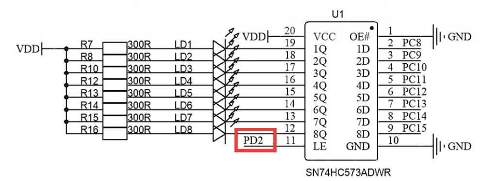
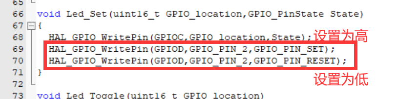
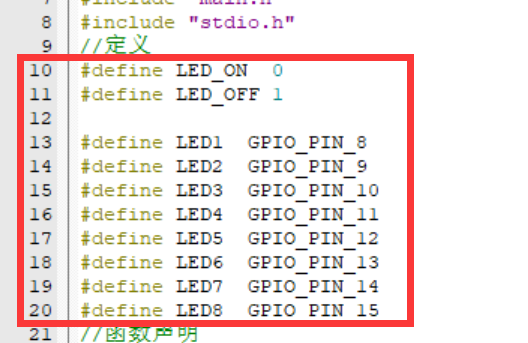
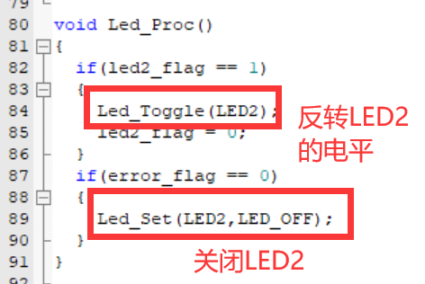
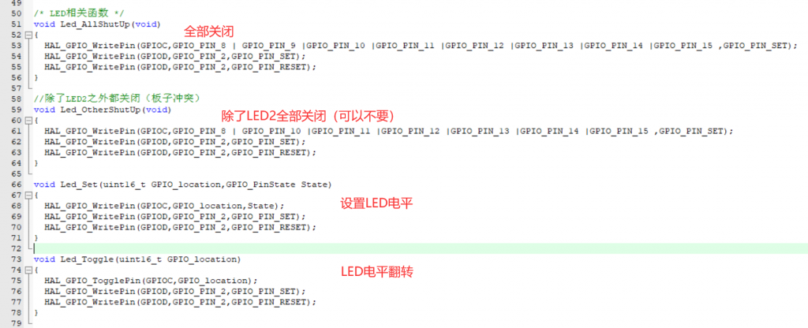

##### LED基础模块

由于CubeMX在生成代码的过程中已经把LED的GPIO初始化，而LED就是通过GPIO来实现控制的。

所以我们只需要使用HAL库的GPIO读写函数就能实现对LED的控制。

蓝桥杯板子的LED和LCD共用部分引脚（一个大坑），所以我们也需要做一些小操作避免冲突。

##### 锁存器

首先，板子官方为了避免冲突是设置了一个锁存器，就像是一扇门，将LCD和LED隔离了，你只有把这扇门打开，你才可以操控LED，而这扇门就是PD2端口。

当PD2设置为高电平的时候这扇门打开，LED可以被改变；LED为低电平的时候，LED便不可以被改变。

那么在考场上是很难记忆这么多引脚的功能的，怎么办呢？你会发现PD2连接着芯片的LE引脚，你可以理解为LOW ENABLE，低电平的时候这个芯片发挥作用，俺么这个芯片发挥什么作用呢——锁存。

总的来说，就是，低电平锁存，这样你记住了吗？来看代码吧！

这样就实现了对LED的电平设置，忘了说了，LED是低电平点亮。

##### 通过自定义提高代码的可读性

那么低电平是0，我们通常理解的点亮是1，这俩是相反的，那么我们为了方便代码的可读性，可以自定义：

这样我们在使用函数的时候可以：

##### 部分LED模块化代码

详细代码请到GITEE或者GITHUB下载

当然最后还是有LED\_Proc()函数就不再多说啦，参考其他文章的思路构建！
