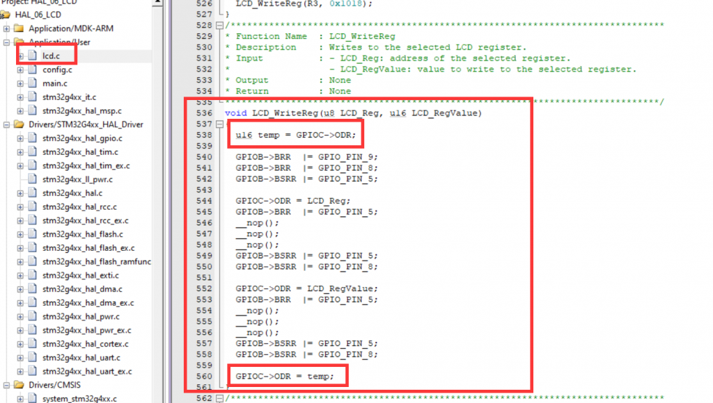
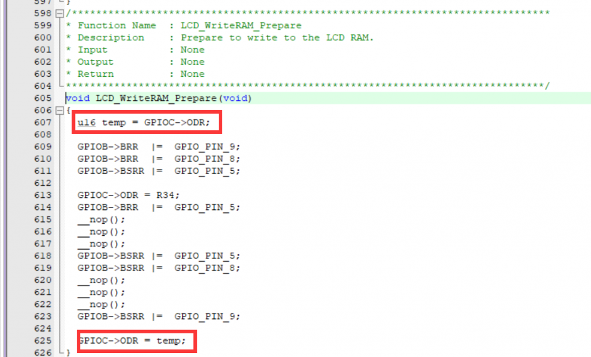
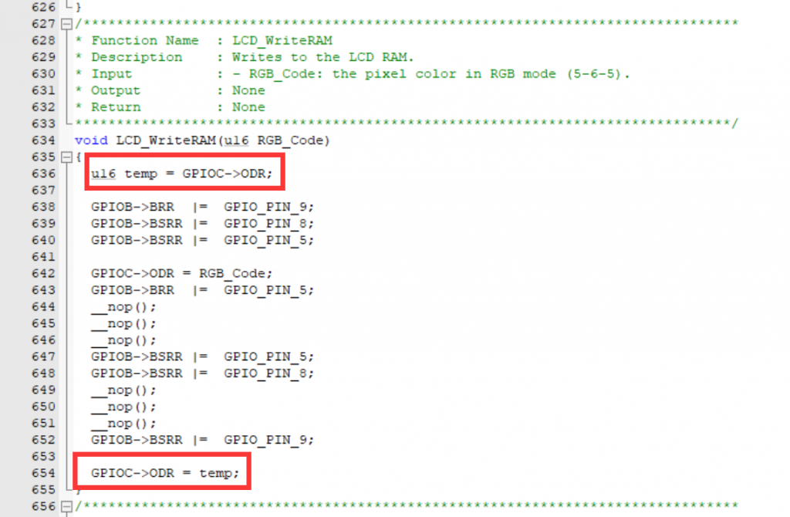
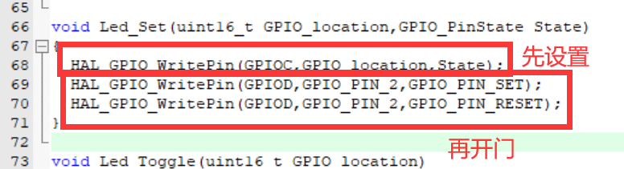

由于LED和LCD的引脚共用问题，所以在一些情况下LED会乱闪。

##### 解决方法1 —— 在lcd.c中添加非常简单的两行代码

我们需要在三个关于写寄存器的函数的首尾添加相同的两行代码。

根据我所坚持的”理解至上主义“，我先介绍这两行的含义。

我们定义了一个u16的变量temp存放GPIOC->ODR:  
ODR寄存器, 控制管脚的高、低电平——低16位有效，写1 高电平， 写0 低电平;

可以理解为，LCD在显示的时候会改变锁存器（门）一边的电平，如果此时门打开了，那么LED就会被影响。那么添加这个temp = GPIOC->ODR的原因就是为了保证LCD在操作的前后，GPIOC->ODR中的值是不变的。就算GPIOC->ODR中的值在这个函数运行的时候被改变了，那么到最后temp中依然会着原来锁存器两端的电平，所以只要在最后把temp中的值再赋给GPIOC->ODR，那么LED就不会受到影响了。完美！

需要修改的有三个函数：

这三个函数差不多是靠在一起的，除了中间夹了一个其他函数。

##### 解决方法2 —— 先设置再开门

如果有其他方法欢迎讨论！
