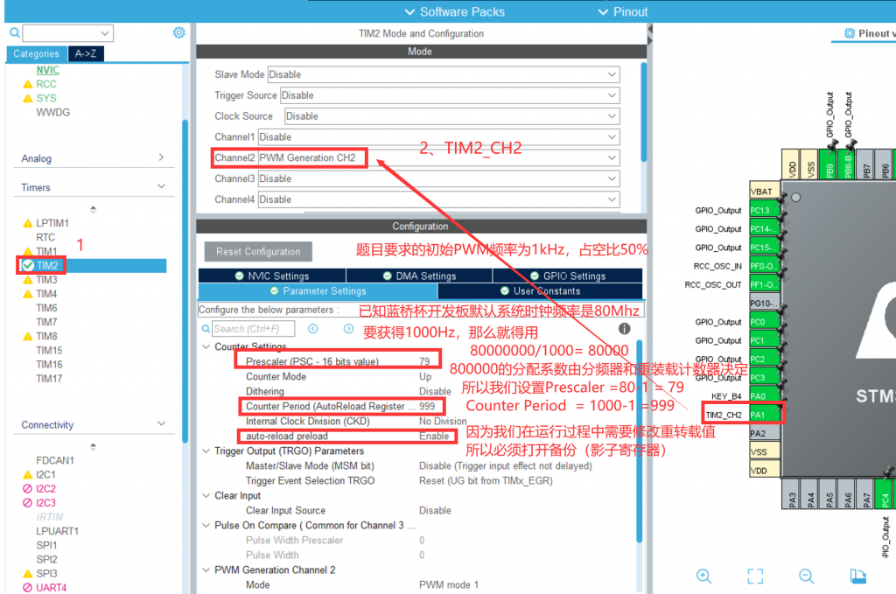
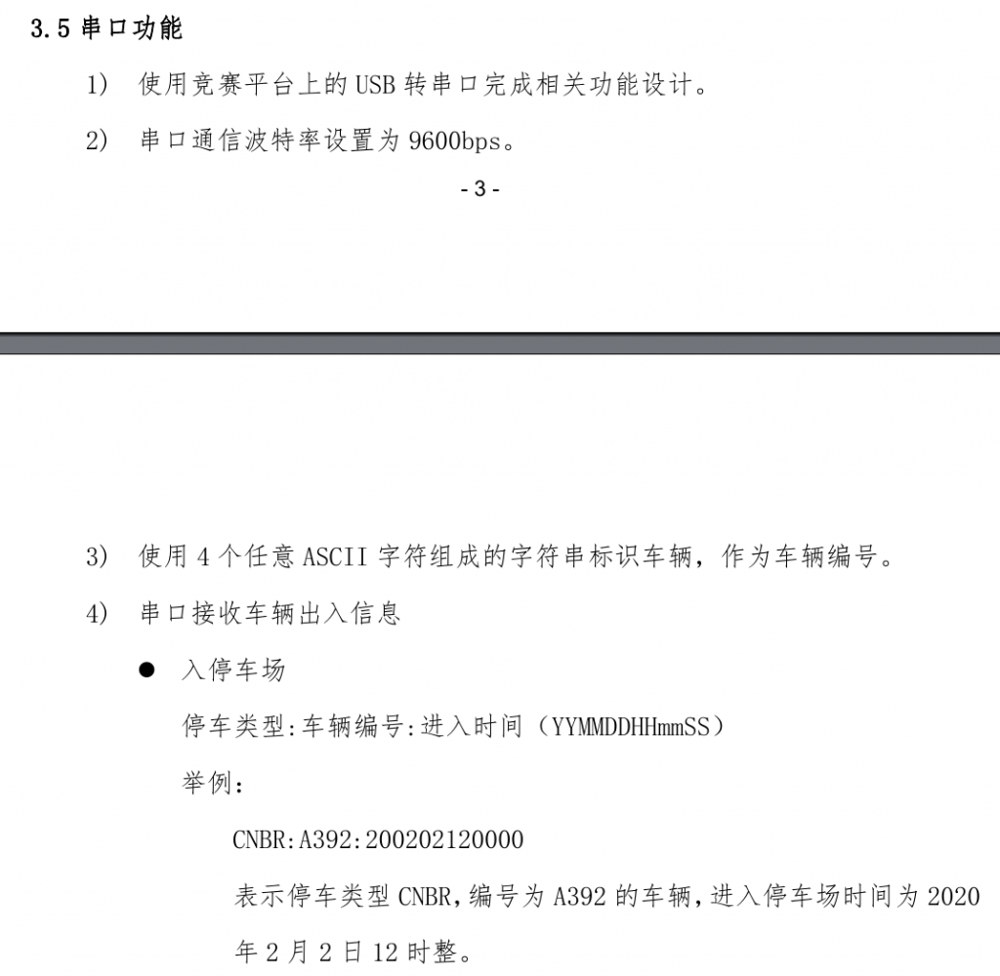
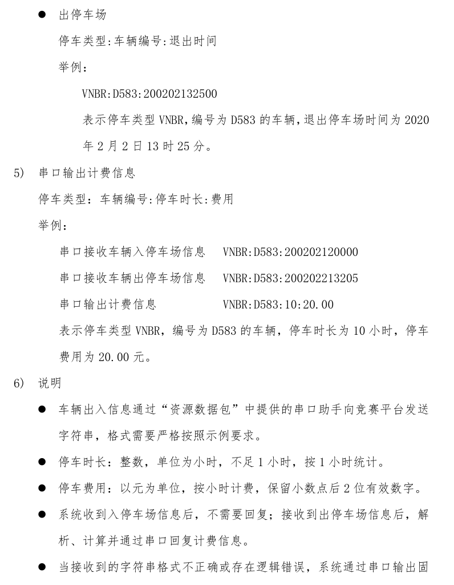
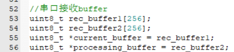
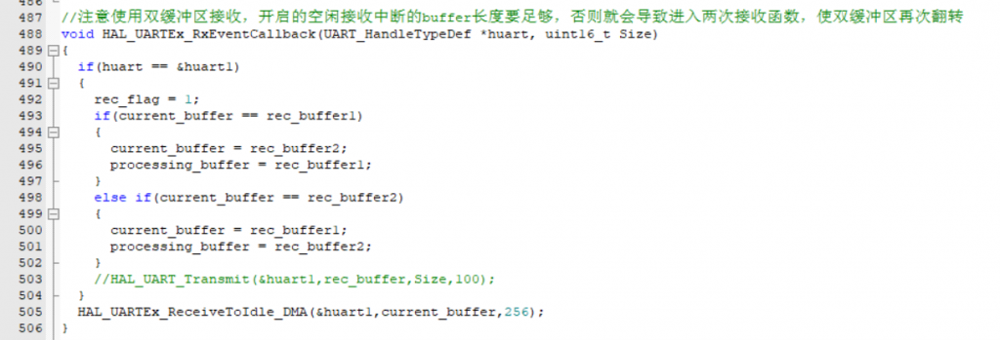
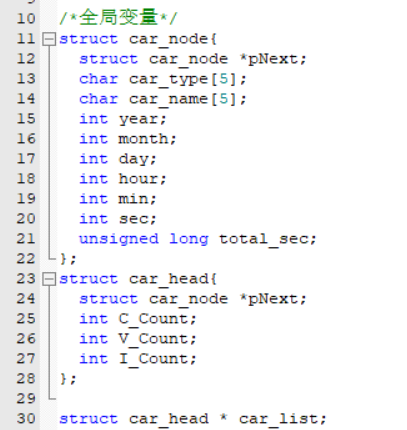
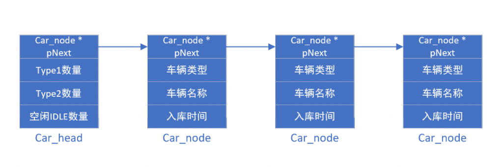

与已经做过了题目不同，这届省赛更加注重对于代码能力的考查，个人认为相较于调库而言更有实际意义以及更加考验代码能力。通过本次练习能提高数据结构的实际应用能力。

如果在赛场上第一次遇到这样的题目，对于数据处理能力的要求是很高的，但是在实践过之后，你会发现，just so so，所以让我们开始吧！

本赛题简单部分便不再提及，可以参考往届赛题的讲解，主要功能中的显示、LED、PWM输出都可以通过模块化的思想解决：

*   [\[蓝桥杯\]LCD模块 – www.hawkjgogogo.com](http://www.hawkjgogogo.com/2024/01/16/%e8%93%9d%e6%a1%a5%e6%9d%aflcd%e6%a8%a1%e5%9d%97/)
*   [\[蓝桥杯\]LED模块 – www.hawkjgogogo.com](http://www.hawkjgogogo.com/2024/01/16/%e8%93%9d%e6%a1%a5%e6%9d%afled%e6%a8%a1%e5%9d%97/)
*   [\[蓝桥杯\]按键模块 – www.hawkjgogogo.com](http://www.hawkjgogogo.com/2024/01/15/%e8%93%9d%e6%a1%a5%e6%9d%af%e6%8c%89%e9%94%ae%e6%a8%a1%e5%9d%97/)

本赛题中的PWM波设置只需要注意两步：

*   cubemx中enable影子寄存器，也就是auto-reload preload选项
*   在程序运行过程中通过setCompare调整pwm的占空比

此为13th的设置截图，修改设置2kHz即可

此赛题的重点是串口数据的接受以及数据处理。请看要求：

### 第一步 接收数据

在配置uart的时候，串口接受有三种方式，轮询、中断、空闲中断，参考：[\[stm32宇宙\]\[HAL\]深入学习三种UART模式及其实现 - www.hawkjgogogo.com](http://www.hawkjgogogo.com/2023/11/21/stm32%e5%ae%87%e5%ae%99hal%e6%b7%b1%e5%85%a5%e5%ad%a6%e4%b9%a0%e4%b8%89%e7%a7%8duart%e6%a8%a1%e5%bc%8f%e5%8f%8a%e5%85%b6%e5%ae%9e%e7%8e%b0/)

我建议使用空闲中断，此方法最为简单易用。配置参考上文。

但是我发现在运行过程中，由于我们需要对rec\_buffer进行清空，而串口接收中断产生之后就会获得最新的数据，但是中断这个事情不是我们能够知晓的，就会导致：

**如果中断恰巧发生在清空数据前，那么就会导致我们刚刚存储的数据立刻被清空，出现error**，这个还并不是小概率事件，在我们的这个轮询的系统中很容易就出现这样的现象。

#### 双缓冲区

通过设置两个缓冲区以及两个缓冲区指针进行交替，一个用于接收数据，另一个用于处理数据，这样就可以一定程度上解决串口中断刚接收到数据就被清空的问题，因为我们接收到的数据存储在接收buffer中，而清空的buffer是数据处理buffer，而这两个buffer在串口接收完数据后角色互换：

**注意使用双缓冲区接收，开启的空闲接收中断的buffer长度要足够，否则就会导致进入多次接收函数，使双缓冲区再次翻转**

因为空闲中断的最后一个参数是最大一次性接收的数据长度，如果数据过长，则会多次进入该函数进行接收，会导致数据覆盖、双缓冲区重置等问题，所以需要根据我们已知接收数据的长度设置这个参数。

### 第二步 设计数据结构

对于需要处理的串口数据，根据题目，数据的内容的对象是汽车，包含的主要特征是“出入时间”。那么我们就可以使用结构体，构建出一个汽车的对象，并且使用单向链表将他们连接在一起。使用单向链表以及结构体去管理对象是常见的方法。

首先我们定义全局变量，头结构体用于存储该链表的一些信息，节点结构体用于存储车辆的对象特征。

接着我们使用链表将这些结构体连接到一起，当然这是应用层做的事，我们首先需要写一些数据结构的基础函数，参考代码图书馆中的链表部分：  
[单向链表 — Code Library From HawkJ v1.0 文档 (hawkj02.github.io)](https://hawkj02.github.io/CL4H/%E4%BB%A3%E7%A0%81%E6%A8%A1%E5%9D%97/%E6%95%B0%E6%8D%AE%E7%BB%93%E6%9E%84/%E9%93%BE%E8%A1%A8/%E5%8D%95%E5%90%91%E9%93%BE%E8%A1%A8.html)

最后就是在Data\_Proc()函数中对数据进行处理即可。
