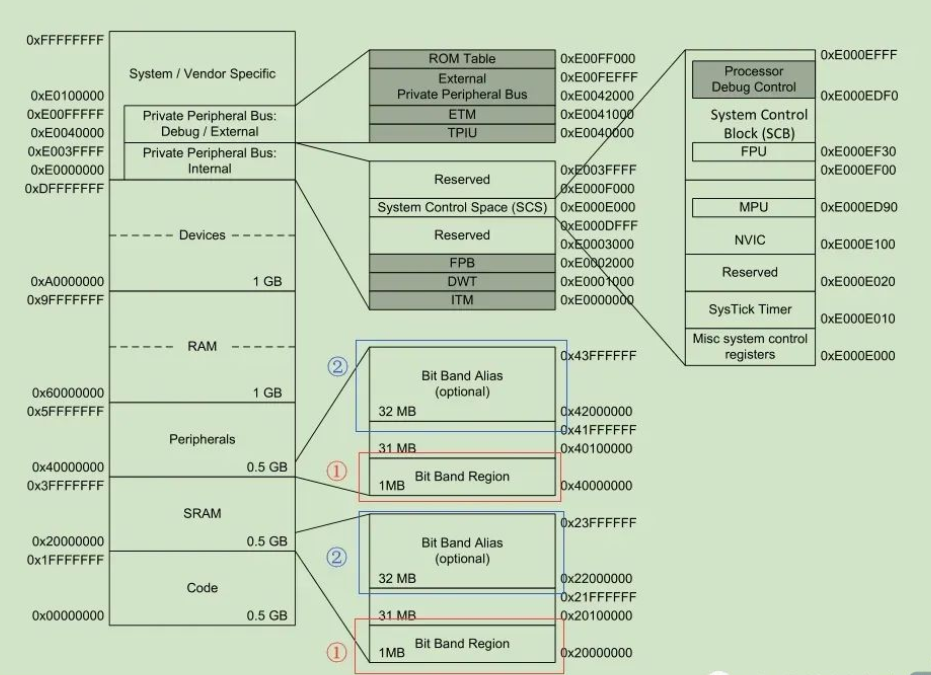
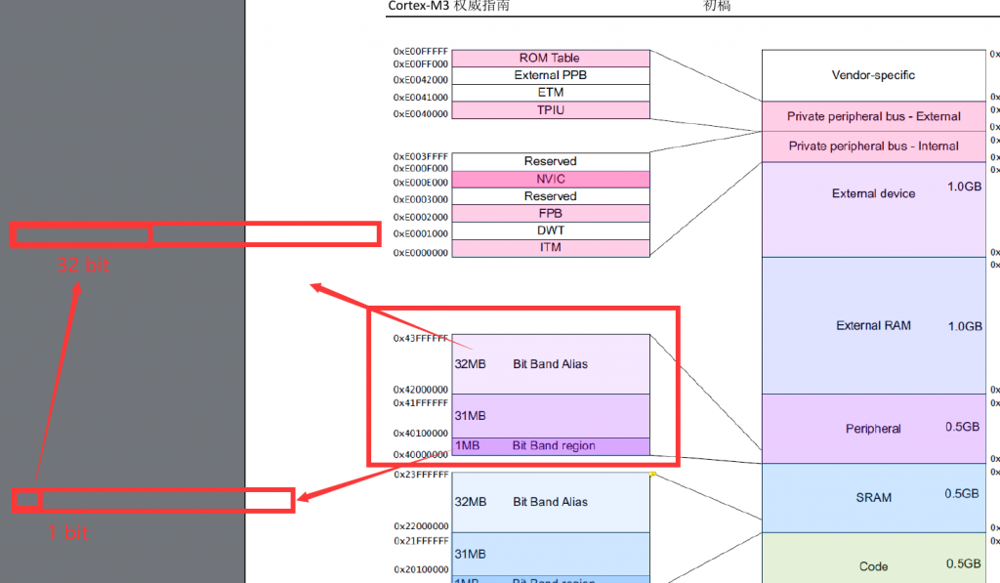
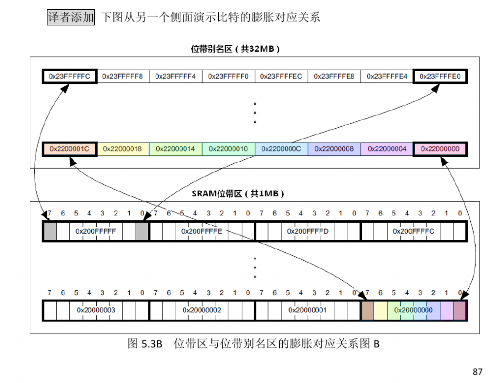
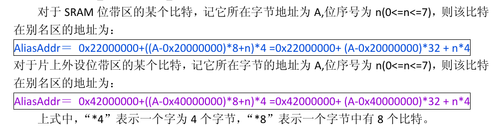
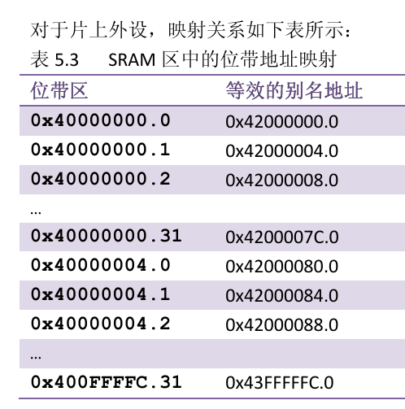
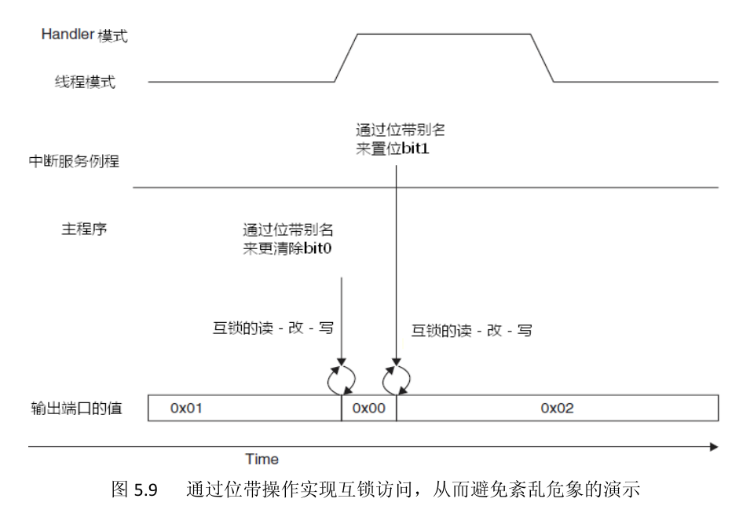
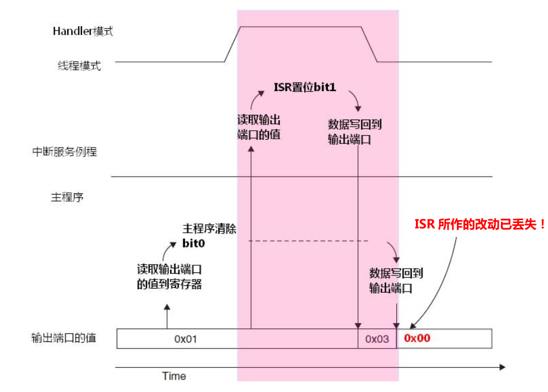

曾经做开发的时候用正点原子的工程真的要骂娘，因为sys.c文件和delay.c等等工程的存在导致移植开发的困难，所以之前我宁可找野火的工程修改IO端口配置都不愿意用正点原子的。  
但是随着我对stm32的研究深入，我发现正点原子工程的很多特性都是偏底层的，对于MCU的开发也是足够深入的，所以本篇文章持续更新，记录我发现的正点原子风格工程的特性。

### 位带操作

#### 什么是位带操作？

##### 位带操作

类似于51单片机点亮LED灯的程序，比如通过P1^1端口输出低电平点亮LED1，代码为：

`sbit LED P1^1  
LED = 1;`

以上就是位带操作，能够对一个bit进行操作。

##### 读-改-写 操作

而stm32中的内存都是以字节为最小单位存放的（我认为是因为一个地址对应一个字节，那么用户需要去通过地址寻找并修改一个字节数据的时候，必然是修改整个字节），1个字节是8个bit。比如修改GPIOA的输出寄存器，以输出一个高电平：

```
GPIOA->ODR |= 1<<2;
```

在运行这段程序的时候，MCU进行以下操作：  
//1.读取ODR寄存器的值到内存  
//2.改写第2bit的值  
//3.再把改写后的值写进ODR寄存器

作为抠门的程序员，你自然不希望牵一发动全身，cortex-M3等内核在芯片上设计了内存映射的功能，参考《Cortex-M3权威指南》（Joseph Yiu 著 宋岩 译）的第83-92页（文章链接由maipdf生成，可供下载：[https://maifile.cn/est/d65d99f5402a81/pdf](https://maifile.cn/est/d65d99f5402a81/pdf)）。

映射在stm32中是一个重要的概念，与内存管理相关。

（一些题外话）我认为：  
**如果设备存在MMU（内存管理单元），则有虚拟内存的概念；而设备没有MMU，则我们在程序中操作的设备地址都是实际的物理地址。**

stm32F1xx和F4xx是没有MMU的，所以无法运行Linux系统。

下图是内存空间分布：



而映射就相当于把一块地址的内容投影（物理上的意思，形成影子）到另一个地方，如下图所示，stm32的peripheral以及sram的内存空间中都存在着位带操作。

由于我们在stm32中能够操作的最小单元是字节，所以就使用4字节（32bit）来代替1bit，我们如果想要操作1bit，只需要操作对应地址的32bit，我们就能在芯片的帮助下操作这1bit。

上述的  
对应地址的32bit就是Bit Band Alias（位带别名区，位带的别的名字存放的地方）  
1bit就是Bit Band（位带区）





公式：



举个例子：

比如我们希望实现开始的操作 GPIOA->ODR |= 1<<2; 将GPIOA的PIN2置1。

已知GPIOA输出寄存器的基地址映射（位带别名区地址）为  
(GPIOA\_BASE+20) //0x40020014  
此处是代表GPIOA的GPIO\_PIN\_0的位带别名存储的起始地址，想要找到PIN2的位带别名的起始地址只需要在此基础上 + 2\*（4 Byte）

类似的，另一个例子：

1.  在地址 0x20000000 处写入 0x3355AACC
2.  读取地址 0x22000008。本次读访问将读取 0x20000000,并提取比特 2,值为 1。
3.  往地址 0x22000008 处写 0。本次操作将被映射成对地址 0x20000000 的“读-改-写”  
    操作(原子的),把比特 2 清 0。
4.  现在再读取 0x20000000,将返回 0x3355AAC8(bit\[2\]已清零)。  
    位带别名区的字只有 LSB 有意义。另外,在访问位带别名区时,不管使用哪一种长度的  
    数据传送指令(字/半字/字节),都把地址对齐到字的边界上,否则会产生不可预料的结果。



上图说明别名区的地址内容中只有最低位有效。

##### 什么时候使用位带操作？

不仅能够提高效率，也能在硬件层面上实现互锁mutex，也就是改变当前变量的过程不会被任何情况所打断。



下图中的现象，简单来说就类似于我之前遇到的，本来计划是触发中断接受串口数据，接着清除缓冲区数据。但是如果main中刚刚运行到清除数据的前面，就被中断打断进入到接收数据，退出中断后运行到清除数据，就会导致本次接收无效。所以在重要的接收过程中最好不要被打断，而位带操作是硬件级别的，不会被打断。


