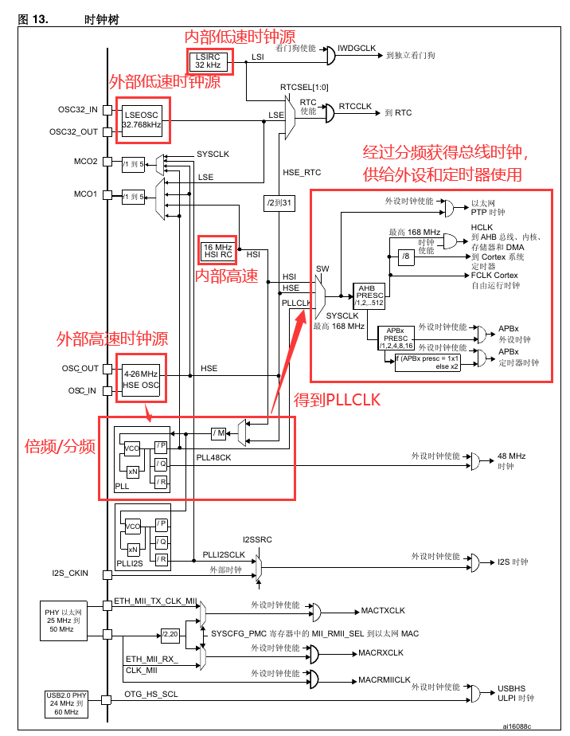
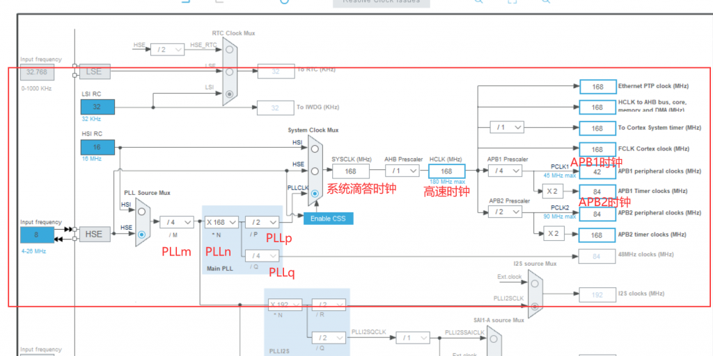
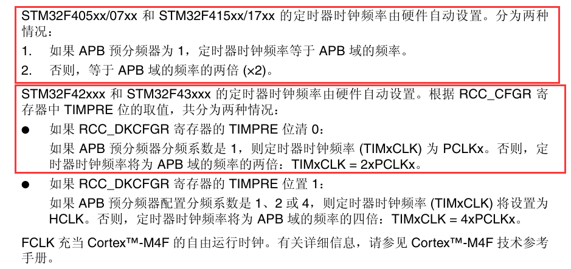
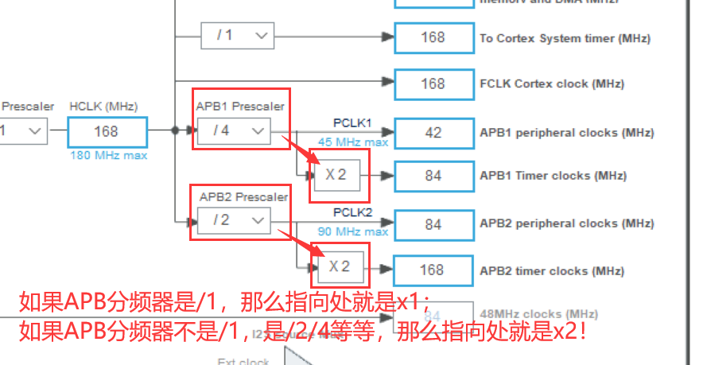
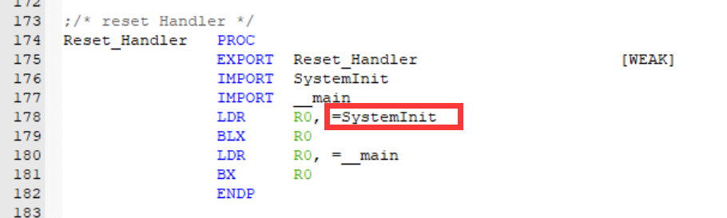
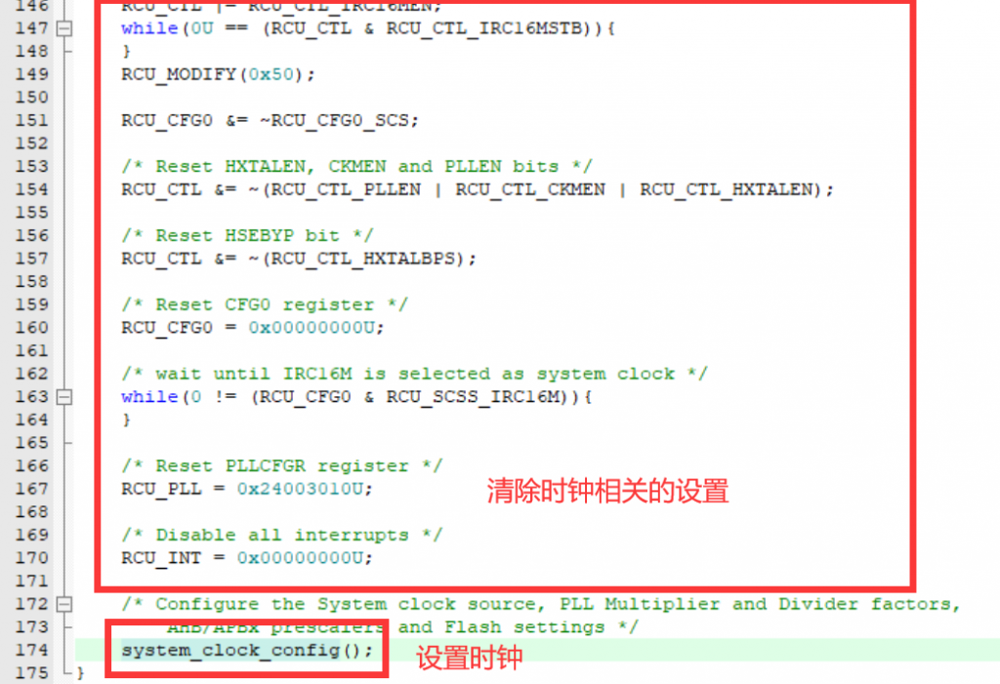
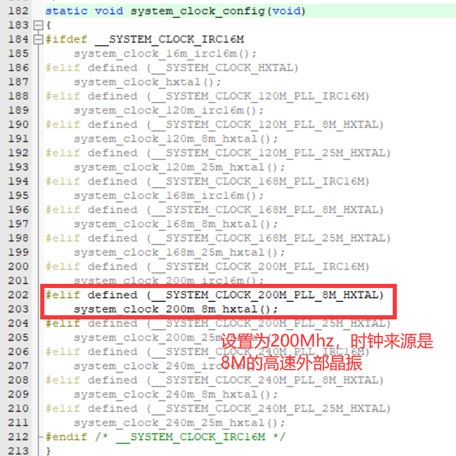
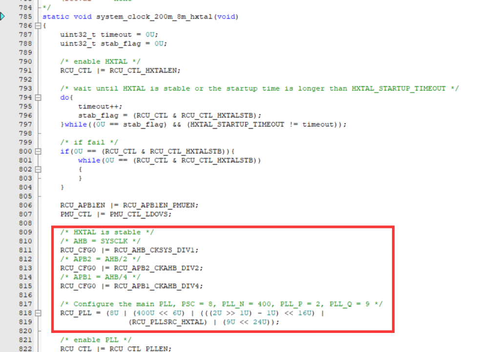
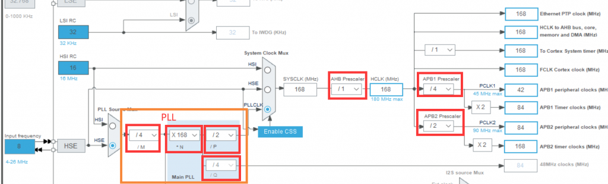

本文的实验硬件是GD32f427ZGT6，主频200Mhz

### 硬件资源

时钟就是单片机的脉搏，比如单片机如何知道1s是多长呢，就是16M的晶振震动了16M次，stm32类型的单片机一般有五个时钟源：  
①、HSI是高速内部时钟，RC振荡器，频率为8MHz。  
②、HSE是高速外部时钟，可接石英/陶瓷谐振器，或者接外部时钟源，频率范围为4MHz~16MHz。  
③、LSI是低速内部时钟，RC振荡器，频率为40kHz。  
④、LSE是低速外部时钟，接频率为32.768kHz的石英晶体。  
⑤、PLL为锁相环倍频输出，其时钟输入源可选择为HSI/2、HSE或者HSE/2。倍频可选择为2~16倍，

就是这些时钟源进行分频（除）或者倍频（乘）而获得特定的时钟值。

下图是stm32f4xx的时钟树

stm32f4xx时钟树

在stm32cubemx中查看更加明朗：

stm32cubemx时钟树

上图中我标注出来的是常用的配置，在开发中常用HSE（高速外部时钟源）作为时钟源，经过分频之后得到我们所想要的时钟值。

1.  **SYSCLK（系统时钟）**：是整个微控制器系统的主时钟。它是由微控制器内部的时钟源产生的，可以是内部振荡器、外部高速晶振（HSE）、外部低速晶振（LSE）等。SYSCLK的频率是整个系统的基础，通常被用作其他时钟信号的参考。
2.  **HCLK（AHB总线时钟）**：HCLK是由SYSCLK分频得到的，提供给高速总线（AHB）的时钟信号。它用于连接处理器核心（CPU）与内存等高速设备。在许多情况下，HCLK的频率等于SYSCLK的频率，但它可以通过设置适当的分频因子而不同。
3.  **PCLK1 和 PCLK2**：这两个时钟信号分别提供给低速总线（APB1）和高速总线（APB2）。它们都是由HCLK分频得到的。PCLK1用于连接低速外设，而PCLK2用于连接高速外设。通常情况下，PCLK1的频率不超过HCLK的一半，而PCLK2的频率等于HCLK。
4.  **FCLK（CPU内核时钟）**：FCLK是提供给CPU内核的时钟信号，是CPU的主频。CPU执行指令的速度取决于FCLK的频率。

##### 注意

手册中有这样的说法：

详细解释请见下图：

### 代码操作

在单片机startup，启动的时候，在设置完堆栈以及中断向量表，会从reset\_handler处开始运行程序，进入SystemInit函数初始化系统，其中主要就是进行时钟的初始化：

在该函数中会将始终相关的设置重置，最后进入时钟设置函数：

使用8M的高速外部晶振，相比较于16M的IRC（内部RC振荡电路），晶振更加靠谱些。不过IRC16M时钟启动更快，上电和睡眠唤醒时默认是IRC16M时钟，后续会根据配置设置HXTAL作为系统时钟源。而在这个设置函数中，就进一步解释了上图中的PLL各种参数的设置：

通过设置RCU\_CFG0以及RCU\_PLL这两个寄存器，可以设置下图中各个部分，也就是上面我们重点提到的关键——分频倍频：

#### 总结

这样我们的时钟树就配置好了，需要注意的就是APB分频的值会影响到timer的时钟，以及keil下文件的分析。
