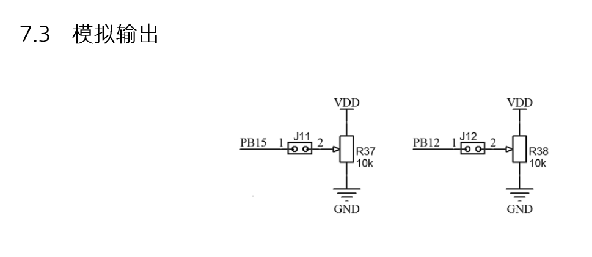
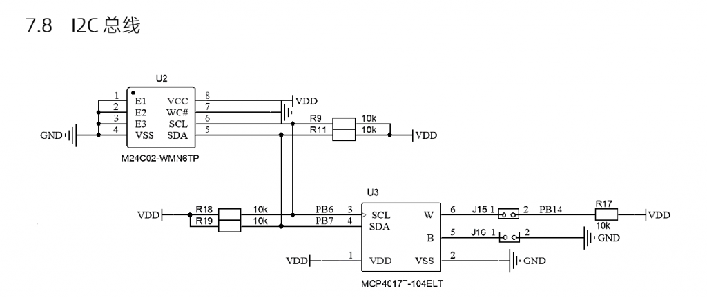
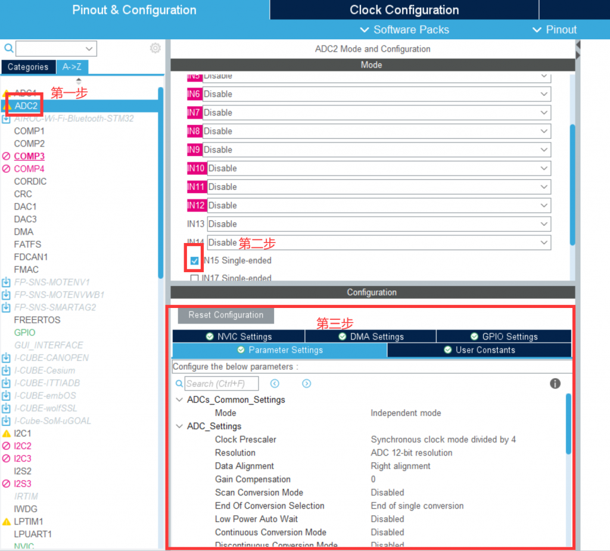
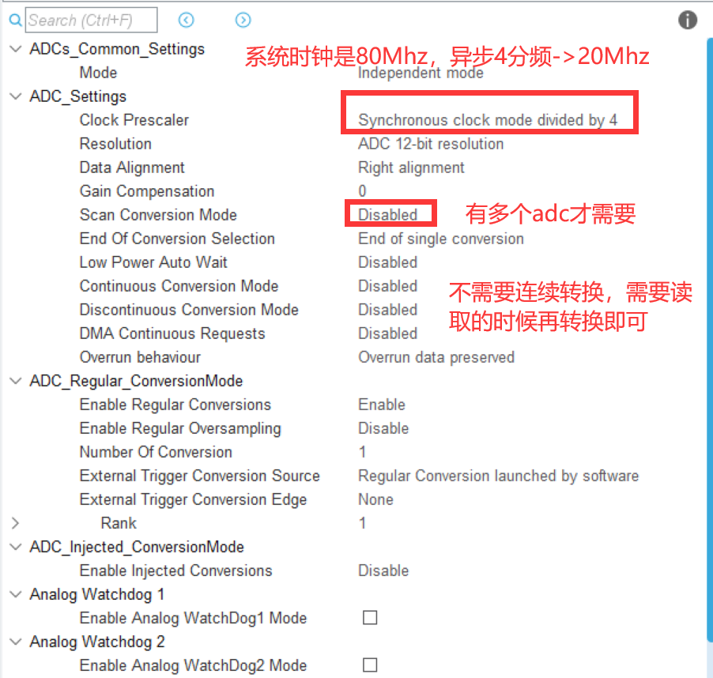
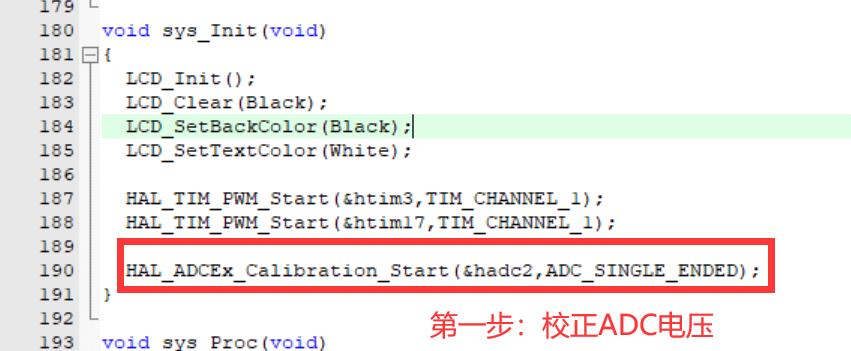
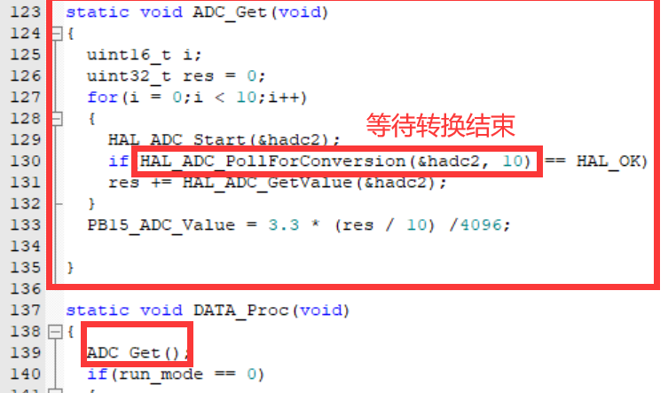

本模块取自G4开发板，f1开发板的配置类似。

G4开发板的ADC主要有以下3个应用，配置都类似。

由电路图可知,训练板上有三路模拟信号输入:

1.  管脚 PB15 接电位器 R37 分压后的电压信号。
2.  管脚 PB12 接电位器 R38 分压后的电压信号。
3.  管脚 PB14 接可编程电阻(数字电位器)MCP4017 的 W 端。

其中:  
PB12 为 ADC1 的输入通道 IN11,  
PB14 为 ADC1 的 IN5;  
PB15 为 ADC2 的 IN15。

### 赛题举例

比如11th省赛赛题中的：

使用 STM32 微控制器 ADC 通道(PB15)测量竞赛板电位器 R37 输出的模拟电  
压信号 VR37。

##### 第一步 使用stmcubemx配置

详细配置：

常用 ADC 函数

1.  初始化 ADC:MX\_ADC1\_Init 里调用 HAL\_ADC\_Init 函数完成各参数配置。
2.  完成 ADC 校准:G 系列芯片的 ADC 需要用户添加 ADC 校准代码。  
    库 函 数 原 型 : HAL\_StatusTypeDef HAL\_ADCEx\_Calibration\_Start(ADC\_HandleTypeDef \*hadc,  
    uint32\_t SingleDiff)  
    参数 1:ADC 句柄,如:&hadc1。  
    参数 2:ADC\_SINGLE\_ENDED(单端输入)或者 ADC\_DIFFERENTIAL\_ENDED(差分输入)  
    返回值:HAL\_OK 等状态。
3.  启动 ADC 转换:HAL\_StatusTypeDef HAL\_ADC\_Start(ADC\_HandleTypeDef \*hadc)
4.  等待 ADC 转换: HAL\_StatusTypeDef HAL\_ADC\_PollForConversion(ADC\_HandleTypeDef \*hadc,  
    uint32\_t Timeout)  
    参数 Timeout:超时(ms)
5.  获取 ADC 转换值:uint32\_t HAL\_ADC\_GetValue(ADC\_HandleTypeDef \*hadc)  
    返回值:ADC 转换值
