### SD卡

SD卡用于嵌入式设备已经是屡见不鲜了，对于SD卡进行读写操作有两种方式，一种是SPI，另一种就是SDIO。  
SD卡有三种容量选择：

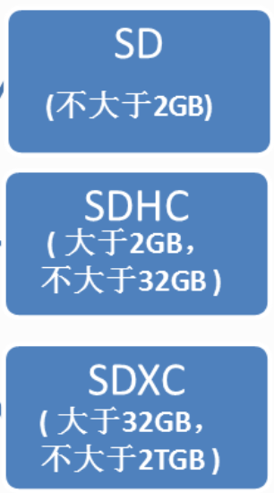

SD卡的物理结构可以参考野火给出的：

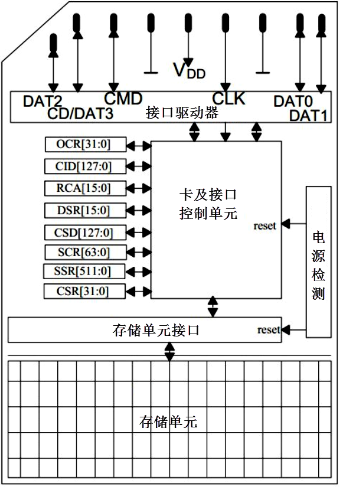

首先我们了解接口功能：

接口名称

接口功能

CLK

由stm32产生时钟，只以上升沿有效。启动时始时钟频率最高位400kHz，  
数据传输模式下默认最高为25Mhz，最高为50Mhz。

CMD

命令控制线，stm32通过该线发送命令控制SD卡，如果命令要求SD卡提供应答(响应)，SD卡也是通过该线传输应答信息；

DAT0

数据线，传输读写数据；SD卡可将D0拉低表示忙状态；

DAT1

数据线，传输读写数据

DAT2

数据线，传输读写数据

DAT3

数据线，传输读写数据

### 传输

##### 命令传输

**SD的命令只通过CMD线传输！**

SD总线通信的传输协议较为简单，类似于I2C总线的ACK，SD总线的流程如下：

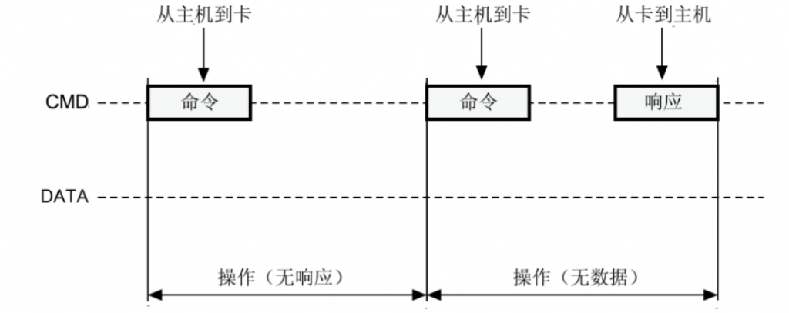

命令与响应

如上图所示，命令有四种类型：

*   无响应广播命令(bc)，发送到所有卡，不返回任务响应；
*   带响应广播命令(bcr)，发送到所有卡，同时接收来自所有卡响应；
*   寻址命令(ac)，发送到选定卡，DAT线无数据传输；
*   寻址数据传输命令(adtc)，发送到选定卡，DAT线有数据传输。

##### SD命令格式

SD的命令格式如下图所示：

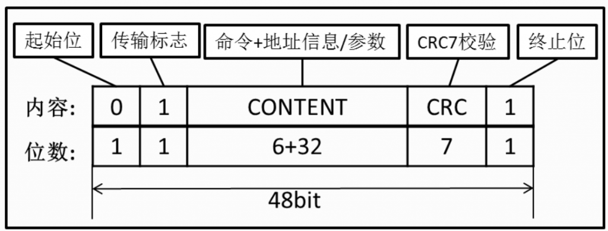

传输标志位类似于I2C，为1时代表命令，主机->SD，为0时代表响应，SD->主机。  
地址信息/传输用于作为命令的附加内容，例如广播命令，即对所有SD卡发送命令，不需要地址信息，就可以携带参数；例如寻址命令，发送到选定卡，就可以携带地址信息。

##### 命令分类

SD的命令分为ACMD和CMD，可以理解为CMD是通用命令，ACMD是SD卡制造商设置的的特定应用命令。在传输ACMD命令之前，需要主机先发出CMD55指令，随后的第一条命令就是ACMD命令。

命令查找表

##### 命令响应

SDIO接口能识别7种响应方式，而SD卡向主机发送的响应一共有5种响应方式，R代表Response：

##### 数据传输

SD卡的数据传输的时候是这样子的：  
1、stm32：“我要开始传输数据了！”  
2、sd卡：“好的！我准备接收数据！”  
3、stm32：“...发送数据中...”（以块的形式，也就是一次一般发送512字节，在最后会加上CRC校验码（就是用前面的数据经过循环计算得出的一个特殊值））  
4、stm32：“我的数据传输完了！”  
5、sd卡：“好的！我已经全部接收到了！”

##### 忙状态

在上述的第3步，传输完一块数据之后，SD卡会将DAT0数据线拉低，因为它需要消化以下刚接收到的数据，将其编程至存储区。stm32检测到DAT0为低就会稍等一会儿，等到SD存储结束再发送下一个块数据。

上述流程如下图所示：

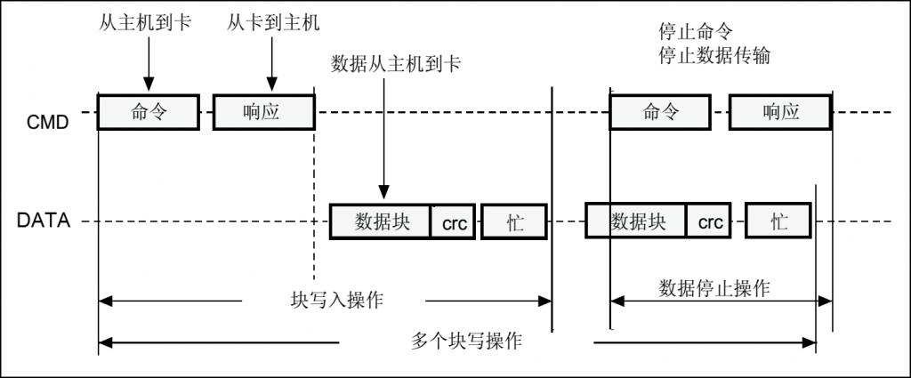

SD卡写入时序

SD卡的读时序与上图类似，只是不需要检测忙状态。

##### SD传输方式

SD是通过4根线传输数据的，数据包的形式如下图所示：

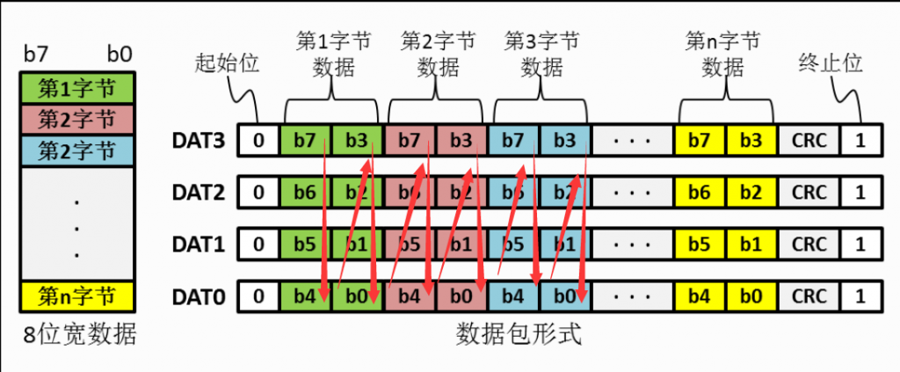

一个字节是8位，每一个字节拆成两次传输，一次传输4个bit，先传输高位4个bit，再传输低位4个bit。stm32读取四根线上的数据就通过上图箭头方向蛇形读取，最后拼接成一个字节，以至一个512字节的块。

另外一种数据包发送格式是宽位数据包格式，对SD卡而言宽位数据包发送方式是针对SD卡SSR(SD状态)寄存器内容发送的， SSR寄存器总共有512bit，在主机发出ACMD13命令后SD卡将SSR寄存器内容通过DAT线发送给主机。

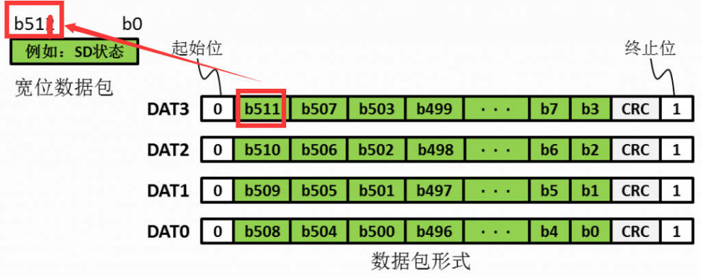

类似于四线同步发送，宽位数据包格式发送的是一个超长的bit集合。

### SD启动

##### 模式识别

主机和SD卡都存在卡识别模式和数据传输模式：

在系统复位后，主机处于卡识别模式， 寻找总线上可用的SDIO设备；同时，SD卡也处于卡识别模式，直到被主机识别到，即当SD卡接收到SEND\_RCA(CMD3)命令后， SD卡就会进入数据传输模式，而主机在总线上所有卡被识别后也进入数据传输模式。

程序的流程就是先这样，再那样，最后在怎么怎么，我是读懂了但是因为感冒实在没力气就暂时搁置了，参考野火的文章：[37\. SDIO—SD卡读写测试 — \[野火\]STM32库开发实战指南——基于野火霸天虎开发板 文档 (embedfire.com)](https://doc.embedfire.com/mcu/stm32/f407batianhu/std/zh/latest/book/SDIO.html#id7)

stm32f4xx\_ll\_sdmmc.c中SDIO初始化，比较有意思的就是我们只需要给出这些参数值就可以设置SDIO的时序。

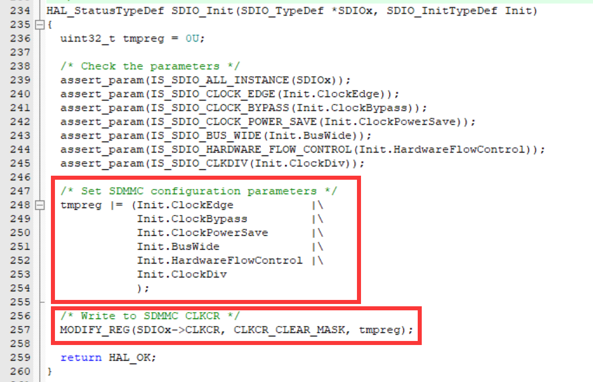

还有比较有意思的是数据的发送过程，与fsmc总线类似，只需要写特定sdio结构体中的cmd变量，就可以自动发送：

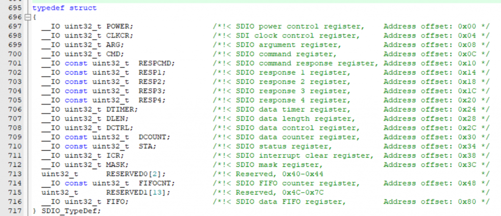

SDIO结构体

最底层还是写寄存器的操作：

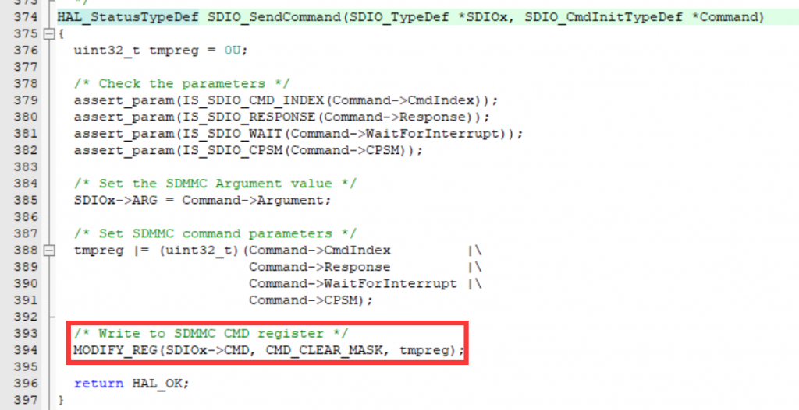

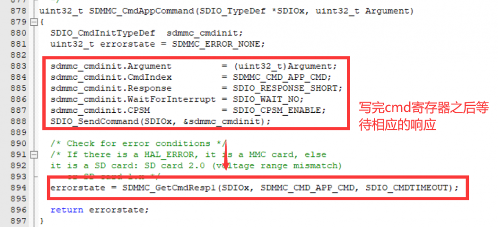

我感觉传输协议的最底层就是从发送字节开始（LL层），然后到各种命令，最后就是顶层封装函数（HAL层）
