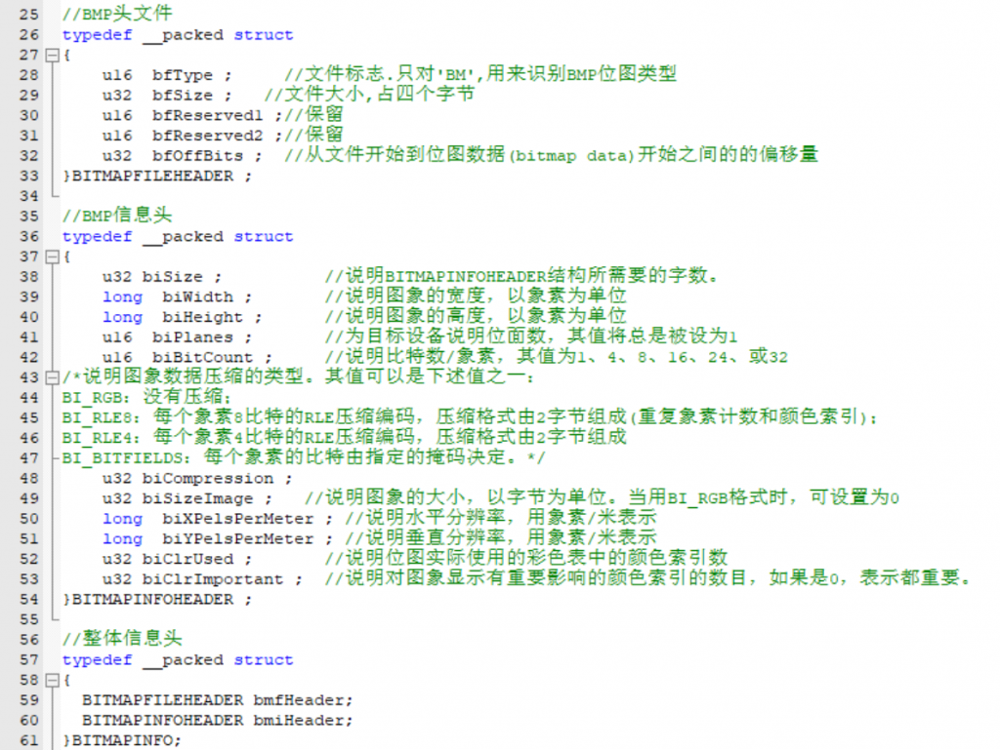
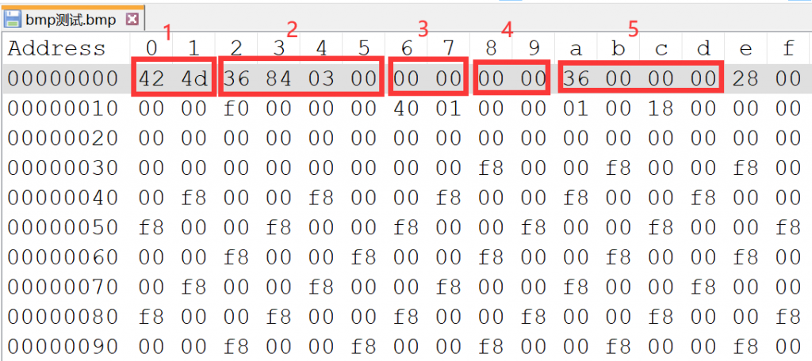
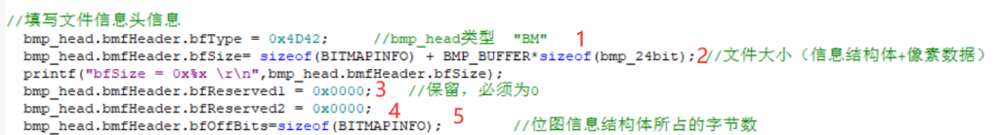
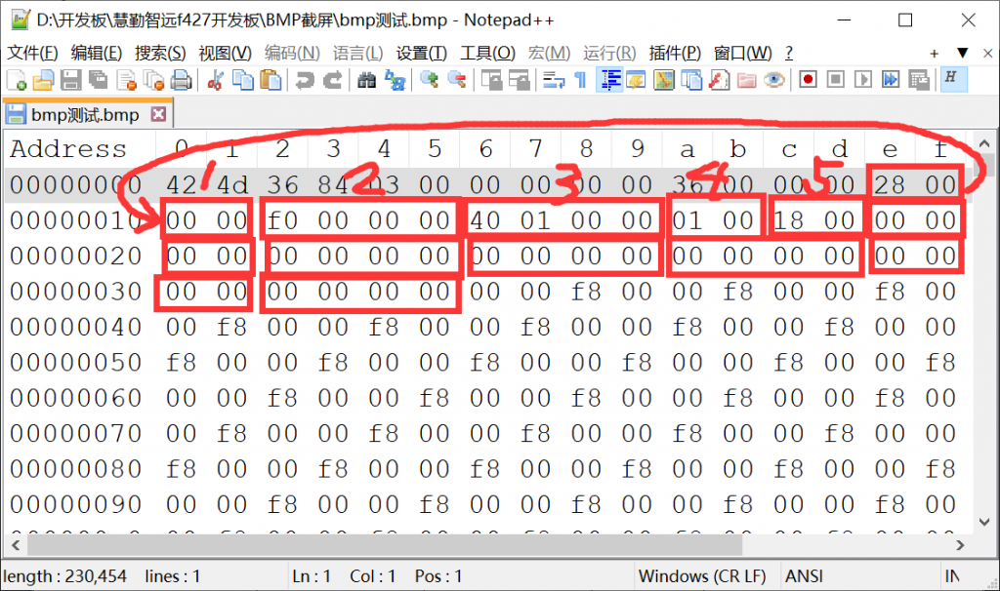
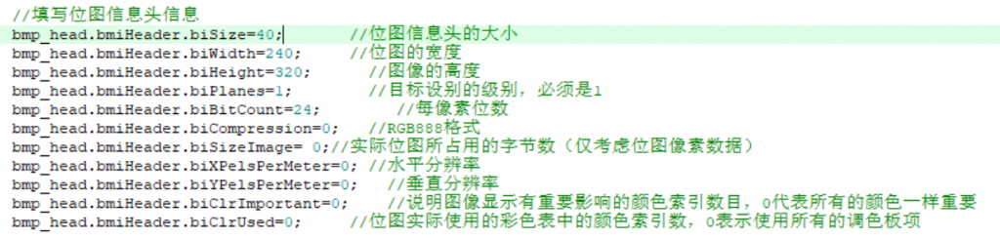
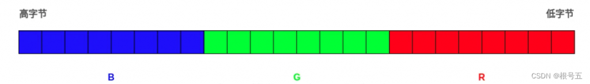
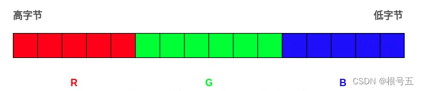
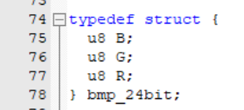
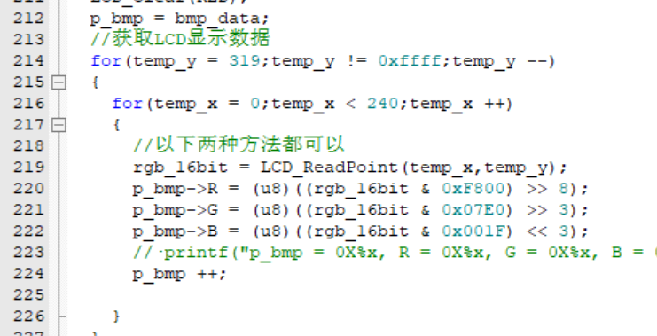
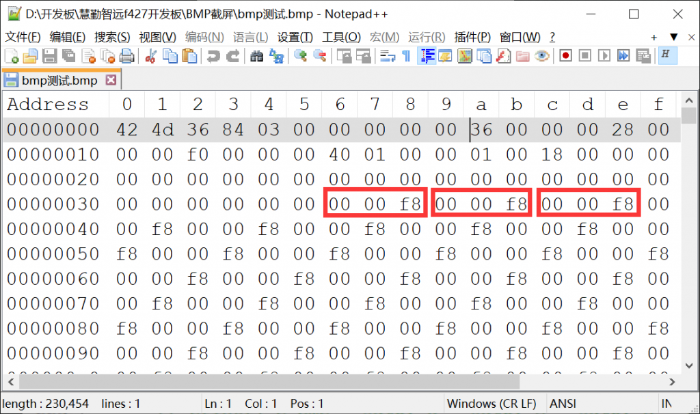

该实验的起因是我在开源示波器osc509上发现的波形截图功能，我觉得这个功能很有意思，所以我希望自己实现一遍，完整的实验需要你具有以下的知识：

*   SDIO驱动SD卡：[\[stm32\]一文搞懂SDIO驱动SD卡 - www.hawkjgogogo.com](http://www.hawkjgogogo.com/2024/03/02/stm32%e4%b8%80%e6%96%87%e6%90%9e%e6%87%82sdio%e9%a9%b1%e5%8a%a8sd%e5%8d%a1/)
*   FatFs移植至stm32：装修中...

代码可以在装备库中复制：[bmp\_888 — Code Library From HawkJ v1.0 文档 (hawkj02.github.io)](https://hawkj02.github.io/CL4H/%E4%BB%A3%E7%A0%81%E6%A8%A1%E5%9D%97/stm32/%E6%88%AA%E5%B1%8F/bmp_888.html)

#### BMP位图格式

BMP格式是一种可以在windows系统中显示的类原始图像，它的文件结构很好理解：  
文件信息头 + 像素数据 。

##### 文件头

每一种文件格式在其最开始几乎都有描述该文件内容的一些信息，就像是论文的最开始都有一个Introduction一样。BMP位图格式的信息头包含以下内容：  
BMP的文件头 = BMP头文件 + BMP信息头

看起来很复杂吧！没关系，我们接下来会讲到每一个参数的功能。

##### BMP头文件

注意以下图像数据在存储的时候会自动使用小段顺序存储，也就是较低的字节在前：  
比如我们存储字符串"BM"即十六进制0X4D42，在存储的时候就会存储为42 4D。  
众所周知两个16进制（2 \* 4bit）等于1字节，大端转换为小端是以字节为最小单位，详细可以自行百度搜索，不再赘述。

根据上述图片的标号，我们可以翻译出如何赋值：

类似地可以参考野火的图：

##### BMP位图信息头

我认为比较重要的就是上图标注处的5个值，可以参考野火的图：

参数设置：

在设置完之后，就代表该文件存储的是RGB888格式的BMP24位图，在后面我们就可以通过LCD的读点函数获得每一个点的像素值。

### 采集LCD数据

常用的LCD一般使用的是16位的RGB565数据，但是如果要存储RGB565数据的话还需要在信息头后面跟一个调色板结构体，所以不如将RGB565转化为RGB888格式的数据进行存储，他俩的区别如下图所示，参考文章：[TFT显示屏开发：24位真彩色（RGB888）转换 16位真彩色（RGB565）\_tft 24位-CSDN博客](https://blog.csdn.net/MQ0522/article/details/135204759?spm=1001.2101.3001.6650.3&utm_medium=distribute.pc_relevant.none-task-blog-2%7Edefault%7EYuanLiJiHua%7EPosition-3-135204759-blog-10516871.235%5Ev43%5Epc_blog_bottom_relevance_base8&depth_1-utm_source=distribute.pc_relevant.none-task-blog-2%7Edefault%7EYuanLiJiHua%7EPosition-3-135204759-blog-10516871.235%5Ev43%5Epc_blog_bottom_relevance_base8&utm_relevant_index=6)  

RGB888

RGB565

可以看出，在对这两个数据进行一些处理就可以实现转换：

此处要注意，RGB888事实上不是RGB，而是BGR，当然在转换的时候不要考虑，只需要在RGB888的结构体定义的时候将R与B置换位置，使其在内存中存储的位置调换即可。

可以看出我们对LCD\_CLEAR(RED)全屏红色进行截屏获得的数据，  
RGB565 : 1111\_1000\_0000\_0000  
RGB888 : 0000\_0000\_0000\_0000\_1111\_1000  
其中RED对应的值就是1111\_1000，非常完美，符合预期。

