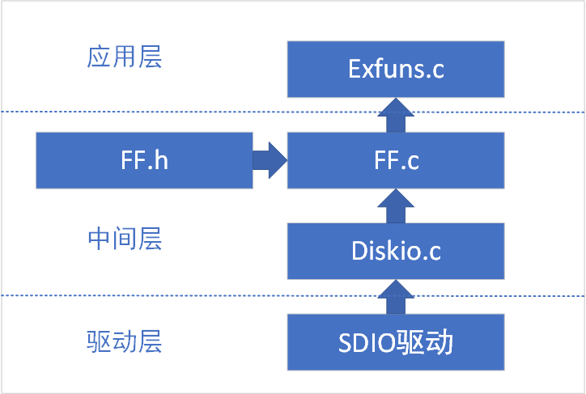
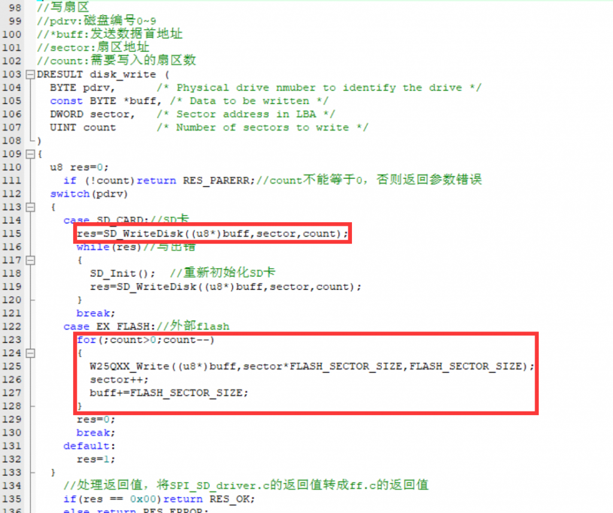
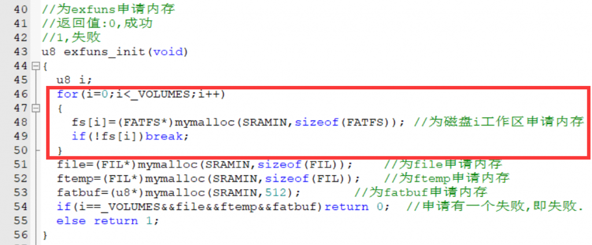
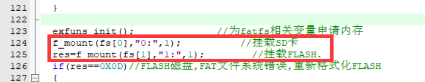
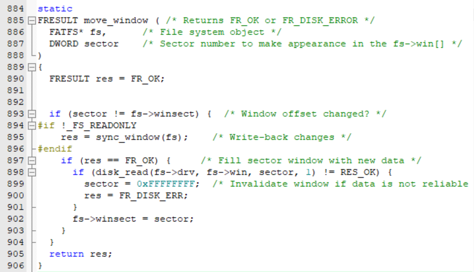
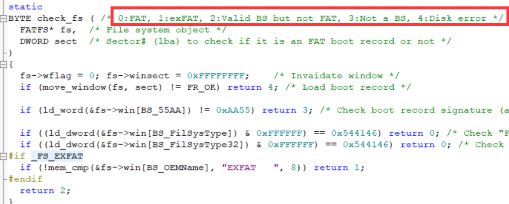

### 整体框架

存在有文件系统的程序框架图如下：



### 驱动层

我们只需要提供写disk和读disk两个函数就可以实现底层与中间层的对接，我们主要修改diskio.c这个文件，完善其中的五个函数：  
disk\_initialize：初始化磁盘，函数中用switch选择初始化函数（这里填写文件系统物理设备的初始化函数）  
disk\_status：返回相应物理设备的状态，这里也是调用物理设备驱动的检测函数（比如检测SD卡的ID）  
disk\_read：从“扇区起始地址”处读取“扇区数量“个扇区，至接收缓冲区。  
disk\_write：从“扇区起始地址”处读写“扇区数量“个扇区，至发送缓冲区。  
disk\_ioctl：通过switch特定的指令，执行任务。

### 中间层

移植的操作不再赘述，本文主要是想从底层分析ff.c以及exfuns.c文件的具体流程。

ff.c文件中存储的是文件系统的精华，我们按照常用的函数顺序分析。

##### 参数

我们需要一些全局变量来保存一些数据。  
一部分是FatFs的volumes，可以理解为物理设备，每一个物理设备的给一个卷号，就像是windows中的C盘D盘一样，还有像是w25qxx的flash芯片，它的驱动接口函数中并不是像SD卡一样有固定的分区（一个分区512字节），而是输入起始地址和要写/读的字节数量。但是对于统一的fatfs中间层函数，我们就需要将这个起始地址以及字节数量转化为分区大小以及分区数。

```
#define SD_CARD	 	0  			//SD卡,卷标为0
#define EX_FLASH 	1			//外部spi flash,卷标为1

#define FLASH_SECTOR_SIZE 	512			  
//对于W25Q128
//前12M字节给fatfs用,12M字节后,用于存放字库,字库占用3.09M
u16	    FLASH_SECTOR_COUNT=2048*12;	//W25Q128,前12M字节给FATFS占用
#define FLASH_BLOCK_SIZE   	8     	//每个BLOCK有8个扇区
```

对照diskio.c中的disk\_write函数就可以明显看出写SD与写Flash的区别：



##### Fatfs相关全局变量

我一般使用的是：

`//文件系统相关变量  
FIL fnew;  
FRESULT res_file;  
UINT fnum;`

其中fnew用来存储当前正在使用的文件的对象，  
res\_file用于接收函数的返回值，并在下文中进行判断，  
fnum用于传入读写函数，保存实际操作的字节数量。

在exfuns.c函数中也有一些定义，如果不使用这个文件也可以自动分配内存，但是为了内存管理的精确，我们最好使用其中的u8 exfuns\_init(void)这个函数，给以下变量分配内存：

`FATFS *fs[_VOLUMES];//逻辑磁盘工作区  
FIL *file; //文件1  
FIL *ftemp; //文件2.  
UINT br,bw; //读写变量  
FILINFO fileinfo; //文件信息  
DIR dir; //目录  
u8 *fatbuf; //SD卡数据缓存区`

详解：我觉得逻辑磁盘工作区是用于保存当前磁盘的状态，通过当前状态与我们需要它的状态来进行设置，比如说挂载、打开文件等操作，可以通过修改其结构体进行操作。

##### 关键的结构体

##### FATFS

`typedef struct {  
BYTE fs_type; /* 文件系统类型 (0:不适用) */  
BYTE drv; /* 物理驱动器编号 */  
BYTE n_fats; /* FAT 表的数量 (1 或 2) */  
BYTE wflag; /* win[] 标志 (b0:脏) */  
BYTE fsi_flag; /* FSINFO 标志 (b7:禁用, b0:脏) */  
WORD id; /* 文件系统挂载标识符 */  
WORD n_rootdir; /* 根目录条目数量 (FAT12/16) */  
WORD csize; /* 簇大小 [扇区] */  
#if _MAX_SS != _MIN_SS  
WORD ssize; /* 扇区大小 (512, 1024, 2048 或 4096) */  
#endif  
#if _FS_EXFAT  
BYTE* dirbuf; /* 目录项块临时缓冲区 */  
#endif  
#if _FS_REENTRANT  
_SYNC_t sobj; /* 同步对象标识符 */  
#endif  
#if !_FS_READONLY  
DWORD last_clst; /* 上一个分配的簇 */  
DWORD free_clst; /* 空闲簇的数量 */  
#endif  
#if _FS_RPATH != 0  
DWORD cdir; /* 当前目录的起始簇 (0:根目录) */  
#if _FS_EXFAT  
DWORD cdc_scl; /* 包含目录的起始簇 (当 cdir 为 0 时无效) */  
DWORD cdc_size; /* b31-b8:包含目录的大小, b7-b0: 链状态 */  
DWORD cdc_ofs; /* 包含目录中的偏移量 (当 cdir 为 0 时无效) */  
#endif  
#endif  
DWORD n_fatent; /* FAT 表项数量 (簇数量 + 2) */  
DWORD fsize; /* FAT 表的大小 [扇区] */  
DWORD volbase; /* 卷基准扇区 */  
DWORD fatbase; /* FAT 表的基准扇区 */  
DWORD dirbase; /* 根目录的基准扇区/簇 */  
DWORD database; /* 数据库基准扇区 */  
DWORD winsect; /* 出现在 win[] 中的当前扇区 */  
BYTE win[_MAX_SS]; /* 用于目录、FAT（和小型配置中的文件数据）的磁盘访问窗口 */  
} FATFS;`

**注释：**

1.  **扇区（Sector）：** SD 卡的存储被划分为多个扇区，每个扇区通常是512字节。这是存储器的最小读/写单位。
2.  **簇（Cluster）：** 为了提高文件系统的效率，多个扇区组成一个簇。例如，一个簇可能包含4个扇区，因此一个簇的大小为 2 KB（4扇区 \* 512字节/扇区）。
3.  **文件系统管理：** 当你在 SD 卡上创建文件时，文件系统会以整数个簇为单位分配空间。如果一个文件只占用不到一个簇的空间，仍会分配整个簇，这可能导致一些空间浪费。
4.  **FAT 表：** 文件分配表（FAT）记录了每个簇的使用情况。它指示哪些簇被文件占用，哪些是空闲的。通过查看 FAT，文件系统可以找到文件的簇，并由此找到文件的实际数据存储位置。

##### FIL

```
/* 文件对象结构体（FIL） */
typedef struct {
    _FDID    obj;            /* 对象标识符 */
    BYTE    flag;            /* 文件状态标志 */
    BYTE    err;             /* 中断标志（错误代码） */
    FSIZE_t    fptr;         /* 文件读/写指针（在文件打开时清零） */
    DWORD    clust;          /* fptr 所在的当前簇（当 fptr 为 0 时无效） */
    DWORD    sect;           /* 出现在 buf[] 中的扇区号（0:无效） */
#if !_FS_READONLY
    DWORD    dir_sect;       /* 包含目录项的扇区号 */
    BYTE*    dir_ptr;        /* 在 win[] 中指向目录项的指针 */
#endif
#if _USE_FASTSEEK
    DWORD*    cltbl;         /* 指向簇链映射表的指针（在文件打开时清零） */
#endif
#if !_FS_TINY
    BYTE    buf[_MAX_SS];    /* 用于文件私有数据读/写的窗口 */
#endif
} FIL;
```

##### \_FDID

```
/* 对象标识符和分配信息结构体（_FDID） */

typedef struct {
    FATFS*    fs;         /* 拥有该对象的文件系统对象的指针 */
    WORD    id;           /* 文件系统挂载 ID */
    BYTE    attr;         /* 对象属性 */
    BYTE    stat;         /* 对象链状态（b1-0: =0:非连续，=2: 连续（FAT 上无数据），=3: 分散，b2:子目录拉伸） */
    DWORD    sclust;      /* 对象起始簇（0: 无簇或根目录） */
    FSIZE_t    objsize;    /* 对象大小（当 sclust != 0 时有效） */
#if _FS_EXFAT
    DWORD    n_cont;      /* 连续部分的大小，簇数 - 1（当 stat == 3 时有效） */
    DWORD    c_scl;       /* 包含目录的起始簇（当 sclust != 0 时有效） */
    DWORD    c_size;      /* b31-b8: 包含目录的大小, b7-b0: 链状态（当 c_scl != 0 时有效） */
    DWORD    c_ofs;       /* 包含目录中的偏移量（当 sclust != 0 时有效） */
#endif
#if _FS_LOCK != 0
    UINT    lockid;       /* 文件锁定 ID，从1开始（Files[] 中文件信号量表的索引） */
#endif
} _FDID;
```

##### DIR

```
/* 目录对象结构体（DIR） */

typedef struct {
    _FDID    obj;        /* 对象标识符 */
    DWORD    dptr;       /* 当前读/写偏移量 */
    DWORD    clust;      /* 当前簇 */
    DWORD    sect;       /* 当前扇区 */
    BYTE*    dir;        /* 指向 win[] 中目录项的指针 */
    BYTE*    fn;         /* 指向 SFN（短文件名）的指针（输入/输出）{body[8],ext[3],status[1]} */
#if _USE_LFN != 0
    DWORD    blk_ofs;    /* 当前处理的条目块的偏移量（0xFFFFFFFF: 无效） */
    WCHAR*   lfn;        /* 指向 LFN（长文件名）工作缓冲区的指针 */
#endif
#if _USE_FIND
    const TCHAR* pat;    /* 指向与名称匹配的模式的指针 */
#endif
} DIR; 
```

##### 小结

1.  **FATFS 结构体：** 表示整个文件系统的信息，包括文件系统类型、驱动器编号、簇大小、扇区大小等。
2.  **\_FDID 结构体：** 包含对象标识符和分配信息，用于表示文件系统中的对象，如文件或目录。这个结构体类似于下面两个结构体的parent，用于继承。
3.  **FIL 结构体：** 用于表示文件对象的信息，包括文件状态、错误标志、读/写指针、当前簇、扇区号等。
4.  **DIR 结构体：** 表示目录对象的信息，用于在文件系统中进行目录的操作，如读取目录项等。

现在，让我们来看一下它们之间的关系：

*   **FATFS 结构体与 FIL 结构体的关系：**
    *   `FATFS` 结构体中可能包含有关文件系统的信息，而 `FIL` 结构体是用于表示单个文件对象的信息。在文件系统操作中，`FIL` 结构体的创建和使用会涉及到 `FATFS` 结构体，以便了解文件所属的文件系统的属性。
*   **\_FDID 结构体与 FIL 结构体的关系：**
    *   `FIL` 结构体中包含了 `_FDID` 结构体，用于表示文件对象的标识符和分配信息。这提供了关于文件对象的额外信息。
*   **DIR 结构体与 \_FDID 结构体的关系：**
    *   `DIR` 结构体用于表示目录对象的信息，而 `_FDID` 结构体则包含了一些目录对象的信息，如包含目录的起始簇、目录的属性等。这意味着在目录操作中，`DIR` 结构体可能需要使用 `_FDID` 结构体来获取有关目录对象的信息。

### 常用函数分析

根据使用函数的流程，我们首先对两个FATFS类型的变量进行初始化，它们对应着我们使用的物理设备：SD卡与Flash。

##### exfuns\_init()

该函数来自于exfuns.c，用于给全局变量分配内存空间，mymalloc函数来自于malloc.c，参考链接：还没写...



##### f\_mount()

下面的函数基本来自于ff.c，中间件中的函数：



函数注释：

```
FRESULT f_mount (
    FATFS* fs,            /* 文件系统对象的指针（NULL: 卸载） */
    const TCHAR* path,    /* 待挂载/卸载的逻辑驱动器号 */
    BYTE opt              /* 模式选项：0 - 不挂载（延迟挂载），1 - 立即挂载 */
)
{
    FATFS *cfs;
    int vol;
    FRESULT res;
    const TCHAR *rp = path;

    vol = get_ldnumber(&rp);          /* 获取逻辑驱动器号 */
    if (vol < 0) return FR_INVALID_DRIVE;

    cfs = FatFs[vol];                 /* 获取当前逻辑驱动器对应的文件系统对象 */

    if (cfs) {
#if _FS_LOCK != 0
        clear_lock(cfs);              /* 清除当前文件系统对象的锁定状态 */
#endif
#if _FS_REENTRANT
        if (!ff_del_syncobj(cfs->sobj)) return FR_INT_ERR;  /* 丢弃当前卷的同步对象 */
#endif
        cfs->fs_type = 0;              /* 清除旧的文件系统对象 */
    }

    if (fs) {
        fs->fs_type = 0;                /* 清除新的文件系统对象 */
#if _FS_REENTRANT
        if (!ff_cre_syncobj((BYTE)vol, &fs->sobj)) return FR_INT_ERR;  /* 为新卷创建同步对象 */
#endif
    }

    FatFs[vol] = fs;                    /* 注册新的文件系统对象 */

    if (!fs || opt != 1) return FR_OK;  /* 如果不立即挂载，或者指定了延迟挂载，则返回成功 */

    res = find_volume(&path, &fs, 0);  /* 强制挂载卷 */
    LEAVE_FF(fs, res);
} 
```

函数分析：  
我们输入的第二个参数是逻辑驱动器号，例子：`f_mount(fs[0],"0:",1);`  
首先我们通过对第二个参数的字符串解析获得冒号前面的数字，比如上例中获得的就是0。  
接着我们获取到FatFs\[0\]，即SD卡的FatFs类型结构体，`cfs` 在这里主要是用于备份原先的文件系统对象，确保在进行文件系统挂载之前，旧的文件系统对象的状态得到清除（或备份）。这是为了确保在挂载新文件系统之前，相关的资源得到适当的管理和清理。

**注意`FatFs[vol] = fs;`这句代码是将指针fs（也就是新建文件系统的首地址）存储进了静态的指针数组中，现在修改fs就相当于修改`FatFs[vol]`指向的值。**

接着就是真正的挂载函数

##### find\_volume(&path, &fs, 0)

根据我的代码分析，这个函数首先会获取FatFs\[vol\]这个静态地址来指向结构体中的数据，并检测是否已挂载：`if (fs->fs_type)` ，如果已挂载就判断是否需要读取等等操作，直接返回。  
如果没有挂载，即 `fs->fs_type == 0`，首先初始化相应的物理存储设备，接着使用`fmt = check_fs(fs, bsect);`检测地址0的扇区中的数据，此时采用 fs->win\[512\]这个数组来保存从SD卡中读出的512字节数据（这些数据应该是Boot，与主机中存储的fatfs\[vol\]存储的是相同的数据，但是主机中的会随着关机而丢失，外部存储介质中的不会）。



从SD卡的扇区0处读取数据

接着通过读取win\[512\]这个数组中相应下标处存储的数据，来判断存储介质类型



如果当前的扇区0并不是FAT文件系统的引导扇区，会返回2，接着就会查找其他可能性，代码通过遍历主引导记录（MBR）的分区表项，将每个分区的起始扇区号记录在数组 `br` 中。接着继续将这些分区的起始扇区号的扇区保存至win\[512\]中，继续check，看能否找到FAT存在痕迹。接着不断进行检验win\[512\]中的文件系统是否valid，最后挂载完毕，  
**也就是将sd卡中特定主引导配置，复制到我们单片机中的fatfs\[vol\]结构体中，同步，即实现挂载。**

（MBR最后两个字节“55，AA”是分区的结束标志）

下面的内容，以后有时间再补充，说到底就是内存管理，外部存储介质中的管理者（MBR），与我们程序中的FatFs\[Vol\]在一定程度上是同步的，其还掌管着簇链，类似于目录的结构，我们只要访问程序中的FatFs\[Vol\]就能获得到我们想要找到的特定文件或者文件夹进行修改，同时修改sd卡中的目录结构（主机给SD卡同步提供数据）。当下一次上电的时候，SD卡给主机同步提供数据，这样子就可以实现双方的目录同步，查找特定的文件只需要知道它在SD卡的存储区中处于什么位置，撒花！

##### f\_mkdir()

##### f\_MKFS()

##### F\_OPEN()
