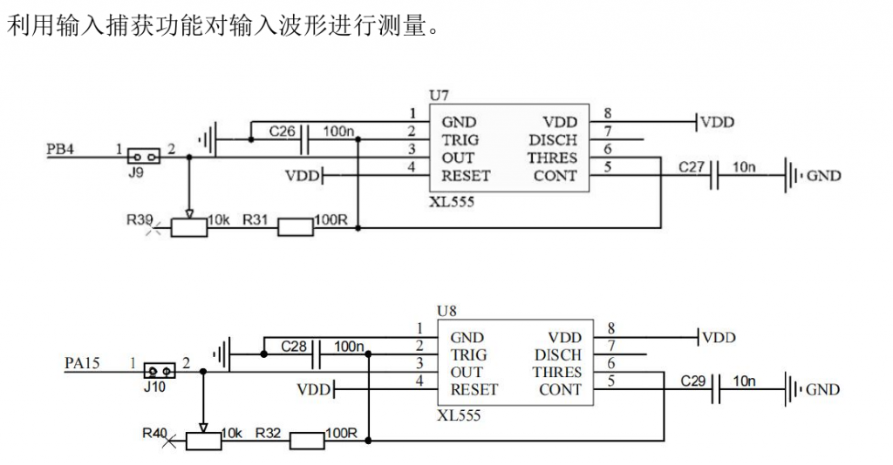
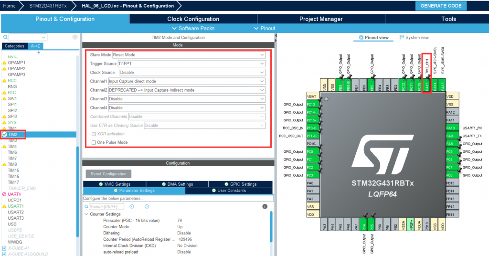
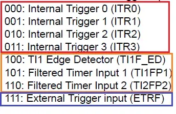
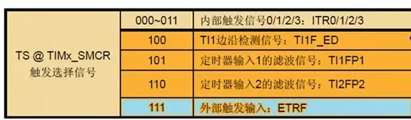
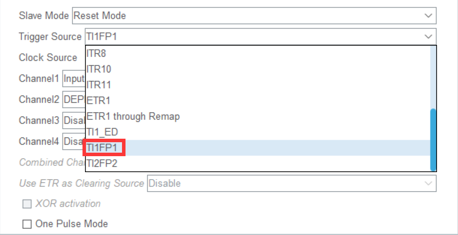
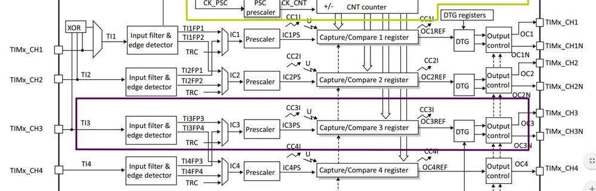
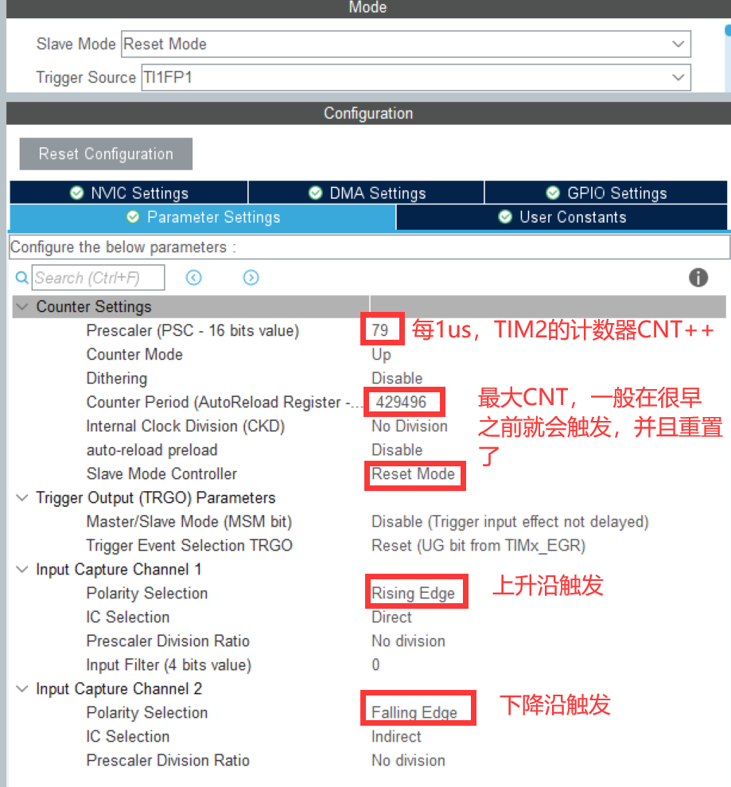
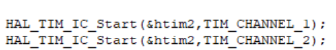
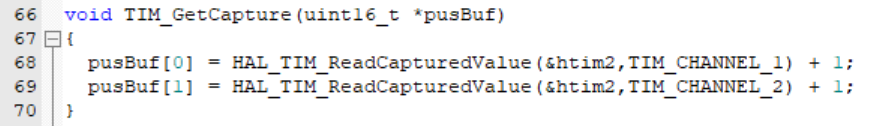
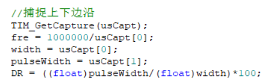

近几年的赛题都没有考察到输入捕获，所以今年省赛是有一定的概率考察到的。在本章节中，我将使用两种方式进行输入捕获。

名词介绍，输入捕获：INPUT\_CAPTURE。

### 方法1 直接与间接IC捕获

训练板上有两个信号发生器 XL555,分别是 U7 和 U8。通过跳线 J9 将 PB4 连接到 U7 上,通过跳线 J10 将 PA15 脚连接到 U8 上。R39 和 R40 是电位器,旋转电位器可以改变 U7、U8的输出波形。U7 连接的 PB4 可配置成 TIM3 的 CH1 的功能,但是前面 TIM3 的 CH1 已经配置在 PA6管脚做 PWM 输出功能了,而 PA15 可配置为 TIM2 的 CH1 未被占用。故以 U8 为例,使用定时器的输入捕获功能测量 U8(XL888)的周期、脉冲宽度(占空比)。若是要对输出的 PWM 波进行测量,此时需将 PWM 的输出端(PA6/PA7)连接到捕获信号输入端(PA15)。

**我们使用PA15测量频率输出2。**

首先我们配置TIM2，PA15连接着TIM2\_CH1。

##### 模式选择

不妨以计数器向上计数为例，将它配置在复位从模式。比方说当计数器计数到某个数据的时候，来了个触发信号，计数器不再继续往上计数，而是重新归0后开始计数。当然，计数器的实际复位操作与触发沿之间往往会有个小的延时，这是由于触发信号作为有效触发脉冲的话，还需要经过定时器内的同步电路确认。

##### trigger source

每一个定时就像沙漏一样，我们设定多长时间的定时就相当于放入了多少沙子。触发类似于中断的作用，在沙漏计时的中途我们提前将其翻转，重新开始计时，那么触发源可能是事情提前结束了，或者其它一些原因。

TI1FP1的意思是 Trigger input 1 Filter process 1，1代表着channel 1，代表整个TIM2这个定时器的触发输入源就是经过了滤波器的通道1，那么接下来无论是CH1还是CH2的输入都是经过滤波器的通道1信号，也就是来自于PA15。

##### 通道设置

在以上请的触发模式设置下，CH2是连接到CH1的，所以设置CH2为间接输入捕获模式。

##### TIM2参数配置

开始时CNT = 0，定时器每1us会使CNT++。PWM经过滤波后从CH1输入进来，检测到上升沿后，会将此时CNT的值放入CCR1，并且将CNT的值置0。那么显而易见，两个上升沿之间就是一个周期，也就是CCR1 - 0 = CCR1，所以每次获取CCR1的值就可以获取到PWM波的周期。

由于输入信号的源是来自于CH1，CH2对于这个信号只能做检测，而不能像上述CH1检测到上升沿之后将CNT的值置0，CH2是不能操作的，所以CH2在检测到下降沿之后就只会将CNT的值的保存至CCR2。显而易见，下降沿与上升沿之间的距离就是高电平脉冲的时间，也就是有效电平时间（脉冲宽度）= CCR2。

那么占空比就是 CCR2 / CCR1 ，即有效电平宽度 / 周期 。

##### 代码实验

在初始化的时候启动：

在运行过程中，获取CCR1和CCR2的值：

数据处理：

