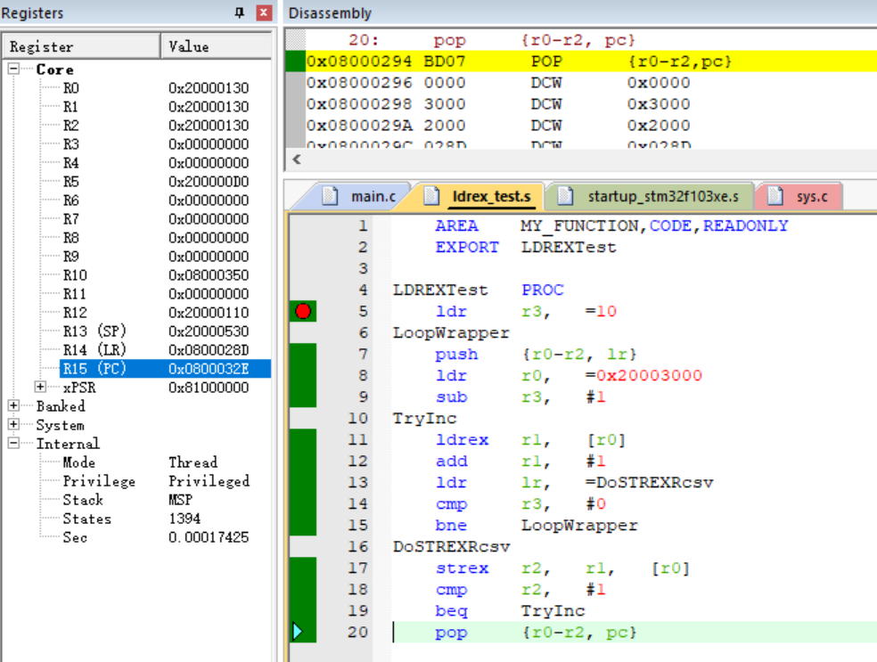

这是一段很有意思的汇编代码，源于Cortex-M3权威指南的94页。  
我们知道在RTOS中有着Mutex信号量，用于互斥访问，因为当两个线程共用一个数据或者外设的时候，很容易就造成问题。

#### 缘由

比如之前写过的使用双缓冲区调用串口的代码：[双缓冲区 — Code Library From HawkJ v1.0 文档 (hawkj02.github.io)](https://hawkj02.github.io/CL4H/%E4%BB%A3%E7%A0%81%E6%A8%A1%E5%9D%97/stm32/%E4%B8%B2%E5%8F%A3/%E5%8F%8C%E7%BC%93%E5%86%B2%E5%8C%BA.html)也是利用了这种互斥的思想，中断随时可能发生，如果中断函数是为了使a = 1，而刚好运行到主函数中的a = 0上面，那么刚出中断a就残忍地被置0，中断说：“那么我走？”，中断没有起到任何作用。

这个放在程序中就是“读-改-写”（READ-MODIFY-WRITE），RMW的操作转化为汇编语言就是：  
LDR - ADD - STR  
为了避免在读改写的过程中出现中断（或者线程切换），从ARMv7内核向后的版本都有了LDREX/STREX这两条指令实现互斥读取以及互斥存储。

#### 汇编代码

这段代码不是很长，但是充分体现了这两条指令的特性：

##### 特性 STREX只能消除最后一条LDREX，LDREX重复加载无效

在第一次运行这个程序的时候，程序会在LoopWrapper - TryInc中循环，将寄存器数据10次加载到堆栈中，并且将\[r0\]的值10次加载（LDREX）到r1中，并保护\[r0\]中的值（互斥访问）。

但是当r3被减为0后会进入到DoSTREXRcsv中，此时使用STREX存储r1的值到\[r0\]中，这是第一次STREX与LDREX消除掉，此时R2的值是0，代表解除互斥成功。

**★**但是由于**LDREX重复加载无效（上述10次LDREX只有最后一次有效，而已经被消除了）**，导致pop出寄存器（此次pop，r1 = 1，因为push进去的时候r1 = 1）之后再次进入DoSTREXRcsv，STREX找不到LDREX，所以此时R2被置1，则条件转移到TryInc（由于此时r1 = 1，将r1的值加载到\[r0\]失败，也证明了此时互斥锁成功保护了R0的值）。  
在TryInc中的第一条指令LDREX，一直到运行到STREX，成功消除互斥，此时成功将\[r0\]处的值->r1 -> \[r0\]，实现\[r0\]+1。此时由于R2被置0，所以返回到本段开头**★**处。

##### 延申

上述的特性是由于在使用LDREX后会在内部标记出一段地址，引用文章中的段落：

当执行了 LDREX 后,处理器会在内部标记出一段地址。原则上,这段地址从 R0 开始,范围由芯片制造商定义。技术手册推荐的范围是在 4 字节至 4KB 之间,但是很多粗线条的实现会标记整个 4GB 的地址。在标记以后,对于第一个执行到的 STR/STREX 指令,只要其存储的地址落在标记范围内,就会清除此标记(对于整个 4GB 地址都被标记的情况,则任何存储指令都会清除此标记)。**如果先后执行了两次 LDREX,则以后一个 LDREX 标记的地址为准。**执行 STREX 时,会先检查有没有做出过标记,如果有,还要检查存储地址是否落在标记范围内。只有通过了这两个关卡,STREX 才会执行。否则,就驳回 STREX。

完结，撒花！
