在阅读大佬源码的时候，经常会看到天花乱坠的define和attribute关键字，还有align之类的对齐方式，但是我认为大佬常用的必然是好的（相较于我这个小菜鸡的coding而言），这一章我们主要来详细分析类似于  
**\_\_attribute\_\_((used, section("")))**  
的巧妙运用。

### 初探

我觉得attribute关键字在程序中的运用类似于英语中的副词，我们常能看见：  
**I think highly of your opinion.**  
在这段话中highly表达了think这个动作的状态。  
而在程序中：  
int **\_\_attribute\_\_((used, section("my\_val."level)))** test0 (void)  
我们知道在阅读的时候副词都是可以用括弧去暂时忽略的，上述代码可以缩减成：  
int test0 (void)  
这就是我们常见的定义函数的形式了，所以，从本质上来说无论哪里添加了attribute关键字都是可以“暂时忽略的”，他只是给这行代码想表达的行为提供了一个“状态”，换个说法就是，cpu将会“通过什么样的方式”执行这行代码。

当然还需要注意的是，我们用的时候会将attribute关键字使用#define重定义，比如：  
#define **SECTION(level)** \_\_attribute\_\_((used, section("my\_val."level)))  
static int value2 **SECTION("1")**;  
int **SECTION("0")** test0 (void)  
在代码中无形中插入这个关键字。

### 官方解释

参考：[c语言attribute关键字参数（详细）总结附示例快速掌握-CSDN博客](https://blog.csdn.net/Luckiers/article/details/128737046)

在本章节中我们主要分析section参数在初始化过程中的使用。

### section参数特性

section的中文翻译过来就是“段”，把所有的东西放在一个段里面，也就意味着它们是连续的，排列规则是：**顺序先按 section 名  01234排一遍，section 内再按函数名称排**。

我们用keil做实验就可以显而易见地看出。

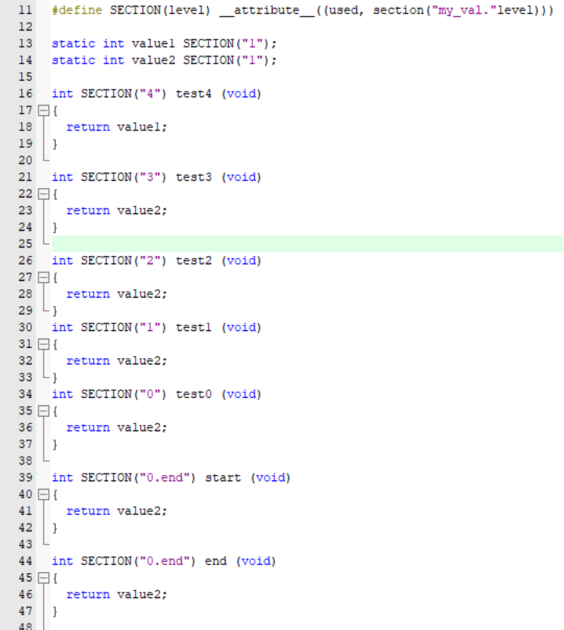

我们首先用define重新定义了attribute关键字，无论接下来定义变量还是函数，都可以用SECTION将其归类到特定的段中。  

在生成的.map文件中，我们可以看到即使我们在定义函数的时候调换了顺序，在生成链接文件的时候，还是按照规则  
“**顺序先按 section 名  01234排一遍，section 内再按函数名称排**”  
如果在其中再使用.的话也会继续重新进行排列，比如.val.0.end的优先级是高于.val.1的。

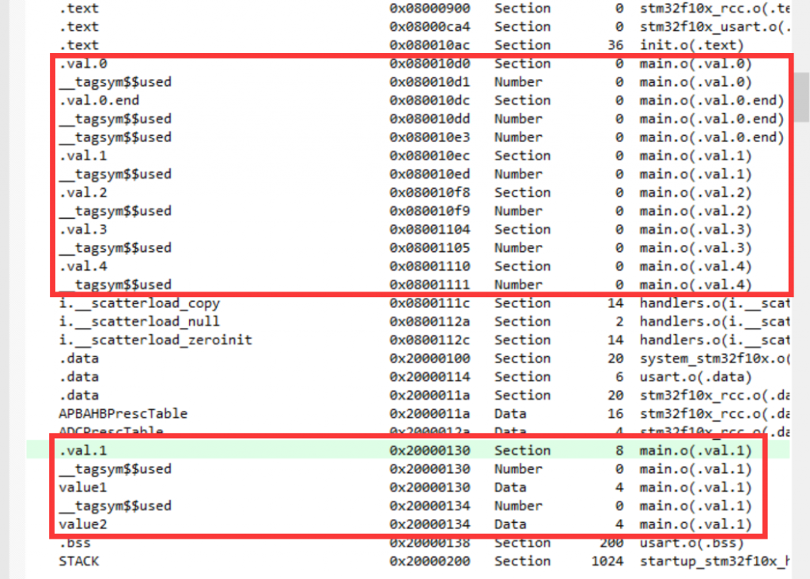

可以看出，如果我们想要在初始化进程中使用到这个方法，那么我们就需要让他们按照一定的顺序进行排列（注意：初始化有先后，比如串口的init必须在某些使用到串口的外设初始化之前）。

在section中我们的初始化顺序并不是按照我们想要的那么排列的，就是很直接，如果有val.0 .1 .2 等等，他们会按照顺序排列，或者按照project items栏中从上至下的顺序

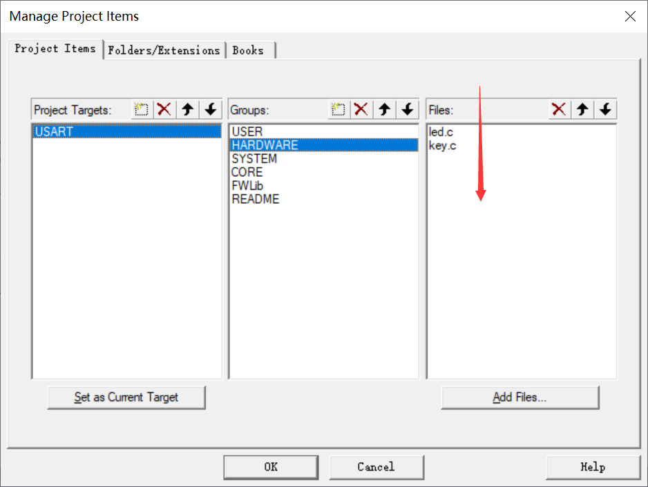

显然这是很麻烦且不合理的，所以我们给这些需要初始化的任务设定优先级，就像在RTOS中的那样。我们使用结构体放置这些内容——初始化函数、优先级、名称，就像我们对待RTThread中的那些object那样（怎么感觉我说话一股翻译味道？？？）。

### 正篇！使用section优化启动流程

首先我们重定义一个初始化的段，方便我们在后面的定义中调用，同时我们定义一个包含初始化函数的结构体节点：

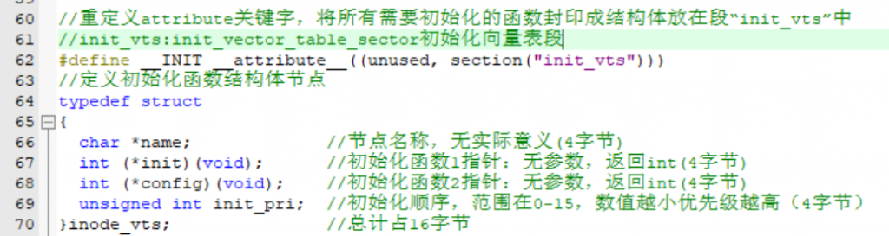

##### 初始化注册

我们的初始化函数通过define的语法进行注册，define类似于一种随处展开的函数，不再赘述。  
注意：  
1、\_\_下斜杠的个数。一般是两个，要对应起来。  
2、#define的backslash反斜杠\\后面不要跟space空格。

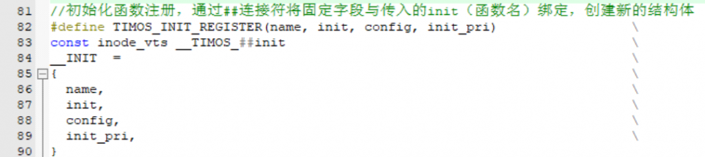

define是发生在预处理阶段，在编译之前，在那个时候所有的初始化注册结构体定义都将被展开（也可以理解为执行），在这个时候会把所有定义的结构体放到init\_vts这个段中，但是不会按照顺序排列的！！所以在初始化的时候我们需要通过结构体中init\_pri这个值来确定顺序。

##### 链接的位置

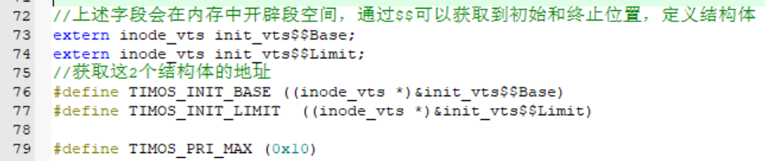

上图中的$$很多人肯定很陌生，网上的资料也不多，我们可以获取.sct文件  
（scatter loading分散加载）看看：

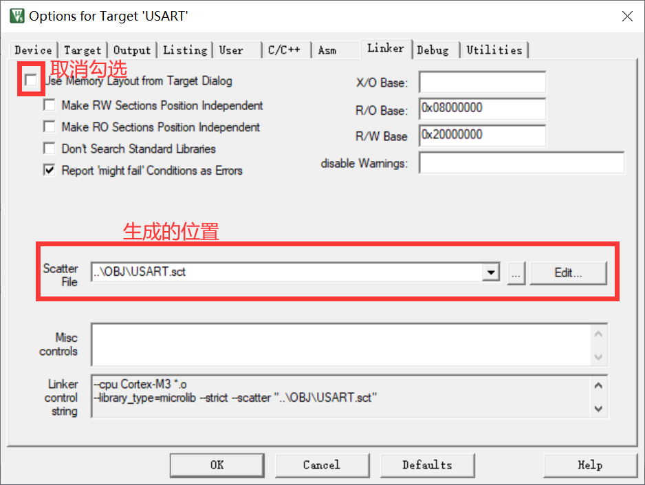

可以看到，其中是存在着sections的，`*(InRoot$$Sections)` 是Keil特定的语法，指代那些标记为特殊section的部分（如`init_vts`等)：

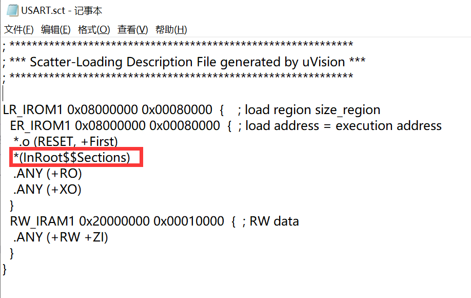

而下图中获取到的就是在链接过程中所绑定的section的起始结构体与结束结构体，再将它们进行取地址的操作就可以获得2个结构体指针，这2个指针就是段在内存中的起始地址与结束地址。

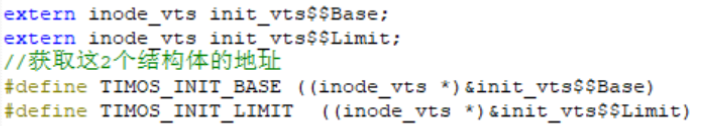

##### 注册！

获取了这些地址，我们就可以注册我们的初始化函数，在本章的代码中我是注册在一个文件里面的。在常规的使用情形下，我们基本是定义在所需要初始化的.c文件当中的，这样就避免了每当追加一个初始化功能都需要去main函数中重新添加init，提高了代码的耦合性（但，都是打工人，能实现代码就行，个人感觉仅仅是炫技的操作（虽然我也会用））。

我们调用define的注册”函数“进行注册。

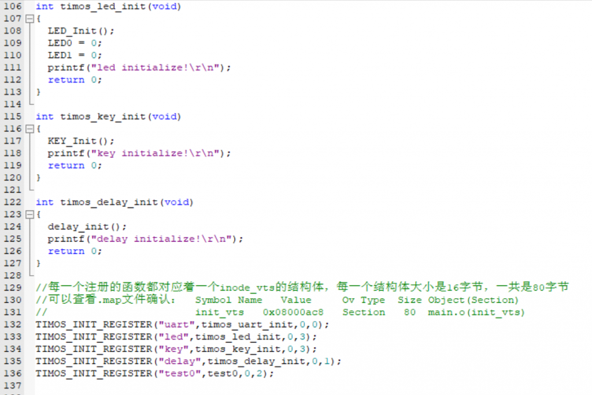

##### 初始化！！

看下图中的注释即可：

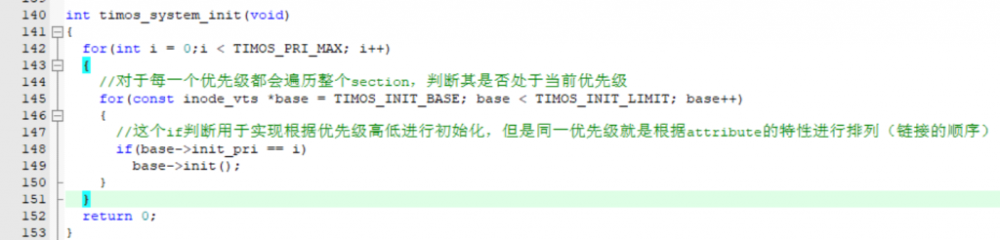

##### 实验结果：

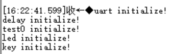

注意，如果没有在初始化循环之外再套一个根据优先级选择是否初始化的循环，那么初始化的顺序是按照链接的顺序进行的，如果打乱了这个顺序会导致初始化先后异常，进而导致，你还没初始化串口呢，程序就调用了printf，hardware\_fault！！

###
