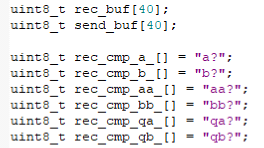
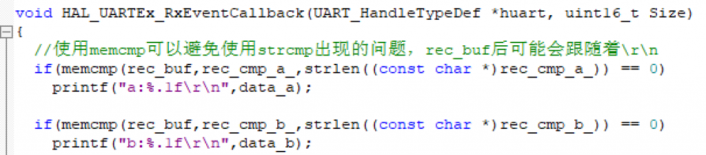
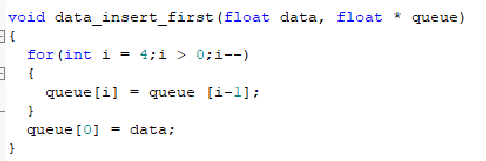
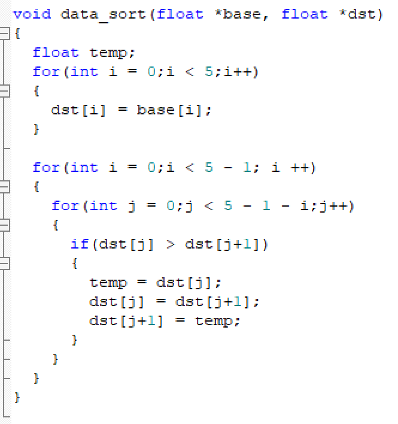

2024年5月17日收到主委会短信说不再使用扩展板，其实也没啥区别==。

十二届国赛的关键注意点在于以下部分。

### memcmp与strcmp

在蓝桥杯的比赛中尽量使用memcmp，因为串口助手发送的消息莫名会出现/r/n，如果使用strcmp进行比较的话，会判断为不相等，可以仿照下面的方式，与固定的字段进行对比，在比赛中差不多够了：

### 简单排序算法

插入以及冒泡排序

